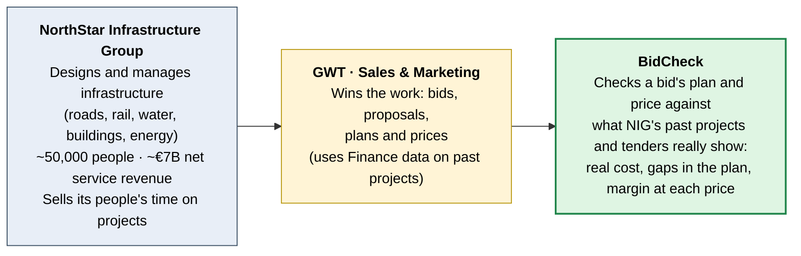
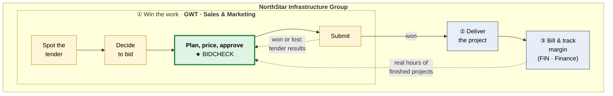
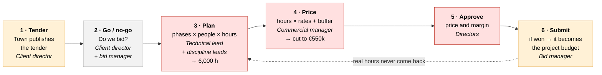
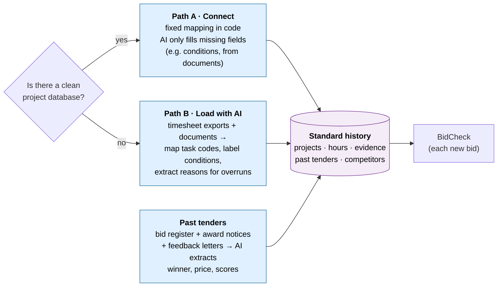
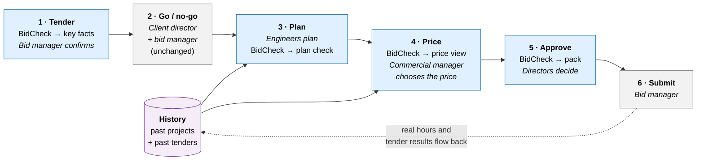
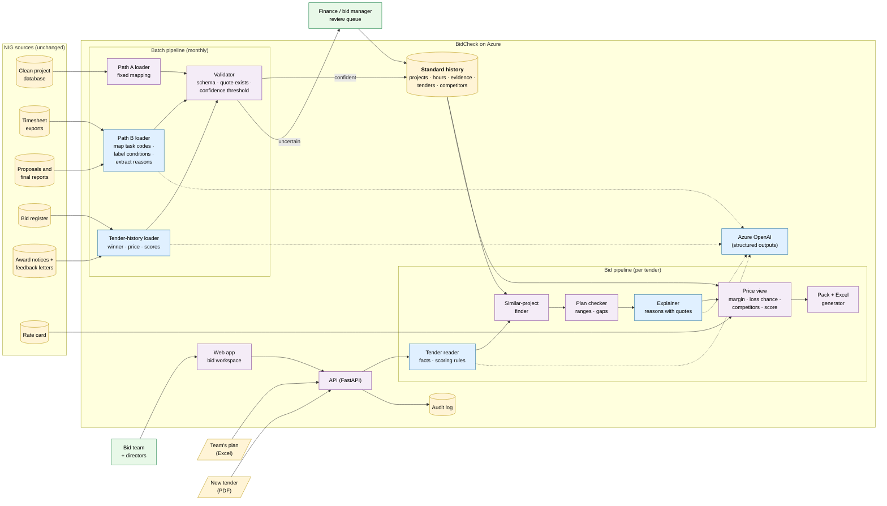
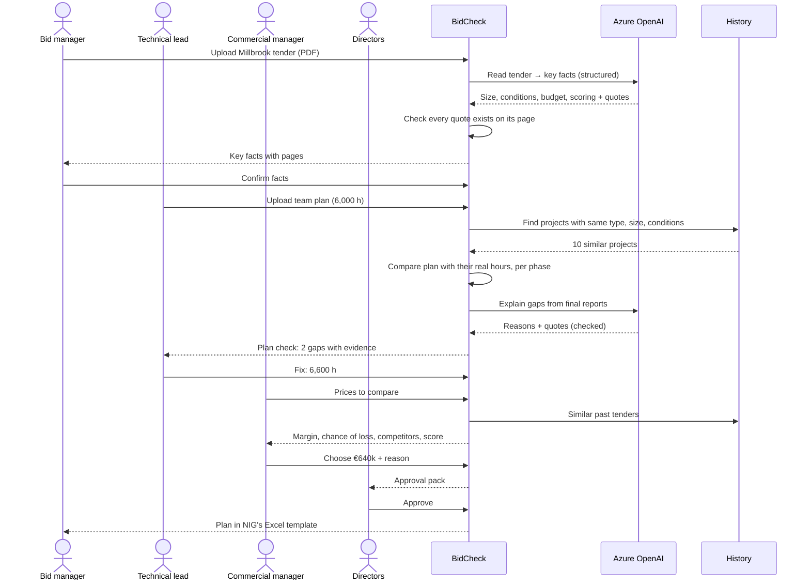

# BidCheck — Use Case Specification

> [!NOTE]
> ## Executive summary (5-minute read)
>
> **In one sentence:** before NIG sends a price, **BidCheck** checks the bid against what NIG's own past projects and past tenders really show: **what the job will really cost, where the plan is too optimistic, and what price can win while still making money.** People still plan and decide; the tool reads, compares and calculates.
>
> ### The story: one bid, two margins
>
> The town of **Millbrook** needs a new water treatment plant. Its tender says: *"the old plant must keep supplying the town until the new one is ready"* — one sentence on page 47 of 200.
>
> NIG's engineers plan **6,000 hours**. Competitors are expected at €550k, so the plan is squeezed to **5,000 hours** to match. The directors see a **27% margin** and approve. NIG wins.
>
> The project really needs **6,800 hours**: three rounds of changes from the town, a slower permit, night work to keep the old plant running. The real margin is **1%**.
>
> NIG had done **10 projects just like this one**, and they needed 6,200–7,600 hours. The answer was in NIG's own history. Nobody looked, because finding and comparing those projects takes days.
>
> **This is not one bad bid. It is how bids are priced today:** drawings are counted carefully, but the work around them — reviews, permits, keeping things running — is guessed, then cut to hit a price. Across ~5,000 significant bids a year, we estimate this costs NIG **~€55M of margin per year**.
>
> ### What we propose
>
> **BidCheck**, a web tool for the bid team that plugs into the steps NIG already has:
> 1. **Reads the tender** and lists the facts that drive the work, each with its page.
> 2. **Checks the engineers' plan** against the ~10 truly similar past projects, phase by phase, and shows where it is too low, with evidence.
> 3. **Shows the price view:** margin and chance of a loss at each price, who usually wins similar tenders and at what price, and the score NIG would get.
> 4. **Builds the approval pack** for the directors.
>
> Engineers still make the plan, the commercial manager still sets the price, directors still decide. With BidCheck, the Millbrook team would have seen: *"your plan is below every similar project"* and *"€550k → 1% margin, 4 in 10 chance of a loss; €640k → 15%, and still the best expected score."*
>
> ### Why AI, and not a spreadsheet
>
> The maths is easy and stays in plain, tested code. The hard part is **reading**: what makes one project twice as expensive as another, who won a past tender and why, are sentences in tenders, reports, award notices and feedback letters — not fields in a database. The AI reads and labels; **it never produces a number**.
>
> ### Doesn't a tool already do this?
>
> **Partly — which confirms the need.** Practice-management tools for small firms suggest budgets from past projects logged inside them; tender-reading tools extract requirements. **Nothing checks a plan and a price against a large firm's own messy, multi-system history.** So we buy what exists and build only the missing piece.
>
> ### Business impact
>
> | Per year | Conservative | Expected | Upside |
> |---|---|---|---|
> | Margin protected (fewer bids priced below real cost) | €1.7M | €4.4M | €8.3M |
> | Skilled time freed (~25–35 h → ~10–14 h per bid) | €0.8M | €3.9M | €10.4M |
> | **Gross value** (before solution costs) | **€2.4M** | **€8.3M** | **€18.6M** |
>
> Plus: directors approve with evidence, price decisions become conscious, and every finished project and lost bid makes the next check better.
>
> ### Feasibility and time
>
> | Stage | Time | Team | Go on if… |
> |---|---|---|---|
> | **Prototype** (this submission) | 5 days | 1 AI engineer | It works end to end on realistic fictional data |
> | **Backtest** on one region's real history | 2 weeks | AI engineer + finance analyst (part-time) | The plan check catches underestimates better than past human estimates |
> | **Pilot**: one region, ~30 bids | 2 quarters | ~3 people + a bid manager as product owner | Teams use it on ≥ 50% of bids and act on its flags |
> | **Roll-out**, region by region | ~1 year | Same team + 2–4 weeks onboarding per region | Margin on won projects improves; win rate holds |
>
> **Costs:** AI usage is a few cents per bid. Team, hosting and support costs depend on NIG's internal rates — **to be estimated with NIG.**
>
> **Why it's feasible:** no big data project first (clean regional databases are connected directly; messy ones are loaded with AI in weeks) · standard technology (Azure OpenAI, a small web app) · no change to the process, only better evidence at three existing steps.
>
> ### Main risks, and how we handle them
>
> | Risk | How we handle it |
> |---|---|
> | NIG's history is too messy or thin | The 2-week backtest tests this first; with too little evidence, the tool says so instead of guessing |
> | People dismiss the flags | Every flag needs a fix or a written reason; directors see both |
> | Higher prices lose bids | People still choose the price; the tool shows margin, chance of a loss and expected score side by side; win rate is tracked |
>
> ### The decision we ask for
>
> **Approve a 2-week backtest** on one region's finished projects and past tenders. If BidCheck doesn't clearly catch underestimates that people missed, we stop there. If it does, we come back for the pilot.
>
> **What it is not:** not a planning or pricing machine (people plan and price) · not a chatbot · not a bid/no-bid tool · not contract review · not a way to rate people.

> Version: draft v6 (engineers plan, BidCheck checks) · Cluster: **GWT · Sales & Marketing** (uses Finance data) · *BidCheck is a working name.*
> All figures are **assumptions** and example numbers are illustrative.



## Contents

1. [Context: who NIG is and how it works](#1-context-who-nig-is-and-how-it-works): [NIG in brief](#11-nig-in-brief) · [How NIG wins work and earns money](#12-how-nig-wins-work-and-earns-money) · [Who is involved in a bid](#13-who-is-involved-in-a-bid) · [Where this sits](#14-where-this-sits)
2. [Business process candidate: planning and pricing a bid](#2-business-process-candidate-planning-and-pricing-a-bid)
   - 2.1 [As-is process](#21-as-is-process): [The process today](#211-the-process-today) · [What really happens](#212-what-really-happens) · [Pain points and manual work](#213-pain-points-and-manual-work)
   - 2.2 [To-be process and its motivation](#22-to-be-process-and-its-motivation): [Why AI, and why not something simpler](#221-why-ai-and-why-not-something-simpler) · [What the tool is](#222-what-the-tool-is) · [Where the data comes from](#223-where-the-data-comes-from) · [The new process](#224-the-new-process) · [What the team sees](#225-what-the-team-sees) · [Millbrook, with the tool](#226-millbrook-with-the-tool) · [Before vs after](#227-before-vs-after)
3. [Analysis of the AI transformation](#3-analysis-of-the-ai-transformation): [Framework check](#31-framework-check) · [Value](#32-value) · [Scalability](#33-scalability) · [Risks](#34-risks) · [Assumptions and kill test](#35-assumptions-and-kill-test-task-5)
4. [Technical: how to build it](#4-technical-how-to-build-it): [What kind of app](#41-what-kind-of-app) · [Architecture](#42-architecture) · [Components](#43-components) · [How one bid flows](#44-how-one-bid-flows) · [Inputs and outputs](#45-inputs-and-outputs-formats-and-fictional-data) · [Key choices](#46-key-technical-choices) · [Technology](#47-technology) · [Feasibility](#48-feasibility-5-day-prototype)
5. [Appendix](#appendix): [A. Fit with the brief](#a-fit-with-the-brief) · [B. Glossary](#b-glossary) · [C. Sources](#c-sources)

Related: [as-is sub-steps](../02-processes/as-is.md) · [to-be sub-steps](../02-processes/to-be.md) · [user journey](../02-processes/user-journey.md)

---

## 1. Context: who NIG is and how it works

### 1.1 NIG in brief

| | |
|---|---|
| **What NIG does** | Designs, builds and operates infrastructure: roads, rail, water, buildings, energy |
| **Size** | ~50,000 employees · ~€7B **net service revenue** (what its own people earn) |
| **Where** | North America, Europe, the Middle East, Asia-Pacific |
| **Clients** | About half public authorities (towns, water utilities, transport agencies), half private companies |
| **How it grew** | Through acquisitions and regional expansion. Regions and business units work differently, with **different systems** and local workarounds (brief) |

### 1.2 How NIG wins work and earns money

- **NIG sells its people's time.** A design project is a number of **hours** worked by engineers, drafters and managers.
- **Most work is won through tenders.** A client publishes what it needs and how offers will be scored; several firms send an offer (a **bid**); the best score wins. NIG wins roughly **45%** of its bids.
- **Engineers sell.** There is no classic sales team: the senior engineer who will run the project also plans the offer, supported by a bid team.
- **The money in one line:**

```
Price (what the client pays)  −  Cost (hours × what each hour costs NIG)  =  Margin
```

- **The price is limited by the market** (the client's budget, the competitors). **The cost is set by the hours.** On most contracts (fixed price or capped), if the project needs more hours than planned, **NIG pays for them**.

### 1.3 Who is involved in a bid

| Role | Who they are | Job in the bid |
|---|---|---|
| **Client director** | Business development; owns the relationship with the client | Spots the tender, pushes to bid |
| **Bid manager** | Professional organiser of offers | Runs the plan and the deadline; assembles and submits the offer |
| **Technical lead** (+ discipline leads) | Senior engineer, usually the future project manager, with process, civil, mechanical, electrical leads | Plans the work and estimates the **hours** |
| **Commercial manager** | Pricing specialist | Turns hours into a **price** |
| **Approvers** | Regional director + finance director | Approve the final price and margin |

### 1.4 Where this sits

NIG's work runs in three stages: ① win the work, ② deliver it, ③ bill it and track the margin. BidCheck sits in **① Win the work (GWT · Sales & Marketing)**, at the *plan, price and approve* steps. It learns from the real hours that **③ Finance** records on finished projects, and from the results of past tenders.



---

## 2. Business process candidate: planning and pricing a bid

**The candidate:** planning and pricing a bid — the steps between *"we bid"* and *"we submit"*, where NIG decides how many hours a project needs and what price to offer. Cluster: **GWT · Sales & Marketing**.

**Why this one:** it runs ~5,000 times a year, it sets the margin of most of NIG's projects, and its most important evidence — what similar past projects really took, and what won similar tenders — is locked in documents that nobody has time to read (§2.2.1).

**The example used throughout:**

> **Millbrook** (40,000 people) publishes a tender: *"Design a new drinking-water treatment plant, 20 million litres a day. **The old plant must keep supplying the town until the new one is ready.** Estimated value: up to €700k. Offers scored 70% on quality, 30% on price. Due in 6 weeks."*

NIG's job, if it wins: design the plant (drawings, calculations, specifications), get it approved, and support the builder during construction. Fixed price.

### 2.1 As-is process

Full sub-step tables: [as-is.md](../02-processes/as-is.md).

#### 2.1.1 The process today



*Red = heavy manual work and friction · Orange = some manual work · Grey = no pain to automate here.*

| # | Step | Who | What is done | Input / data | Tool | Output | Pain point / manual work | Can AI help? |
|---|---|---|---|---|---|---|---|---|
| 1 | **Tender** | Client director, technical lead | Finds the tender; the technical lead reads it to find what drives the work | Tender documents (~200 pages: scope, contract, scoring rules, budget) | Tender portal, PDF | Key facts, in someone's head | Hours of reading; key sentences easy to miss | ✅ Pull out the key facts, with pages |
| 2 | **Go / no-go** | Client director + bid manager | "Can we win it? Do we have the people?" | Tender summary, client relationship, team availability | Meeting | Decision: bid | Short meeting; a business judgement | ✖ Out of scope (lead qualification is excluded by the brief) |
| 3 | **Plan** | Technical lead + discipline leads (+ finance analyst, if asked) | Phases; counts the drawings (~120) and calculations; asks around for similar past projects — usually no time, so **guesses** the work around the drawings | Key facts · deliverable list · past projects, *if found* | Excel, email, project system | **6,000 hours** | Searching 140 past projects and comparing their hours takes days, so it's skipped | ✅ Check the plan against similar projects |
| 4 | **Price** | Commercial manager | 6,000 h × €100/h + 10% = **€660k**. "Competitors will bid ~€550k" → hours cut to 5,000 | Hours, rate card, budget, a guess of competitors' price | Excel | Offer: **€550k** | Hours cut blindly; competitors known only by hearsay | ✅ Margin, chance of a loss, past winners and score at each price |
| 5 | **Approve** | Directors | Pack built by hand; cost 5,000 h × €80 = €400k → margin **27%**. Approve | Approval pack | Slides | Approved | No evidence to challenge | ✅ Generate the pack with evidence |
| 6 | **Submit** | Bid manager | Sends the offer; NIG wins; the 5,000 h become the budget | Final offer | Tender portal | Contract | Real hours and tender results never feed the next bid | ✅ Feed them back automatically |

**Total effort today:** ~25–35 hours of skilled time from 6–10 people, over 1–3 weeks.

#### 2.1.2 What really happens

The project needs **6,800 hours**: three rounds of design changes from the town, a slower permit, and extra planning and night work to keep the old plant running.

| | What the directors approved | What really happened |
|---|---|---|
| Price | €550k | €550k |
| Hours | 5,000 | 6,800 |
| Cost (× €80/h) | €400k | €544k |
| **Margin** | **€150k (27%)** | **€6k (1%)** |

**A wrong hours estimate makes a bad price look good.** NIG had done 10 similar projects — water plants where the old plant had to keep running — and they needed 6,200–7,600 hours. And the €550k "competitor price" was a rumour: on similar tenders scored 70% on quality, NIG had usually won at €610–650k.

#### 2.1.3 Pain points and manual work

1. **Reading the tender (step 1):** hours of reading to find the few sentences that drive the work.
2. **Finding and comparing past projects (step 3):** the biggest manual job — days of searching, reading and regrouping — so it's skipped and the work around the drawings is **guessed**.
3. **Pricing blind (step 4):** hours cut to hit a rumoured competitor price, with no view of which cuts are risky or what really won similar tenders.
4. **Building the approval pack (step 5):** by hand, with no evidence behind the numbers.
5. **No learning loop (step 6):** real hours of finished projects and results of lost bids never come back.

**Why it matters:** ~25–35 skilled hours per bid, and estimates that are too low. Across NIG (~5,000 significant bids a year), underestimated hours cost an estimated **~€55M of margin per year** [assumption: ~40% of €7B is work where NIG pays for overruns × ~2% lost].

### 2.2 To-be process and its motivation

Full sub-step tables: [to-be.md](../02-processes/to-be.md) · the story as a journey: [user-journey.md](../02-processes/user-journey.md).

#### 2.2.1 Why AI, and why not something simpler

**In short:** the maths (hours × rates, cost, margin, scores) is easy and stays in plain, tested code. The hard part is the **evidence**: what similar projects really took and what won similar tenders. It sits in tenders, proposals, task lists, final reports, award notices and feedback letters that someone has to **read**. That reading is what AI is for.

| Attack | Answer |
|---|---|
| **Why not a spreadsheet or a deterministic tool** (standard ratios, rules, a database with filters)? | We do keep the maths deterministic. What a spreadsheet can't do is tell *which* past projects are similar: the facts that drive hours (*"the old plant must keep running"*) are sentences, not database fields. A ratio gives the same hours for a plant on an empty site (needed 5,400 h) and one where the old plant kept running (needed 7,100 h). Creating those fields by hand means relabelling thousands of projects across every region's system — the long data project the brief warns about. |
| **Why not a machine-learning model** trained on past projects? | Too little data and too little trust. Per project type NIG has **tens** of truly comparable projects, not thousands; the signals are in text; and an approver won't accept a black-box number, but will accept *"these 10 real projects needed 6,200–7,600 hours"*. |
| **Why not Copilot / ChatGPT, or an off-the-shelf product?** | A chat assistant can summarise one tender, but it doesn't know NIG's past projects or tenders, so any number it gives is invented. Off-the-shelf products each cover one piece (see the market check below). None checks a plan and a price against a large firm's own messy history. |
| **Why build it, instead of buying?** | The closest products would require moving every region's project accounting into them first — a multi-year migration. What we build is small, made of standard parts (Azure OpenAI, a web app), and sits on top of NIG's existing systems. We still **buy** the AI model, the cloud and the accounting tools, and build only the reading-and-comparing layer. The cleaned history stays NIG's asset. *(Solution cost depends on NIG's internal team and rates — to be estimated.)* |
| **Can we trust an AI with numbers?** | The AI never produces a number. It only reads and labels text, always quoting the source sentence, which code checks. Every hour, cost, margin and score comes from tested code on real data, and people review every flag. |
| **Why not just ask engineers to look at past projects more carefully?** | They would if they could. Finding and comparing similar projects takes days per bid, on top of project work, so it's skipped. A new rule doesn't create time; the tool removes the work. |
| **Won't more realistic (higher) prices make NIG lose bids?** | The tool doesn't set the price — people do. It shows margin, chance of a loss **and the expected score** at each price, so NIG can still bid low to win a client, knowingly and with a written reason. |
| **Isn't this contract review or lead qualification?** | No. The tool is used only **after** the decision to bid, and reads the tender only for what drives hours and price (size, conditions, budget, scoring rules) — never contract clauses. It never says whether to bid. |
| **Is NIG's data good enough?** | It's messy, but it exists: hours in the project system, documents in folders, tender results in the bid register and on public portals. Making messy text usable is exactly what the AI does. Where evidence is too thin (fewer than 5 similar projects), the tool says so instead of guessing. |

**Market check: does a tool already do this?** *(public product information, November 2026; to confirm with vendor demos during the pilot)*

| Kind of tool | Examples | What they do | What's missing for NIG |
|---|---|---|---|
| General AI chat | ChatGPT, Microsoft Copilot | Summarise a tender | No access to NIG's past projects or tenders; numbers would be invented |
| Practice management for architecture and engineering firms | Monograph, CMap | Suggest a phase budget (Monograph) or margin (CMap) from past projects — **the closest to our idea** | Works only on time logged **inside their own tool**; similar projects matched on category or fee; doesn't read tenders or past tender results; built for small and mid-size firms |
| Enterprise project accounting and pricing | Deltek (Vantagepoint, ProPricer), Unanet (incl. Champ AI) | Store projects and hours; build prices from cost items; AI to write proposals | Don't check a plan against what comparable projects really took |
| Tender-analysis AI | Aitenders, Temelion, ContraVault | Read tenders: requirements, risks, go/no-go | Don't use a firm's own project or tender history |
| Construction cost estimating | Quantity take-off and cost tools (e.g. CostX, Candy) | Price materials and works for builders | Not design hours |

**Conclusion:** the pieces exist separately, and the closest products show that firms want this. **None checks a plan and a price against a large firm's existing, messy history of projects and tenders.** That gap is what we build.

**The resulting split:**

| Who | Does what |
|---|---|
| **AI (a language model)** | The reading: tender facts, labels of past projects, task-code mapping, reasons for overruns, winners and scores from award notices and feedback letters — always with the source sentence |
| **Plain code** | The maths: similar projects, ranges per phase, gaps, cost, margin, chance of a loss, competitor statistics, scores at each price |
| **People** | The decisions: the plan, the price, the approval — with a reason for every flag they override |

#### 2.2.2 What the tool is

**BidCheck** is a **web application with a guided "bid workspace"**: one bid, four tabs in order — *Tender → Plan check → Price → Approval pack*. It is **not a chatbot** (users never type a prompt; the prompts live inside the app) and **not a dashboard** (it is a working tool for one bid).

| | |
|---|---|
| **Users** | Bid manager, technical lead and discipline leads, commercial manager, directors; finance analyst for the history |
| **Inputs per bid** | The tender (PDF) · the team's plan (hours per phase and role, Excel or typed) · the prices to compare |
| **Data in the background** | **Past projects** (real hours, proposals, final reports) · **past tenders** (NIG's bids and results, winners' prices, feedback letters) · the **rate card** |
| **Outputs per bid** | ① Key facts of the tender, with pages · ② **Plan check**: where the hours are below what similar projects really took, with evidence · ③ **Price view**: margin and chance of a loss at each price, who usually wins similar tenders and at what price, NIG's score at each price · ④ **Approval pack** (PDF) and the plan in NIG's Excel template |
| **Who does what** | **AI** reads · **code** compares and calculates · **people** plan and decide |
| **Boundaries** | Used only after the decision to bid; no bid/no-bid advice; no contract-clause review; it shows history, never predicts a competitor's price |

#### 2.2.3 Where the data comes from

The history is loaded and kept up to date **in the background**, so that each bid takes seconds. It has two parts.

**Past projects — two paths**, depending on what a region has. Both write the **same standard format** (e.g. a [Frictionless Data Package](https://datapackage.org/): CSV files + a JSON schema), so nothing downstream knows where the data came from.



| | **Path A · Connect** | **Path B · Load with AI** | **Past tenders** |
|---|---|---|---|
| **When** | A region keeps a clean project database | Only timesheet exports (each project with its own task codes) and documents | Always |
| **Source** | Database | Exports + proposals + final reports | Bid register (CRM/spreadsheet) + public award notices + feedback letters on lost bids |
| **AI needed?** | Only for what the database lacks — usually the conditions | Yes: map task codes, label conditions, extract overrun reasons | Yes: extract winner, price, scores and reasons |
| **Human check** | One-off check of the mapping | Finance analyst approves uncertain items | Bid manager approves uncertain items |
| **Onboarding a region** | Days | ~2–4 weeks, then ~1 h/month | Included |

Every AI label carries a **confidence score and its source sentence**; code checks the sentence exists; uncertain items go to a person.

#### 2.2.4 The new process



*Blue = BidCheck does the reading and the maths, people decide · Grey = people only · Purple = the history.*

| # | Step | Who | Input | BidCheck does | Output | Skilled time: today → with BidCheck |
|---|---|---|---|---|---|---|
| 1 | **Tender** | Bid manager confirms | Tender PDF | **AI** lists the key facts (size, conditions, budget, scoring rules), each with page and quote; **code** checks the quotes | Confirmed key facts | 2–3 h → 15 min |
| 2 | **Go / no-go** | Client director + bid manager | Key facts | — (unchanged; no advice given) | Decision: bid | unchanged |
| 3 | **Plan** | Engineers make the plan; technical lead reviews the check | The team's plan + key facts + history | **Code** finds the ~10 similar projects and compares the plan phase by phase with what they really took; **AI** quotes why they needed more | **Plan check**: gaps with evidence; each flag fixed or explained | 15–20 h → 8–12 h (searching and guessing removed; counting stays) |
| 4 | **Price** | Commercial manager chooses | Checked plan + prices to compare + history + rate card | **Code**: cost, margin and chance of a loss at each price; who won similar tenders and at what price; NIG's score at each price | **Price view** → chosen price + reason | 2–3 h → 1 h |
| 5 | **Approve** | Directors decide | Everything above | **Code** builds the pack; **AI** writes a one-paragraph summary from its numbers | Approval pack (PDF) | 4–6 h → ~1 h |
| 6 | **Submit** | Bid manager | Approved offer | Exports the plan to NIG's template; later, real hours and the tender result flow back | Offer sent; history updated | unchanged |
| | | | | | **Estimating work per bid** | **~25–35 h → ~10–14 h** |

**Rules BidCheck enforces:** the AI never produces a number · every fact and reason shows its source · too little evidence → the tool says so · every flag is fixed or explained in writing · everything is logged.

#### 2.2.5 What the team sees

**Tab 1 — Tender facts**
```
Millbrook water treatment plant — design                        [Confirm facts ✓]
  Size        20 million litres/day                               (p. 12)
  Conditions  ● old plant must keep supplying the town            (p. 47)
              ● town reviews each design stage                    (p. 31)
  Budget      up to €700k                                         (p. 5)
  Scoring     quality 70% · price 30% (lowest price ÷ your price × 30)   (p. 9)
```

**Tab 2 — Plan check**
```
Similar projects: 10 of 140 water plants (old plant kept running)       [see list ▸]

PHASE                       YOUR PLAN   SIMILAR PROJECTS TOOK   CHECK
Study & concept                800 h        800 – 1,050 h       ✓
Detailed design              3,000 h      2,950 – 3,400 h       ✓
Town reviews & permits         400 h        650 –   850 h       ⚠ below every similar project
Keeping the old plant running  200 h        400 –   650 h       ⚠ below every similar project
Construction support         1,600 h      1,400 – 1,650 h       ✓
TOTAL                        6,000 h      6,200 – 7,600 h       ⚠ (typical: 6,800 h)

⚠ Town reviews — "three review rounds with the town council" (Eastbrook final report)
   [ Fix the hours ]   or   Reason: [_____________________________]
```

**Tab 3 — Price view**
```
Cost if it goes like similar projects:  typical €544k (6,800 h) · high €608k (7,600 h)

PRICE    MARGIN (typical)  MARGIN (high)  CHANCE OF A LOSS   EXPECTED SCORE
€550k       €6k   1%       −€58k  −11%     4 in 10            92.0
€600k      €56k   9%        −€8k   −1%     1 in 10            90.0
€640k      €96k  15%        €32k    5%     0 in 10            88.3   ◄ chosen
€700k     €156k  22%        €92k   13%     0 in 10            86.0

WHO WON SIMILAR TENDERS (14, same region, last 5 years)
  NIG                   6 wins   €610–650k   on quality (quality weighted 70%)
  Riverton Engineering  4 wins   €560–600k   on price (price weighted 40%+)
  BlueLine Water        3 wins   €620–660k   on quality
⚠ Millbrook weights price at 30%: NIG won 5 of 6 tenders scored like this.
⚠ Riverton's usual price is below NIG's cost if the project goes like the harder ones.
Expected score assumes Riverton at €560k with 55/70 quality, BlueLine at €650k with 60/70,
NIG at 62/70 — NIG's and competitors' typical scores from past feedback letters.

Chosen price: €640k   Reason: [ we win on quality, 70% of the score ]
```

**Tab 4 — Approval pack:** key facts · the 10 similar projects · the plan and every flag with its fix or reason · the price view at the chosen price · the competitor panel. Exported as PDF; the plan as Excel in NIG's template.

#### 2.2.6 Millbrook, with the tool

> **Monday.** Bid manager **Priya** uploads the tender. BidCheck lists the key facts with pages: *20 million litres a day*, *the old plant must keep supplying the town* (p. 47), *the town reviews each design stage*, *budget up to €700k*, *quality 70% / price 30%*. She confirms. Clara and Priya decide to bid.
>
> **Tuesday.** Technical lead **Tom** and the discipline leads make their plan as usual: **6,000 hours**. They load it into BidCheck. Out of 140 past water plants, it keeps the **10 where the old plant also had to keep running** and compares phase by phase. Two flags: *town reviews* (400 h; every similar project needed 650–850 h, *"three review rounds with the town council"*) and *keeping the old plant running* (200 h; similar projects 400–650 h). Tom raises them to 700 and 500 hours. **Plan: 6,600 hours.**
>
> **Wednesday.** Commercial manager **Marco** opens the price view. At €550k, the rumoured competitor price, NIG would earn **1%** in a typical case and lose money in 4 of 10 similar cases. The competitor panel shows that the low bidder, Riverton, wins when price counts 40% or more — Millbrook counts it at 30%, and NIG won 5 of 6 tenders scored like this. Marco chooses **€640k**: 15% margin if it goes as usual, still profitable in the harder cases, and the best expected score. Reason recorded: *"we win on quality, 70% of the score."*
>
> **Thursday.** The directors receive the generated pack and approve in 20 minutes. Priya submits. **4 days, not 2–3 weeks.**
>
> **The outcome.** If NIG wins, it starts with a budget of 6,600 hours instead of 5,000. If it loses to a much cheaper bid, it has avoided a project that would likely have earned nothing. **Either way, the price was a decision, not a guess.** When the project ends — or the result is published — the history learns from it.

#### 2.2.7 Before vs after

| | Today | With BidCheck |
|---|---|---|
| Reading the tender | 2–3 h; key sentences easy to miss | Key facts in minutes, with pages |
| Similar past projects used | 0–2, from memory | ~10, matched on the conditions that drive hours |
| The plan | Guessed where it's hard, then cut | Made by engineers, checked phase by phase; every gap fixed or explained |
| Competitors | Hearsay ("they'll bid €550k") | Who won similar tenders, at what price, and how they were scored |
| Price decision | Hours cut blindly to hit a price | Margin, chance of a loss and expected score at every price |
| Approval | *"Margin 27%, OK"* — no evidence | Evidence behind every number |
| Skilled time per bid | ~25–35 h, 1–3 weeks | ~10–14 h, 3–4 days |
| Learning | None | Every finished project and every tender result improves the next check |

---

## 3. Analysis of the AI transformation

### 3.1 Framework check

Using the selection [framework](../05-how-we-worked/framework/assessment-framework.md).

**Gates** (all must pass)

| Gate | Result | Why |
|---|---|---|
| 1. Allowed by the brief | ✅ | Planning and pricing a bid. Used after the go/no-go decision (not lead qualification); reads tenders only for what drives hours and price (not contract review); no chat |
| 2. Real, frequent pain | ✅ | ~5,000 significant bids a year × ~25–35 h of skilled time; ~€55M of margin lost per year |
| 3. No off-the-shelf tool, including general AI chat | ✅ ⚠️ | Partial tools exist, but none checks a plan and a price against a large firm's own history (§2.2.1) |
| 4. Data exists today | ✅ ⚠️ | Hours, documents and tender results exist in every region — clean in some (Path A), messy in others (Path B) |
| 5. Measurable | ✅ | **Backtest:** run the check on finished projects; see whether it catches the underestimates that really happened |
| 6. One-sentence hook, common across companies | ✅ | *"Before you sign the price, see what jobs like this really took — and what really won."* Every company that sells projects has this problem |

**Scores** (1 = poor, 5 = excellent)

| Score | 1–5 | Why |
|---|---|---|
| ROI (conservative) | **4** | ~€2.4M gross value per year in the conservative case (§3.2) |
| Scalability | **5** | A new region = connect or load its history, not new code |
| Adoption | **4** | Engineers keep their plan; the tool removes searching and spreadsheet work; directors get evidence |
| **Value** = (2 × ROI + Scalability + Adoption) / 4 | **4.25** | |
| Feasibility | **3** | The history exists but is messy in many regions |
| Build & run cost | **3** | Small team; low running cost (AI cents per bid) |
| Risk | **3** | Flags could be dismissed and thin evidence could mislead — mitigated by mandatory reasons and ranges instead of single numbers |
| **Ease** = average | **3.0** | |
| **Verdict** | **GO** | All gates pass · Value ≥ 3.5 · Ease ≥ 3 |

### 3.2 Value

**Where the value comes from**

1. **Margin protected** — fewer projects won at a price that doesn't cover their real cost (Millbrook: a "27%" that was really 1%).
2. **Skilled time freed** — ~25–35 h per bid becomes ~10–14 h. *This is capacity, not cash: it becomes money only if the time goes to more bids or billable work.*
3. *Not counted:* stronger position in US hour negotiations; better win rate where competitor evidence changes the price; a clean history reusable by other use cases.

**Assumptions**

| | Conservative | Expected | Upside |
|---|---|---|---|
| Margin lost per year to underestimated hours | €55M | €55M | €55M |
| Share of that loss the tool avoids | 3% | 8% | 15% |
| Significant bids per year | 3,000 | 5,000 | 7,000 |
| Skilled hours saved per bid | 8 | 14 | 18 |
| Cost of an hour of the bid team's time (senior roles; NIG's average across all roles is €80) | €110 | €110 | €110 |
| Adoption (share of bids using the tool) | 30% | 50% | 75% |

**Result per year**

| | Conservative | Expected | Upside |
|---|---|---|---|
| Margin protected (= €55M × share avoided) | €1.7M | €4.4M | €8.3M |
| Capacity freed (= bids × hours saved × €110 × adoption) | €0.8M | €3.9M | €10.4M |
| **Gross value** | **€2.4M** | **€8.3M** | **€18.6M** |

**Solution costs** (team, hosting, support) depend on NIG's internal rates and team set-up — **to be estimated with NIG**. AI usage itself is a few cents per bid; the history is labelled once, not per bid.

**Caveat:** the margin line rests on two assumptions — ~€55M lost per year, and the share the tool avoids. Both are measured in the backtest and the pilot (§3.5) before any roll-out.

### 3.3 Scalability

- **Across NIG:** a new region is onboarding, not development — days with a clean database (Path A), ~2–4 weeks without (Path B). Every region adds projects and tender results for everyone.
- **Across project types:** water plants, roads, buildings… only the size driver (litres/day, km, m²) and the phase list change — configuration, not code.
- **Across languages and countries:** the AI reads documents in local languages; scoring formulas are read from each tender; the tool compares **hours**, so currency only matters when rates are applied.
- **Beyond NIG:** any company that bids for projects sold by the hour — engineering, consulting, IT services — has the same problem.

### 3.4 Risks

| Risk | Level | What could happen | Mitigation |
|---|---|---|---|
| Too little usable history | **High** | Too few similar projects or tenders | Start in the region with the best data; below 5 similar projects, the tool says "not enough evidence" |
| **Flags dismissed** | **High** | People type a quick reason and move on | Reasons are shown to directors in the pack; boilerplate reasons are tracked (K2) |
| Wrong similar projects | Med | The check compares with projects that aren't really alike | Every label shows its source sentence; the tool says *why* each project matches; people can remove or add |
| Wrong labels or mappings (Path B) | Med | Hours land in the wrong phase | Confidence scores; uncertain items approved by finance; accuracy measured (A1) |
| Invented explanations | Med | The AI cites reasons that aren't in the reports | Every reason must quote a document, and code checks the quote exists |
| Incomplete competitor data | Med | Some award prices or scores are not public | The panel shows only what is known and how many tenders it is based on; never a prediction |
| Scope creep into excluded areas | Med | Someone uses the tool to decide whether to bid, or to review contracts | Opened only after go/no-go; no win-probability for an opportunity; no clause analysis |
| Higher prices lose bids | Med | Win rate drops | People choose the price; expected score shown next to margin; win rate tracked (K3) |
| Confidential data | Med | Past prices and margins are sensitive | Access by role and region; only public or NIG-owned data |
| EU AI Act | Low | — | Minimal risk: supports a commercial decision, not decisions about people |

### 3.5 Assumptions and kill test (Task 5)

**Our assumptions about NIG** (stated, as the brief asks)

| Assumption | Why it matters |
|---|---|
| Design work is sold as hours by role and phase | That's what the plan check compares |
| ~40% of net service revenue is on contracts where NIG pays for extra hours | That's where better checks protect margin |
| Some regions have a clean project database; most have exports and documents | Hence Path A and Path B |
| Finished projects have hours, a proposal and a final report, even if inconsistent | Needed to find similar projects and explain overruns |
| NIG keeps a bid register (price, result) and receives feedback letters; award notices of public tenders are public | Needed for the competitor panel and scores |
| Original estimates of past projects were kept | Needed for the backtest (K1) |

**The three assumptions everything depends on**

| # | Assumption | Why it matters | How to check it, fast | If it's false |
|---|---|---|---|---|
| A1 | **The history is usable:** enough finished projects and tender results, and the AI labels and maps them correctly | No similar projects, no check | Load 200 finished projects and 100 past tenders from one region; a finance expert checks a sample (target ≥ 90% correct); count how many new bids find ≥ 8 similar projects | Limit the tool to project types with good data, or stop |
| A2 | **Similar past projects predict real cost** better than today's plans | The core of the method | Backtest on 100 finished projects: compare the original plan and the similar-project range with what really happened | **Kill:** the method doesn't work for NIG |
| A3 | **People act on the evidence:** they fix or explain flags, and price with the margin view, without wrecking the win rate | A check nobody acts on is worthless | Shadow mode on the next 30 bids: share of flags fixed vs explained; win rate vs comparable bids | Redesign the review step, or stop |

**The three metrics that would make us stop**

| # | Metric | When | Stop or redesign if… |
|---|---|---|---|
| K1 | **Accuracy:** in the backtest, share of real overruns (> 10%) the plan check would have flagged, and how much closer the similar-project range is to reality than the original plans | Before the pilot (2 weeks), then every quarter | It flags **under 60%** of real overruns, **or** isn't **at least 20% closer** to reality than the original plans |
| K2 | **Healthy use:** share of bids using the tool; share of flags closed with a fix or a specific reason (not boilerplate) | First 3 months | Under 50% of bids use it, **or** over 50% of flags are dismissed with boilerplate |
| K3 | **Value:** margin on won projects and win rate, vs a comparison group | 6 months (early signal), 12 months | No margin improvement, **or** win rate down more than 5 points |

---

## 4. Technical: how to build it

*Full design in [technical design](../03-technical-design/technical-design.md) (to write).*

### 4.1 What kind of app

- **A web app with a guided bid workspace** — four tabs in order: *Tender → Plan check → Price → Approval pack*.
- **Not a chatbot:** users upload files, confirm facts, edit numbers, write reasons and choose a price. Prompts exist only **inside** the app, as versioned files, each returning a fixed structured result.
- **Not a dashboard:** a tool for one bid. A portfolio view (accuracy over time) could come later.
- **Two pipelines:** a **batch pipeline** loads and labels the history (offline, monthly); a **bid pipeline** runs per tender (seconds to a minute).

### 4.2 Architecture



*Blue = uses AI · Purple = plain code · Yellow = data · Green = people. Dotted lines = calls to the language model.*

### 4.3 Components

| Component | What it does | AI or code | Input → output |
|---|---|---|---|
| **Path A loader** | Maps a clean database into the standard format | Code | Database tables → projects, hours |
| **Path B loader** | Maps each project's task codes to standard phases; labels conditions; extracts overrun reasons | AI + code | Exports + documents → projects, hours, evidence |
| **Tender-history loader** | Reads award notices and feedback letters: winner, price, quality/price scores, reasons | AI + code | Bid register + notices + letters → tenders, competitors |
| **Validator** | Checks schemas and that every quote exists; sends low-confidence items to a person | Code | Candidate records → accepted / review queue |
| **Tender reader** | Size, conditions, budget, scoring rules, deadlines | AI, checked by code | Tender PDF → key facts with pages |
| **Similar-project finder** | Filters history on type, size band, conditions, region; ranks; explains each match; minimum 5 | Code | Key facts + history → ~10 similar projects |
| **Plan checker** | Per phase: hours per size unit across similar projects → low / typical / high, scaled to the bid; compares with the plan; flags gaps | Code | Team's plan + similar projects → gaps |
| **Explainer** | Why similar projects needed more, quoting final reports | AI, checked by code | Evidence → reasons with quotes |
| **Price view** | Cost; margin (typical, high); chance of a loss; competitor statistics on similar tenders; score at each price from the tender's formula | Code | Plan + prices + history + rate card → price table, competitor panel |
| **Pack + Excel generator** | Approval pack (PDF), plan export, short summary written from the numbers | Code (+ AI for the summary text) | Everything above → files |
| **Web app + API** | Bid workspace; every edit and reason saved to the audit log | Code | — |

### 4.4 How one bid flows



### 4.5 Inputs and outputs: formats and fictional data

NIG's real data is not available, so the prototype runs on **fictional data from a seeded generator**, realistic enough to expose the hard parts.

**Inputs**

| Input | Real-world format | Prototype format | How we generate it |
|---|---|---|---|
| **New tender** | PDF, 100–300 pages | Text-based PDF, ~15 pages | Template + language model, key sentences buried mid-document; 5 tenders, Millbrook included |
| **Team's plan** | Excel | `.xlsx` / `.csv` (phase, role, hours) or typed in a grid | Hand-made for Millbrook (6,000 h, low on reviews and phasing) |
| **Prices to compare** | — | Typed in the app | — |
| **Project history — Path A** | Database | SQLite / CSV on standard phases (~250 projects) | Generator |
| **Project history — Path B** | Timesheet exports + documents | CSV per region (project, task code, task text, local role name, hours) + proposal and final report per project (~350 projects) | Generator, then "messed up": own task codes and role names per project; texts written once by the language model from hidden facts, cached |
| **Tender history** | CRM, portal notices, letters | CSV bid register (~300 tenders: NIG price, result, winner, winning price, weights) + short award notices and feedback letters | Generator with 3 invented competitors; texts by the language model, cached |
| **Rate card** | Finance system | CSV: role, region, price/h, cost/h | Hand-made |
| **Standard phases** | Estimating standard | YAML (~5 phases, size driver per project type) | Hand-made |
| **Ground truth** (evaluation only) | — | JSON, kept apart | The generator's hidden facts |

**How the generator works:** each fictional project gets hidden true facts (type, size, conditions). Real hours per phase come from a formula — size × base rate × condition multipliers + noise. The original estimate is the same formula with built-in optimism on the work around the drawings (what the check should catch). Tender results follow simple rules (low bidders win when price weighs more). The language model writes the documents **from the hidden facts**, with varied, sometimes vague wording — so the reading is genuinely hard, and every answer is known.

**Outputs**

| Output | Format |
|---|---|
| Key facts, plan check, price view | On screen (bid workspace); JSON through the API |
| Approval pack | PDF (or printable HTML) |
| Plan for submission | Excel in NIG's template |
| Decisions and reasons | Audit log in the database |
| Quality report | Evaluation results: reading accuracy, mapping accuracy, backtest |

### 4.6 Key technical choices

| Choice | Why |
|---|---|
| **The AI never produces numbers** | It only reads and labels. Every number comes from tested code, so results are repeatable and auditable |
| **Structured outputs** | Every AI call returns a fixed, typed format (Pydantic). Invalid output is retried once, then shown as an error — never guessed |
| **Every claim carries its source** | Facts, labels and reasons quote a sentence; code checks it exists. No quote, no claim |
| **One standard history format** | Path A, Path B and tender history write the same schema; adding a region is configuration |
| **A guided workspace, not a chatbot** | Fixed steps are predictable, testable and cheap; users decide, they don't prompt |
| **A pipeline, not an agent** | Nothing here needs an AI to plan its own actions |
| **Evaluation built in** | The generator keeps the right answers, so reading, mapping and the backtest are measured, not eyeballed |
| **Low AI cost** | Small model for reading; results cached; history labelled once |

### 4.7 Technology

| Layer | Prototype | Production |
|---|---|---|
| Web app | React (fallback: server-rendered pages if time is short) | Same |
| API and pipelines | Python, FastAPI, Pydantic | Same; batch pipeline as a scheduled job |
| Language model | Azure OpenAI, small model | Same, in NIG's Azure tenant |
| Storage | SQLite + files | Azure Database for PostgreSQL + Blob Storage |
| Hosting | One container on Azure Container Apps | Same, per-region access rules |
| Sign-in and secrets | Simple access token | Microsoft Entra ID (single sign-on), managed identity, Key Vault |
| Monitoring | Logs | Application Insights: errors, latency, AI cost per bid |
| Quality | pytest, evaluation set, GitHub Actions CI | Same, plus a quarterly backtest |

### 4.8 Feasibility: 5-day prototype

| Day | Build |
|---|---|
| 1 | Schemas, data generator, fictional documents and tenders |
| 2 | Batch pipeline (mapping, labels, tender history, checks) + evaluations against the ground truth |
| 3 | Bid pipeline: tender facts, similar projects, plan check, price view; backtest |
| 4 | Web app (4 tabs), PDF and Excel export, deploy on Azure |
| 5 | Hardening, technical design, executive summary, video |

| Priority | Scope |
|---|---|
| **Must** | Tender facts · plan check · margin and chance of a loss · approval pack · backtest |
| **Should** | Competitor panel and score at each price (simple code; needs the tender-history dataset) |
| **Could** | Both Path A and Path B (Path B alone shows the hard part) |
| **Not in the prototype** | Scanned PDFs (OCR), single sign-on, live integrations, multiple languages — covered in the production-readiness chapter |

**Real technical risks:** task-code mapping accuracy (measured; uncertain cases to people) · small samples (ranges, never single numbers) · generated documents that are too easy (varied, vague, distracting wording) · time — the UI is the biggest schedule risk.

---

## Appendix

### A. Fit with the brief

| The brief asks for | BidCheck |
|---|---|
| A specific, painful workflow, **meaningfully automated or augmented** | Planning and pricing a bid: tender reading, plan check, price view and pack are automated; people plan and decide |
| Who uses it and why they'd trust it | The bid team and directors; trust from source quotes, ranges from real projects, and a measured backtest |
| No six-month data project | Path A connects what's clean; Path B and tender history are loaded with AI in weeks |
| Mock data that exposes the hard parts | Messy task codes, conditions hidden in text, thin history, incomplete tender results |
| Not a generic assistant; not an excluded workflow | A guided workspace, no chat; after go/no-go; no contract review |
| Clear value, realistic path, human oversight | Margin + capacity; backtest → shadow mode → one region → all regions; people choose every price |

### B. Glossary

| Term | Plain meaning |
|---|---|
| **Tender** | A client's public request for offers: what it wants, the contract, how offers are scored and often a budget |
| **Bid** | NIG's offer: a technical part (how, who, when) and a price |
| **Go / no-go** | The early decision whether to bid at all |
| **Phase** | A stage of the work, e.g. *study & concept → detailed design → reviews & permits → construction support* |
| **Rate card** | NIG's list, per role and region, of the **price** per hour and the **cost** per hour |
| **Cost / margin** | Cost = hours × cost per hour. Margin = price − cost |
| **Fixed price** | The client pays an agreed amount; extra hours are paid by NIG |
| **Task code** | The label people book their hours to; each project sets up its own list |
| **Final (close-out) report** | Written when a project ends: what went well, what went wrong |
| **Condition** | A fact in a tender that changes the hours without changing the size, e.g. *"the old plant must keep running"* |
| **Similar project** | A finished project with the same type, a similar size and the same conditions |
| **Typical / high hours** | From the similar projects: *typical* = the middle value; *high* = the top of the range |
| **Plan check** | The comparison of the team's plan with what similar projects really took, phase by phase |
| **Chance of a loss** | Share of similar projects whose real hours, at this price, would have lost money |
| **Award notice** | Public notice of who won a tender and at what value |
| **Feedback letter** | The client's letter to a losing bidder, with scores and comments |
| **Expected score** | The tender score NIG would get at a given price, using the tender's own formula and typical quality scores from past feedback letters |
| **Backtest** | Testing the tool on finished projects: hide what really happened, run the check, compare |
| **Path A / Path B** | The two ways to fill the project history: connect a clean database, or load exports and documents with AI |

### C. Sources

Company figures, contract mix, win rates, fee-building practice and public-tender rules: see the sources in the [as-is document](../02-processes/as-is.md#sources).

Market check (§2.2.1): [Monograph – budget recommendations from past projects](https://monograph.com/blog/improve-pricing-with-budget-recommendations) · [CMap – fee estimating for architects and engineers](https://www.cmap.io/features/job-costing-and-crm-for-architecture-and-engineers) · [Deltek – AI and proposal pricing](https://www.deltek.com/en/blog/how-deltek-is-driving-the-future-of-ai) · [Unanet – Champ AI](https://unanet.com/news/unanet-introduces-champ-ai-the-natural-language-copilot-for-govcon-and-aec-firms) · [Aitenders](https://datadrivenaec.com/tools/aitenders) · [Temelion](https://datadrivenaec.com/tools/temelion) · [ContraVault AI](https://listicler.com/tools/contravault-ai)
