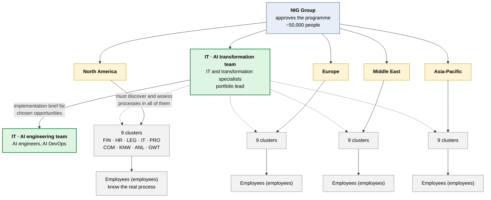
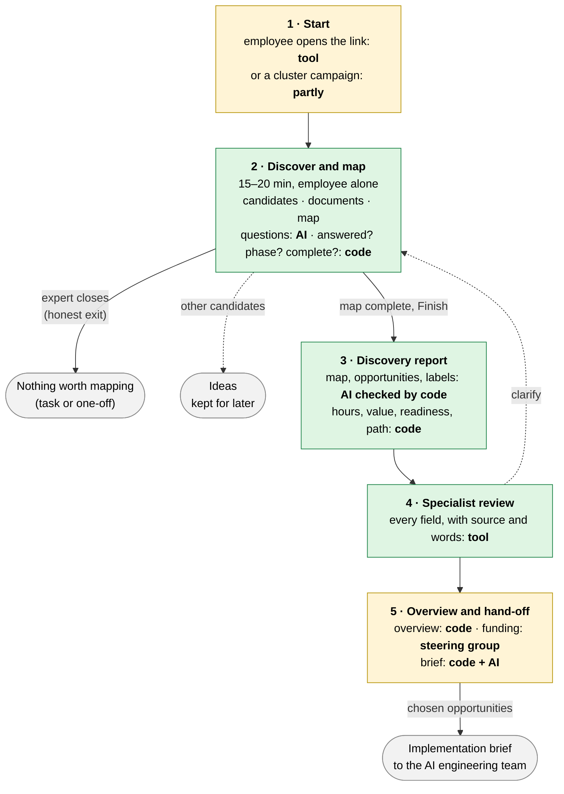
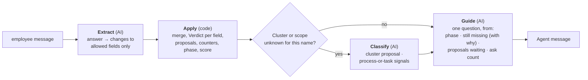

# Selected process: finding, mapping and assessing processes for AI

> Interview deliverable. NIG is a fictional company. Every figure marked *assumption* is our estimate, to check with the NIG AI transformation team.
> Brief: the assignment PDF in the git-ignored `brief/` folder.
> The tool: **Discovery Agent** *(working name)*. What it does in detail: [product specification](../../specs/01-product.md). How it is built: [architecture](../../specs/02-architecture.md).
> This document is the source of truth for **why**: the problem, the users, the value and the assumptions. The worked example is the FIN monthly cost review, an earlier candidate use case.

---

## In short

| | |
|---|---|
| **The problem** | NIG wants to become an **agentic enterprise**: work that AI agents can do should be done by them. But it doesn't know **which processes to start with**, which ones make sense to automate, and which are not ready. That knowledge sits with the 50,000 employees who do the work, not with the central team that must decide |
| **Workflow** | Finding AI automation candidates in NIG's daily work, mapping them, and assessing their **transformation potential**. The brief names it as NIG's first need: "rapidly identify and validate high-value operational use cases". Cluster: **IT · IT and Security** |
| **Users** | **The employee** who owns or knows a process (the process expert) is the main user: the tool helps them discover which processes in their routine are worth mapping, map one, and see its transformation potential and how to realise it. IT and transformation specialists review the reports and see all of them in one overview. AI engineers and AI DevOps receive an implementation brief for the opportunities chosen for a build |
| **Pain today** | Discovery runs through central workshops: about **28 person-hours and 2–3 weeks per process**, booked weeks ahead, profiles that can't be compared. The programme reaches about 150–200 processes a year, chosen by who is nearest, not by value. Employees who see a good candidate in their own work have no easy way to raise it |
| **With the tool** | A 15–20 minute guided conversation helps the employee spot candidate processes in their week, map one step by step (starting from documents they already have, if they want), and get a **discovery report**: the mapped process plus an AI transformation assessment: hours a year, where automation or AI fits and how, what to prepare first. Code checks every answer and makes every number; the tool guides, it never gives a go / no-go. About **5 person-hours per process**. IT gets one overview of every mapped process; chosen opportunities leave with an implementation brief |
| **Value** (base case, 400 processes a year) | **€0.46M a year conservative, €0.69M expected**, for about €0.1M to build and €35k a year to run. **Payback in about 3 months.** Not counted: AI builds on unready workflows avoided, worth €150–250k each |
| **Why not buy** | Process mining needs clean system logs that NIG's fragmented systems don't have. Task mining needs agents on every desktop. Questionnaires and chat assistants don't produce comparable, checked profiles. We buy the commodity parts and build only the interview core (section 2.1.3) |
| **Why people would trust it** | The employee sees the profile fill up live and confirms it; anything the AI reads from a document counts only after they confirm it. Every field shows its source and the employee's own words. Code, not the model, decides what counts as answered and when the map is complete (section 2.3.6) |

---

## Terms used in this document

| Term | Meaning |
|---|---|
| **Programme** | NIG's multi-year Agentic Operations Programme. It decides which workflows get AI, and funds them. |
| **AI transformation team** | The small team in IT that runs discovery for the programme: IT and transformation specialists (business process mapping) and a portfolio lead. |
| **AI engineering team** | AI engineers and AI DevOps in IT. They build and run the AI applications. They receive the implementation brief. |
| **Process** | Work that repeats, involves more than one person, and has a clear start and end. Example: the monthly cost review. |
| **Task** | One person's one-off or private activity. Example: "I file one purchase request a week." Not worth a profile on its own. |
| **Employee** | The main user. The person who does the work and knows how it really runs. In consulting language, the subject-matter expert. |
| **Agentic enterprise** | A company where AI agents do the routine parts of processes, and people direct, check and decide. |
| **Transformation potential** | How much a process would gain from automation and AI, and what it takes. Calculated by code: **value** (hours a year, and the hours and euros the opportunities could free) plus a **readiness checklist** (section 2.3.7). |
| **Discovery** | Finding out how a process really runs today: steps, people, systems, time, pain. |
| **Baseline** | The documented "how it runs today" of a workflow: steps, roles, systems, data, volume and time. It is also the "before" number against which an AI application is later measured. |
| **Readiness checklist** | Six dimensions (defined, standard, data, systems, rules, risk and size), each rated *high*, *medium* or *low* by code from the profile, with what to prepare. A guide, not a verdict (section 2.3.7). |
| **Implementation brief** | The hand-off for opportunities chosen for a build: scope, steps, data in and out, systems, rules and exceptions, what to prepare, the baseline, and acceptance criteria. The AI engineer's starting spec. |
| **Discovery report** | The output of one mapped process: a summary of the process (map and steps) and the AI transformation assessment (opportunities and how to realise them, value, readiness checklist, suggested path). The same structure for every process. |
| **Profile** | The structured description of one process that discovery produces. It has a fixed set of fields. |
| **Field** | One slot in the profile, such as *trigger*, *volume* or *systems used in step 3*. |
| **Sub-step** | One of the 2–6 main steps of a process. Each sub-step has its own fields. |
| **Verdict** | Code's judgement on one field: *complete*, *partial* or *invalid*. Only *complete* counts. |
| **Quality score** | The weighted share of profile fields that are complete. |
| **Map complete** | The rule that must pass before the employee can finish: score ≥ 80%, all steps described, roles and systems confirmed by the employee. It is about the quality of the map, never about the worth of the process. |
| **Proposal** | A value the AI read from an uploaded document, with the quote. It counts only after the employee confirms it. |
| **Idea** | A candidate process the employee mentioned but did not map yet; kept for later. |
| **Opportunity** | A concrete change to the process: which step, what kind of change (for example *workflow*, *document AI* or *AI agent*), what it would look like, what to prepare, and the employee's words that support it. |
| **Process overview** | All mapped processes in one view, with value and readiness, across clusters and regions. NIG's process baseline. It informs the people who decide; the tool itself never ranks a process in or out. |
| **Cluster** | One of NIG's nine operational areas: FIN, HR, LEG, IT, PRO, COM, KNW, ANL, GWT. |
| **Conservative / expected** | Conservative: 50% of the possible saving is realised. Expected: 75%. Higher than for a tool end users adopt by choice, because the AI transformation team owns this workflow and decides how it runs (section 2.1.6). |
| **ROI score** | The framework's 1–5 score for return on investment. |

---

## 1. Context

### 1.1 What NIG is

NorthStar Infrastructure Group (NIG) is a fictional global engineering, construction and operations company. It has about **50,000 employees** in North America, Europe, the Middle East and Asia-Pacific. It designs, builds and runs infrastructure: water plants, roads, rail, buildings and energy.

NIG grew through acquisitions and regional expansion. Because of this, each part of the group works in its own way. Finance, HR, Procurement, Legal, Sales and Operations often use different systems, approval steps, reporting lines and local workarounds.

Earlier transformation programmes struggled. The brief names five reasons: **fragmented data, inconsistent processes, regulatory requirements, local business needs, and resistance to change.**

### 1.2 How NIG is structured, and where the programme sits

- **Group:** sets the overall strategy. It approved the Agentic Operations Programme.
- **IT, with its AI transformation team and AI engineering team:** IT runs the programme's platform. *Assumption:* a small **AI transformation team** of about 4–8 IT and transformation specialists and one portfolio lead maps processes and qualifies use cases, and an **AI engineering team** (AI engineers, AI DevOps) builds them. The brief does not give sizes.
- **Four regions:** North America, Europe, the Middle East and Asia-Pacific. Each runs its own business, systems and approval steps.
- **Nine operational clusters:** FIN (Finance), HR (People and HR), LEG (Legal), IT (IT and Security), PRO (Procurement), COM (Comms and Growth), KNW (Knowledge and Ops), ANL (Analytics and Strategy), GWT (Sales and Marketing). Each cluster exists in each region, so there are about **36 cluster-region teams** *(assumption)*.
- **Employees:** the people who do the work. They know where the time goes, but nobody has written it down in a comparable way.

*Green boxes: the two IT teams. Today the transformation team maps processes by hand, and the engineering team re-discovers the details again before it builds.*

### 1.3 What the brief asks for

| Requirement | What it means for us |
|---|---|
| "NIG wants to rapidly identify and validate high-value operational use cases" | This is the workflow we pick: finding candidate processes with the employees who run them, mapping them, assessing their transformation potential, and handing the best to engineering |
| Build a working prototype | A running app with mock data, not a slide deck |
| Pick one workflow from any cluster | We pick **IT · IT and Security**: IT's own workflow for mapping processes and feeding its AI engineers (section 2.1.4) |
| Not invoice processing, CV screening, contract review, ticket routing, knowledge chatbots or lead qualification | The tool interviews people to fill a fixed form. It does not answer questions from documents (section 2.1.4, Q2) |
| "Not another generic assistant" | A fixed form, a fixed interview, a completeness rule held by code, fixed outputs. The user cannot ask it anything else |
| Mock data is fine, but it must show the hard parts | Simulated employees who are vague, describe a task instead of a process, give 13 steps, change language, or contradict themselves |
| Show the value and a realistic path to production | Specialist time saved, more processes reached, better funding decisions. Staged rollout by cluster |
| Deliver a technical design, an executive summary and a 5–10 minute demo | With the prototype |
| Name three assumptions and three kill metrics | How we decide to stop the project |

The brief stresses budget, engineering capacity, regulatory duties, stakeholder alignment and business continuity. This tool fits those limits well: it **needs no system integration** to start, it **touches no system of record**, and it **involves employees from the first day**, which works against resistance to change.

---

## 2. Selected process: finding, mapping and assessing processes for AI

### 2.1 Why this process

**The problem.** NIG, like most large companies, wants to become an **agentic enterprise**: AI agents doing the routine parts of its processes, people directing and deciding. The first question is not technical. It is **"which processes first?"** Which ones make sense to automate, which are worth it, and which are not ready yet. Get this wrong and the programme repeats what leadership already lived through: "AI hype" and "impressive demos that never survived contact with real operations". Most of those failures start here: a use case chosen on a hunch, described by the wrong person, never measured, or handed to engineers before the process itself was clear. AI cannot fix a process that nobody has defined.

**Where the answer sits.** The people who know where the time goes, which steps are repetitive and which decisions follow fixed rules are the **employees who do the work**. There are 50,000 of them. The central team that must decide has a few specialists. Today the two meet only in workshops, so the programme sees only the processes it has time to ask about.

**The idea.** Turn it around. Let **any employee** find a candidate in their own work, with a tool that asks the right questions, maps the process with them, and shows its transformation potential. The central team then reviews, compares and prioritises, instead of interviewing.

**Who owns it, and why IT.** The work sits between business process mapping and IT. We place it in **IT**, because IT runs the programme's platform, owns the AI engineering team that will build the applications, and is the one team that sees every cluster's systems. The specialists who review the reports work for IT, alongside the business. The outputs serve three groups: the employee (what their process could gain, and how), IT (one overview of every mapped process) and IT's engineers (an implementation brief for the opportunities chosen for a build).

Today the AI transformation team does discovery by hand. A specialist books a workshop with a team, interviews two or three people for an hour or two, writes up notes, draws the process in Visio, sends it back for corrections, estimates volume and hours in Excel, and scores the idea. That takes **about 20 specialist hours and 8 employee hours per process**, spread over **2–3 weeks** *(assumption: two workshops of about 2 hours with 2–3 employees, plus write-up, validation and the value estimate; consultancies typically quote 2–4 days per process for as-is discovery and a business case)*. With 6 specialists who spend part of their time on discovery, the programme can profile about **150–200 processes a year**. NIG has hundreds of candidates in 36 cluster-region teams. Then, for each workflow it builds, the AI engineering team spends **about 60 more hours re-discovering the details** it needs and that the workshop notes don't hold: the data in and out of each step, the systems and their access, the rules, the exceptions, what "done" means *(assumption: about 1.5 engineer-weeks of requirements work per build)*.

We chose this process for six reasons:

- **The brief asks for it.** "Rapidly identify and validate high-value operational use cases" is the programme's first need.
- **It is common.** Every company with an AI or transformation programme must baseline its processes and decide what to build first. Most do it with workshops and spreadsheets.
- **It is manual and slow.** Interviews, notes, diagrams, spreadsheets and email loops.
- **It is easy to explain.** "Any employee can find a process in their work that AI could take over, map it in 15 minutes, and see its potential, and how to get there. IT sees all of them in one overview."
- **It is measurable.** Hours per profile, profiles per month, share of profiles that survive specialist review, engineering hours before the first build, and later, how many funded use cases deliver against their baseline.
- **It serves every other cluster.** One tool, used by FIN, HR, PRO, IT and the rest. The build cost is paid once.

#### 2.1.1 Why it is a mess today

The work has three parts, and all three are messy.

- **Collecting (finding and mapping):** spotting which of the work is a real candidate, and getting a clear, complete description of it out of the people who do it.
- **Judging (readiness and value):** deciding whether the workflow is defined well enough for AI, whether it is worth it, and comparing it with all the others.
- **Handing over:** giving the AI engineers what they need to build.

The mess has seven sources:

1. **The bottleneck is specialist time.** Every profile needs a specialist in a workshop. The programme can only reach the teams it has time for, usually the loudest or the nearest, not the ones with the most value. An employee who sees a good candidate in their own work has no easy way to raise it.
2. **Every profile looks different.** Each specialist asks different questions and writes up in a different format. A FIN profile from Europe cannot be compared with a PRO profile from Asia-Pacific. Volume is "a lot" in one and "400 a month" in another.
3. **People describe tasks, not processes.** An employee says "I chase late timesheets". Is that a process with five people and two systems, or one person's Monday morning? A specialist must dig to find out, and often doesn't.
4. **Key facts go missing.** Volume, time per run, who approves and what goes wrong are often skipped in a workshop. They are exactly what the value estimate needs. The specialist finds the gap only when writing up, then has to email and wait.
5. **The judgement is not traceable.** The score sits in a spreadsheet. Six months later, nobody can say which statement from which person the "high value" came from.
6. **Nobody checks readiness.** A workflow can be painful and high-volume but still not ready for AI: every region does it differently, nobody owns it, the inputs are paper or phone calls, or the key decision is pure judgement. Today this is found out by the engineers, weeks into a build.
7. **The handoff loses the detail.** The engineers get a Visio and some notes. They book their own workshops with the same employees to find the data, the systems, the rules and the exceptions. The employee is asked the same questions twice.

**Result:** about 20 specialist hours and 8 employee hours per profile, 2–3 weeks of calendar time, profiles that can't be compared, a portfolio built from whoever got a workshop, and about 60 more engineering hours per build to re-discover the detail. Weak use cases get funded, builds start on undefined workflows, and strong ones are never found.

#### 2.1.2 Why AI could help, and where it must not be used

**AI can help with conversation and text:**

- reading what the employee says in their own words, and writing it into the right profile field;
- asking the next question in plain language, and asking again in different words when the answer is half there;
- proposing which cluster the process belongs to;
- judging, against a fixed rubric, whether the work described is a process or only a task;
- labelling each step's inputs (for example "scanned PDF", "SAP export", "phone call") and each decision as a fixed rule or a judgement call, which code then uses for the readiness checklist;
- reading documents the employee already has (a procedure, a process map, an example output) and proposing profile values, each with its quote, for the employee to confirm;
- describing, for each opportunity, what would change and what to prepare first;
- drafting the plain-language parts of the implementation brief from the confirmed profile;
- proposing automation opportunities, each tied to the employee's own quote.

**AI must not:**

- decide whether a field counts as answered. Code decides, from a rule on the field;
- decide the interview phase, the score or whether the map is complete. Code decides;
- rate readiness. Code rates each dimension from the confirmed fields; the model only labels words, with quotes;
- count anything read from a document before the employee confirms it;
- say whether a process should or should not be automated. The tool shows potential and the path to it; people decide;
- produce any number. Hours a year, value and scores come from tested code;
- state an opportunity that has no quote from the interview;
- approve a use case or fund it. People decide.

**Why not only a form?** A static form (Microsoft Forms, a survey) gets short, vague answers and cannot follow up. "Volume: a lot" stays "a lot". A form cannot tell a task from a process, cannot ask "and who approves that?" on step 3, and cannot help a person group 13 steps into 6.

**Why not a general chat assistant?** Someone could ask a chat assistant to "interview me about my process". It would have a good conversation once. It would not produce the same fields for 400 processes, would not hold a completeness rule, would not stop asking after the third try, and would leave no overview or audit trail. The value is the fixed form and the rules around it, not the chat.

**The limit:** the profile is only as good as what the employee knows and says. The tool does not observe the real work. We test this (section 2.1.8, weak points 3 and 6).

#### 2.1.3 Why existing tools do not solve it

NIG could buy several kinds of tool. Each solves part of the problem. None turns "what do our people actually do" into **comparable, checked baselines across 9 clusters and 4 regions, with a transformation assessment and a brief an engineer can build from, without first connecting NIG's systems**.

| Kind of tool | Examples *(to verify in the buy-versus-build review)* | What it does well | Why it does not solve NIG's problem | How we use it instead |
|---|---|---|---|---|
| **Process mining** | Celonis, SAP Signavio Process Intelligence, Microsoft Power Automate Process Mining | Shows the real flow from system event logs, at large scale | Needs clean event logs from a few systems. NIG's work runs across fragmented regional systems, email and Excel. Connecting them is the "six months of data engineering" the brief rules out. It sees only what is logged: not the approval by email, not the pain | Later, for the few qualified processes that run mostly in one system (for example SAP purchasing), to confirm the volume |
| **Task mining** | Celonis Task Mining, UiPath Task Mining, Skan | Records what people do on their desktop | An agent on every desktop. Privacy and works-council approval in Europe, months to roll out, and it sees clicks, not why or who decides | Not planned |
| **Process modelling (BPM)** | SAP Signavio Process Manager, ARIS, Bizagi, Nintex Promapp | Store, govern and publish process maps | Someone still has to interview and draw. They are where maps are kept, not how they are found | We export BPMN, so profiles can go into NIG's BPM tool if it has one |
| **Automation pipeline and idea intake** | UiPath Automation Hub, ServiceNow idea portals | Collect ideas, ask a fixed questionnaire, rank a pipeline | The closest alternative. But a static questionnaire takes whatever is typed ("volume: a lot"). It has no follow-up, no check that an answer is complete, and no process-or-task test. It is often tied to one vendor's automation product, so it leans towards that product | If NIG already owns one, our profiles can feed it. The guided interview is the part it lacks |
| **Surveys** | Microsoft Forms, Qualtrics | Cheap, reach everyone | Short, vague answers, no follow-up, no detail per step | — |
| **General AI assistants** | Microsoft 365 Copilot, ChatGPT, Claude | Good conversation, already available | Every chat is different: no fixed fields, no completeness rule, no limit on repeated questions, no overview, no audit trail. 400 chats give 400 different documents | The model inside our tool (through Azure OpenAI) |
| **Consultants** | Process and strategy consultancies | Experienced, structured | Expensive *(assumption: €1,200–1,800 per consultant day)*, weeks per wave, and the knowledge leaves with them | Keep for the 10–20% of complex processes that cross many teams |

*A few start-ups now offer AI interviews for process discovery. We have not assessed them. They are the first thing to check in the buy-versus-build review (technical design).*

**Could a user get 80% of the value by pasting into a chat?** No. One person can have a good conversation with a chat assistant about their process. The programme needs **400 profiles with the same fields, the same rules for "answered", readiness and value calculated the same way, one overview, and implementation briefs in one format the engineers know**. That consistency is the product, and a chat session does not give it.

**What we buy and what we build:**

| Buy (commodity) | Build (what makes it work, and what is NIG-specific) |
|---|---|
| The language model (Azure OpenAI) | The field registry and the rule for "answered" on each field |
| Hosting, database, monitoring (sign-in with Entra ID in production) | The interview logic: phases, limits, the completeness rule |
| BPMN as the exchange format to BPM tools | NIG's cluster taxonomy, the selection framework, the readiness rules, the rate card |
| PDF, Excel and document-reading libraries | The value calculator, the readiness checklist, the discovery report, the implementation brief and the overview |

The build is small: about 3,000 lines for the interview core, built on plain, well-known parts (a web API, a document database, a hosted language model).

#### 2.1.4 Fit with the brief

**Q1. Does the workflow come from one of the operational clusters?**
Yes. It sits in **IT · IT and Security**. It is IT's own workflow: IT's specialists map how knowledge workers in every cluster work, assess their transformation potential, and pass the chosen opportunities to IT's AI engineers. *Alternatives: KNW · Knowledge and Ops, because the method is business process mapping, or ANL · Analytics and Strategy, because the portfolio feeds strategy. We pick IT because IT owns the platform, the engineers who receive the output, and the systems the workflows run on. The choice does not change the design.*

**Q2. Is it on the excluded list?**
No. It is not a **knowledge chatbot**: it does not answer questions from a knowledge base, and the user cannot ask it anything. It asks the questions, from a fixed list, to fill a fixed form. It is not **ticket routing** or **lead qualification**: it does not route requests or score sales leads. Its users map and assess their own internal processes.

**Q3. Is it a specific, painful workflow with a clear user?**
Yes. The main user is the employee, who finds and maps a candidate in their own work. The IT and transformation specialists own the workflow and prioritise. The AI engineers use the output. The pain is about 28 person-hours and 2–3 weeks per profile, profiles that can't be compared, and about 60 engineering hours per build spent asking the same employees again.

**Q4. Can we build a working prototype without a long data project?**
Yes. The input is a conversation. No system integration and no historical data are needed. The prototype uses simulated employees.

**Q5. Does the prototype show the hard parts?**
Yes, on purpose. The simulated employees include people who are vague, describe a task instead of a process, give 13 steps, refuse to give numbers, switch language, contradict themselves, or describe a one-off project.

**Q6. Do people stay in control?**
Yes. The employee confirms every value read from a document, and the roles and systems, before the map is complete. The specialist reviews every field and every opportunity, and can correct them. The programme's steering group decides what is funded, outside the tool. The AI engineer accepts the implementation brief or sends it back. The AI never decides that a field is answered, that a profile is ready, or that a workflow is ready for AI.

**Q7. Is there clear value and a realistic path to production?**
Yes. About €0.46M a year conservative at the base case, with payback in about 3 months (section 2.1.6). A further value, builds on unready workflows avoided, is not counted. The path is one cluster in one region first, then all clusters. No integration work is needed per region.

**Q8. Can we measure it, and stop it if it fails?**
Yes. We measure the minutes per interview, the share of interviews that reach a complete map, the share of reports the specialist validates without major edits, the share of implementation briefs the engineers accept, and the field accuracy against simulated ground truth. The kill test is part of the next deliverable.

#### 2.1.5 Who uses the tool, and how much

The unit we count is the **profiled process**: one process, discovered, mapped and assessed once. We don't know NIG's real counts, so this section uses three scenarios: **Low**, **Mid** (the base case) and **High**. All counts are *assumptions*.

**How we size the number of processes:** 36 cluster-region teams × 5–30 candidate processes each = about 180 to 1,000 candidates in the first year.

**Who uses it**

| Role | What they do | Login? | Low | Mid | High |
|---|---|---|---|---|---|
| **Employee (the main user)** | Finds candidates in their own work, maps one in the interview (optionally from documents), reads the discovery report, follows its status | No account in the prototype; single sign-on in production | 200 | 400 | 800 |
| **Transformation specialist** | Shares the link with teams, reviews and corrects reports, creates implementation briefs | Yes (workspace) | 4 | 6 | 10 |
| **Cluster lead** (one per cluster, group level) | Shares the link in the cluster, reads the cluster's reports, sponsors use cases | Through a specialist in the prototype (own read-only view later) | 9 | 9 | 9 |
| **Portfolio lead** | Uses the process overview to prepare the steering group | Yes (workspace, specialist access) | 1 | 1 | 2 |
| **Steering group** | Decides what gets funded (outside the tool), from the overview and the reports | Through the portfolio lead (own read-only view later) | 5 | 6 | 8 |
| **AI engineering team** (AI engineers, AI DevOps) | Receives the implementation brief for chosen opportunities. Accepts it or sends it back with questions | Yes (workspace: read, accept or return) | 4 | 8 | 12 |
| **Total named users** | | | **~223** | **~430** | **~841** |

**How much each user uses it**

| Role | Active use | When |
|---|---|---|
| Employee | 15–20 minutes, once per process; a glance at the status later | On their own initiative, or when a cluster lead runs a campaign |
| Transformation specialist | About 4 hours per profile (review, clarification, adjusting opportunities, implementation brief) | Continuously |
| Cluster lead | About 1 hour a month | Before each portfolio review |
| Portfolio lead | About 1 day a month | Before each steering-group meeting |
| Steering group | 30 minutes a month | Steering-group meeting |
| AI engineering team | 1–2 hours to read and accept an implementation brief, then about 20 hours of requirements work instead of 60 | At project start |

**Scenario results**

| | Low | Mid (base case) | High |
|---|---|---|---|
| Processes profiled a year | 200 | 400 | 800 |
| Person-hours a year if done by hand (28 h each; gate: 5,000) | about 5,600 | about 11,200 | about 22,400 |
| Specialist full-time equivalents needed by hand (20 h each, 1,600 h a year) | about 2.5 | about 5 | about 10 |
| Specialist full-time equivalents needed with the tool (4 h each) | about 0.5 | about 1 | about 2 |
| Workflows built a year (funded by the programme) | about 15 | about 25 | about 40 |

**Why 400 is the base case:** 36 cluster-region teams × about 11 candidates each. A multi-year programme across 9 clusters needs a pipeline of this size to choose its top 20–30 use cases a year. Done by hand, 400 profiles a year needs about 5 specialists doing nothing else.

**What this changes:**

- **The tool turns discovery from a staffing problem into a configuration problem.** Without it, the programme must hire or buy about 4 extra specialists to reach 400 profiles, or settle for the 150–200 it can reach.
- **The employee interview has almost no marginal cost.** The tool can reach teams the programme would never send a specialist to. The limit moves from specialist time to employee willingness.
- **One platform serves all nine clusters.** Adding a cluster or region needs no integration, only a translated interview and an invitation list.

#### 2.1.6 Value and ROI

The tool creates value in four ways. We count only the first two in the ROI.

| # | Value | Counted? | Why |
|---|---|---|---|
| 1 | **Baseline capacity:** specialist and employee hours per profile fall from about 28 to about 5 | **Yes** | Measurable in the pilot |
| 2 | **Faster handoff to engineering:** the implementation brief cuts the AI engineers' requirements work from about 60 to about 20 hours per build | **Yes** | Measurable on the first builds |
| 3 | **Reach and speed:** profiles from teams no specialist would visit, in days instead of weeks, so the best use cases start earlier | No | Real, but hard to put a number on before the pilot |
| 4 | **Builds that don't fail on an undefined workflow:** the readiness checklist shows what to prepare before engineers start, and the baseline gives every build a "before" number to prove its benefit | No, shown separately | Cannot be proven before the programme has a track record |

**Basis** (all *assumptions*):

- By hand: about **20 specialist hours + 8 employee hours = 28 hours** per profiled process (section 2.2.4).
- With the tool: about **4 specialist hours + 1 employee hour = 5 hours**. The saving is about **23 hours per process**.
- Handoff: about **60 engineering hours** of requirements work per build by hand, about **20** with the implementation brief. The saving is about **40 hours per build**, on about 25 builds a year at Mid (section 2.1.5).
- **Conservative** adoption: 50% of the possible saving is realised. **Expected**: 75%. This is higher than the framework's default (30% / 50%) for one reason: the users of this workflow are IT's own teams. IT decides that discovery runs through the tool and that builds start from an implementation brief. Some processes will still need a workshop, which the 50% allows for.
- Time is valued at **€90 an hour** (the framework default).

**How hours become money.** Here the freed time has a clear destination, in both streams. The programme needs about 400 profiles a year. By hand, that needs about 5 specialists full time. With the tool, about 1. The difference is **specialists or consultants NIG does not have to hire or buy**: cost avoided, not only time freed. If NIG already pays consultants for discovery, part of it is direct cash. On the engineering side, 40 hours saved per build is about one more workflow built a year for every 6–7 builds, with the same team.

**ROI by scenario:**

| Scenario | Baseline: hours saved, conservative | Handoff: hours saved, conservative | Value, conservative | Value, expected | ROI score (conservative) |
|---|---|---|---|---|---|
| Low (200 profiles, 15 builds) | about 2,300 h (200 × 23 h × 50%) | about 300 h (15 × 40 h × 50%) | about €234k | about €351k | 2 |
| **Mid (400 profiles, 25 builds)** | **about 4,600 h** (400 × 23 h × 50%) | **about 500 h** (25 × 40 h × 50%) | **about €459k** | **about €689k** | **2** (3 at expected) |
| High (800 profiles, 40 builds) | about 9,200 h (800 × 23 h × 50%) | about 800 h (40 × 40 h × 50%) | about €900k | about €1.35M | **3** |

The framework sets the ROI score bands as: below €100k = 1, €100k–500k = 2, €500k–2M = 3.

**Costs** (all *assumptions*, to firm up in the technical design):

| Cost | Amount | Basis |
|---|---|---|
| Prototype | About 1 engineer-week | This case |
| Build to production | **About €100k, once** | About one quarter, 2 engineers (€3k per engineer-week × 26) + language testing and a security review |
| Hosting | About €6k a year (production) | Two or more replicas, database, private networking, monitoring. The prototype runs for about €15–40 a month |
| Model calls | Under €0.50 per interview with a small model (target) | About 40–60 calls per interview. Under €1k a year at Mid |
| Support and upkeep | About €25k a year | About 0.2 of an engineer |
| **Run cost** | **About €35k a year** | |

**Net value and payback (Mid, 400 processes a year):**

| | Conservative | Expected |
|---|---|---|
| Value a year | €459k | €689k |
| Run cost a year | −€35k | −€35k |
| **Net a year** | **about €424k** | **about €654k** |
| **Payback on the €100k build** | **about 3 months** | **about 2 months** |

**Break-even:** the tool pays for its run cost at about 35 profiles a year, and for its build within the first year at about 130 profiles.

**Not counted: builds on unready workflows avoided.** A build that starts on a workflow nobody has defined, and stops after a quarter, costs real money *(assumption: about €150–250k: one quarter of a small team plus run cost)*. If the readiness checklist makes **one** such workflow get prepared first instead of going straight to the engineers each year, that alone is worth €150–250k a year. We show it **separately** and never add it to the ROI, because we cannot prove it before the programme has a track record. It is the first thing to track after the pilot (section 2.1.9, A8).

#### 2.1.7 Framework score

The selection framework (`docs/05-how-we-worked/`) has six gates and six scores. The base case is **Mid** (400 processes a year).

**Gates:**

| Gate | Result | Reason |
|---|---|---|
| 1 Allowed | Pass | Not on the excluded list (section 2.1.4, Q2) |
| 2 Real, frequent pain (≥ 5,000 h a year) | Pass | About 11,200 hours a year by hand at Mid, plus about 1,500 hours of engineering re-discovery. Passes at Low too (about 5,600) |
| 3 No off-the-shelf tool or general assistant does it | Pass | Process mining needs clean logs, task mining needs desktop agents, questionnaires and chat assistants don't give comparable, checked profiles, a transformation assessment or an implementation brief (section 2.1.3) |
| 4 Data exists today | Pass | The data is in people's heads. No data project is needed |
| 5 Measurable | Pass | Minutes per profile, share of interviews that finish, specialist edit rate, field accuracy on simulated employees |
| 6 One-sentence hook | Pass | "Any employee can find a process in their work that AI could take over, map it in 15 minutes, and see its potential, and how to get there. IT sees all of them in one overview." Every company that wants to become an agentic enterprise has this need |

**Scores** (1 = worst, 5 = best):

| Score | Base case (Mid) | Reason |
|---|---|---|
| ROI | **3** at expected, 2 at conservative | €654k net a year expected, €424k conservative (section 2.1.6). Avoided failed builds not counted |
| Scalability | 5 | Any cluster or region by configuration. No integration per region. The main cost per region is testing the interview in its language |
| Adoption | 4 | IT owns the workflow at both ends: its specialists run it and its engineers use the output. Employees give 15–20 minutes instead of two workshops, and are not asked the same questions again by the engineers. Not yet tested with NIG staff |
| Feasibility | 5 | No source system. Input is a conversation. Plain, well-known building blocks |
| Build and run cost | 4 | About €100k and one quarter to production, about €35k a year to run |
| Risk | 4 | A wrong profile costs specialist time and is caught in review. Nothing is written to a system of record |

**Result (base case, expected adoption):**

- **Value** = (2 × ROI + Scalability + Adoption) ÷ 4 = (6 + 5 + 4) ÷ 4 = **3.75**
- **Ease** = (Feasibility + Build and run + Risk) ÷ 3 = (5 + 4 + 4) ÷ 3 = **4.3**
- **Verdict: GO.**

**Under the strictest reading** (conservative adoption, ROI 2), value is (4 + 5 + 4) ÷ 4 = 3.25, just below the GO line: MAYBE. At €459k it sits just under the €500k band line. Any one of these turns it into GO: 800 processes a year (ROI 3 even at conservative adoption), avoiding one failed build a year, or replacing paid consultant days.

**Conclusion:** cheap to build, nothing to integrate, every cluster served, engineers start from a checked brief, and payback in a few months. The pilot must confirm three numbers before the executive summary claims them: the hours per profile (A3, A4), the share of employees who finish the interview (A5), and the engineering hours saved per build (A13).

#### 2.1.8 Weak points found in our review

| # | Attack | Our answer | Status |
|---|---|---|---|
| 1 | A chat assistant can interview someone. | For one person, once: yes. Not 400 people with the same fields, a completeness rule, a limit on repeated questions, a cluster taxonomy, an overview and an audit trail. The form and the rules are the product (section 2.1.3). | Holds |
| 1b | NIG could buy an idea-intake tool (for example UiPath Automation Hub). | It is the closest alternative. Its static questionnaire has no follow-up and no check on answers, and it leans towards one vendor's automation. If NIG owns one, our profiles feed it. | Holds; check what NIG owns |
| 2 | This is a meta-tool. It doesn't automate an operational workflow. | It automates IT's own operational workflow, process mapping and handoff, which the brief names first ("identify and validate use cases"). The demo shows it profiling a real FIN workflow end to end, through to an implementation brief. | Holds; must be shown in the demo |
| 3 | Employees don't know their own numbers. | Often true. The tool accepts a range or "not sure", marks the field partial, and the specialist sees it. After three tries it stops asking. Documents the employee uploads can fill numbers they do not remember, once confirmed. | Holds; to test |
| 4 | Employees won't start an interview on their own. | Possible. It takes 15–20 minutes, gives them something back at once (the discovery report) and a status they can follow. Cluster leads can also run campaigns. We measure how many start on their own and how many finish. | To test (kill metric) |
| 5 | Process-mining tools already do discovery. | Only from clean event logs in a few systems. NIG's data is fragmented, and most of the work is in email and Excel. Process mining can come later for the processes that pass. | Holds |
| 6 | People describe the ideal process, not the real one. | True for any interview, also for today's workshops. Uploaded documents and the specialist review reduce it. We do not claim to remove it. | Accepted |
| 7 | The AI will invent facts in the profile. | The extractor may only write to allowed fields. Opportunities and labels need the employee's words, checked by code. Document values count only after the employee confirms them, and the employee confirms the roles and systems. | Holds; to test with the evaluation set |
| 8 | Different languages and cultures across four regions. | The model works in many languages. The profile keeps the employee's own words in their language. Prompts must be tested per language; translated reports are a production item. | Open |
| 9 | Interviews about "what takes your time" feel like performance monitoring. Works councils in Europe may object. | The tool profiles processes, not people. No individual's time is reported. This must be agreed with HR and works councils before rollout. | Open; a production-readiness item |
| 10 | There is no baseline for today's discovery effort. | True. We time the next five manual profiles before the pilot. | Open |
| 11 | The 28 hours by hand may be too high. | Possible. If it is 18 hours, the conservative value at Mid falls to about €279k a year, and payback is still about 5 months. The case holds at ROI score 2. | To measure (A3) |
| 12 | A readiness rating from an interview can be wrong. The employee may not know what data the step really uses. | True. The checklist is a guide, not a verdict. The specialist can correct the profile and add notes, and the AI engineer can send the brief back. We track how many briefs engineers return. | To test (A14) |
| 13 | Engineers will redo the requirements anyway. | Some will, for the parts the brief can't hold (API details, access rights). The brief is written in the format the engineering team chose, and its acceptance rate is a pilot metric. | To test (A13) |

**What the review changed:** the ROI now counts the manual effort fully (employees in two workshops) and the engineering re-discovery saved by the implementation brief, sets adoption from who owns the workflow, and includes build and run cost and payback. A clear section on why existing tools fall short (section 2.1.3). Two further values, reach and decision quality, are named but not counted. The demo must show the tool working on a real operational workflow, not on an abstract example.

#### 2.1.9 Assumptions to check with NIG

| # | Assumption | Value used | How we check it |
|---|---|---|---|
| A1 | Programme specialists | 4–8 | Ask the AI transformation team |
| A2 | Processes profiled a year (Low / Mid / High) | 200 / 400 / 800 | Count the candidate list with each cluster lead |
| A3 | Hours per manual profile | 20 specialist + 8 employee | Time the next five manual profiles |
| A4 | Hours per profile with the tool | 4 specialist + 1 employee | Pilot: 20 interviews in one cluster |
| A5 | Adoption (conservative / expected) | 50% / 75% | Pilot: share of invited employees who complete the map, and share of profiles that need no workshop |
| A6 | Value of an hour | €90 | NIG finance rate |
| A7 | Reports the specialist validates without major edits | At least 70% | Pilot: specialist validates each report and records whether it needed major edits |
| A8 | Failed builds avoided a year thanks to the readiness checklist | At least 1 (€150–250k each). Not in the ROI | Track funded use cases against their profiles for 2–3 quarters |
| A9 | Interviews work in the main NIG languages | English, German, French, Spanish, Arabic | Run the simulated employees in each language |
| A10 | HR and works councils accept process interviews | Yes, with no personal reporting | Ask HR in one European region before the pilot |
| A11 | Build and run cost | €100k once, €35k a year | Technical design estimate; confirm with NIG's platform team |
| A12 | NIG pays consultants for discovery today | Unknown | Ask the AI transformation team. If yes, part of the saving is cash |
| A13 | Engineering requirements hours per build, by hand and with the brief | 60 h and 20 h; 15 / 25 / 40 builds a year | Ask the AI engineering team for its last three builds; measure the first builds from a brief |
| A14 | Implementation briefs that engineers accept without a new workshop | At least 80% | Pilot: engineers mark each brief accepted or returned, with a reason |

---

### 2.2 As-is process

**Who does it:** an IT or transformation specialist in the AI transformation team, with two or three employees from the team that owns the process. After funding, an AI engineer from the AI engineering team.

**Goal:** for each candidate workflow, know how it really runs (the baseline), how big it is, where it hurts, whether it is ready for AI and worth automating, in a form the steering group can compare with all other candidates. For the funded ones, give the engineers what they need to build.

#### 2.2.1 What the specialist does, in plain words

1. **Collect** candidate ideas from cluster leads, emails and workshops.
2. **Prepare** an interview: find the right employees, book a slot, send a questionnaire.
3. **Interview** the employees in a workshop of 1–2 hours.
4. **Write up** the notes and draw the as-is process.
5. **Validate** the write-up with the employees, by email, and correct it.
6. **Estimate** the volume, the hours and the value in Excel. Chase missing numbers.
7. **Score** the idea against the selection framework.
8. **Rank** it in the portfolio and prepare the steering-group pack.
9. **Hand over** the funded use cases to the AI engineering team, who then hold their own workshops with the same employees to find the data, systems, rules and exceptions they need (about 60 engineering hours per build).

#### 2.2.2 Inputs

| Input | Format and content | Why it is needed |
|---|---|---|
| **Candidate list** | Excel or email: idea name, team, who suggested it. Often one line per idea | Decides who to interview |
| **Employee knowledge** | In people's heads. Partly in local process documents, if they exist | The real process |
| **Local process documents** | Word, Visio, PowerPoint. Often old, often the ideal process | A starting point for the interview |
| **Sample work items** | Emails, exports, forms that show the process running | Evidence for volume and steps. Rarely collected |
| **Selection framework** | Excel scoring sheet | Scores the idea |
| **Rate card** | €/hour by role | Turns hours into money |

#### 2.2.3 Documents the specialist produces

| Document | Format | Content | Who reads it |
|---|---|---|---|
| **Interview notes** | Word or OneNote | Free text. Different per specialist | Specialist |
| **As-is process map** | Visio or PowerPoint | Steps, roles, systems. Different level of detail per specialist | Specialist, employee, AI engineering team |
| **Value estimate** | Excel | Volume, hours, value. Often with gaps | Specialist, portfolio lead |
| **Score sheet** | Excel | Gates, scores, verdict | Portfolio lead |
| **Portfolio list** | Excel or PowerPoint | All candidates, ranked | Steering group |
| **Steering-group pack** | PowerPoint | Top candidates, one slide each | Steering group |

#### 2.2.4 Step by step

| | **Step 1** | **Step 2** | **Step 3** | **Step 4** | **Step 5** | **Step 6** | **Step 7** | **Step 8** | **Step 9** |
|---|---|---|---|---|---|---|---|---|---|
| **Name** | Collect candidates | Prepare | Interview | Write up | Validate | Estimate | Score | Rank | Hand over |
| **Owner** | Specialist; cluster leads suggest | Specialist | Specialist; 2–3 employees | Specialist | Specialist; employees correct | Specialist; employees give numbers | Specialist | Portfolio lead | Portfolio lead; AI engineering team |
| **Description** | Gather ideas from leads, emails and past workshops | Find the employees, book the slot, send questions | Ask about trigger, steps, people, systems, volume, time, pain | Turn notes into a description and a map | Send the write-up back. Merge corrections | Fill volume and hours. Chase missing numbers | Apply the gates and scores | Compare with all others. Build the pack | Brief the AI engineering team. Engineers re-interview employees for the detail |
| **Tools** | Email, Excel | Outlook, Teams | Teams or a room, notebook | Word, Visio | Email | Excel, email | Excel | Excel, PowerPoint | Meetings, PowerPoint |
| **Specialist time** *(assumption)* | 0.5 h | 1.5 h | 4 h (two workshops) | 5 h | 2 h | 3.5 h | 2 h | 1 h | 0.5 h (+ about 60 engineer h per build) |
| **Employee time** *(assumption)* | — | — | 6 h (2–3 employees × two workshops) | — | 1 h | 1 h | — | — | Asked again by the engineers |
| **Output** | Candidate list | Booked interview | Notes | Description and map | Validated description | Value estimate | Score sheet | Portfolio and pack | Brief |

*Timing: about 20 specialist hours and 8 employee hours per process, over 2–3 weeks of calendar time, plus about 60 engineering hours for each workflow that is built. Most of the calendar time is waiting: booking slots and waiting for corrections and numbers (assumption).*

#### 2.2.5 Example (fictional)

The FIN cluster lead in Europe suggests "monthly cost review" as a candidate. A specialist books a 90-minute workshop with two cost controllers, three weeks later. In the workshop, the specialists talk mostly about the pain: "we spend days in pivot tables" and "we email site managers and wait". The specialist writes up nine steps. Volume and hours are missing, so they email the next day. The answer arrives a week later: "about 28 hours per business unit per month, 30 units". Nobody asked who approves the summary or what goes wrong when the plan version is wrong. The idea scores well in Excel. A different specialist profiled a similar review in North America, with seven steps and no hours. The two cannot be compared, so the steering group sees two separate ideas instead of one use case for 34 review units. When the European one is funded, an AI engineer books two more workshops with the same cost controllers to learn which SAP export they use, which plan version, and who signs off. Only then does it turn out that each site sends its numbers in a different spreadsheet layout: the workflow was not ready to build, and the first month goes on standardising it.

---

### 2.3 To-be process

**The idea in one line:** any employee opens the tool from a link and, in a 15–20 minute guided conversation, discovers which processes in their routine are worth mapping, maps one step by step (starting from documents they already have, if they want), and gets a **discovery report**: the mapped process and its transformation assessment: hours a year, where automation or AI fits and how, what to prepare first. Code checks every answer and makes every number. The tool guides; it never says go or no-go. IT reviews instead of interviewing, every report lands in one overview, and the opportunities chosen for a build go to the AI engineers as an implementation brief. People decide.

**How to read the tables below:**

- **Tool used?** **Yes**: the work happens in the app. **Partly**: the app supports it, part happens outside. **No**: outside the app.
- **Done by:** **Code** (rules, no AI), **AI** (the model reads or writes text, under code's rules), or a **person** (role named).
- **Screen:** 0 My processes, 1 Interview, 2 Discovery report, 3 Review, 4 Overview, 5 Implementation brief.

> **Prototype scope:** the prototype builds the MVP features of the [product specification](../../specs/01-product.md#6-features). Invitation campaigns (1.2) and a read-only view for the steering group come later.

#### 2.3.1 What the tool is

A **guided interview with a fixed form behind it**, which can also read the employee's documents, plus a workspace for the AI transformation team.

- **For the employee:** a chat on the left, the profile filling up on the right, a progress meter, an *Add a document* button, and a *Finish* button that unlocks only when the map is complete. The employee cannot ask the tool questions; the tool asks, one at a time. Anything the AI reads from a document appears as a proposal, with its quote, until the employee confirms it. At the end the employee gets the **discovery report**, on screen and as a PDF. Candidates they mentioned but did not map stay on "My processes" as **ideas** for later.
- **For the specialist:** a review screen per report (every field with its status, source and the employee's words), the process map, the opportunities to accept or adjust, value with its formula, the readiness checklist; and the **process overview** across clusters and regions.
- **For the AI engineer:** implementation briefs for the opportunities chosen for a build, to accept or send back with questions.

**It is not a chatbot.** It does not answer questions and does not search documents for answers. Under the chat it is a form-filling machine: each turn it reads the answer, writes it into the form, finds the most useful empty or unconfirmed field, and asks one question about it.

**It does not judge.** No result says "not worth it". The report shows potential and the path to it; the programme's steering group decides what to fund, outside the tool.

**Example (fictional).** A cost controller in Europe opens the tool from an intranet post. Asked where her week goes, she mentions chasing site managers, the monthly cost review and booking travel. The agent lists them back; she picks the cost review (repeats every month, five people, two systems); the other two stay as ideas. She uploads the team's procedure document: the agent proposes five steps with roles and systems, she corrects step 3 and confirms the rest, then answers what the document didn't say: volume, time, pain, exceptions. After 15 minutes her report shows about 340 hours a year for her business unit, about 10,000 across the 30 units in Europe, three opportunities (document AI to read the site spreadsheets, an AI assistant to draft the variance summary, a workflow to chase explanations) and one thing to prepare first: *Standard: low, agree one site template*. The North American controllers' version of the same process, with one template, shows the same opportunities and nothing to prepare. The steering group funds the North American one first; the specialist turns its opportunities into an implementation brief.

#### 2.3.2 Sub-steps and when the tool is used

**Step 1 · Start**

| Sub-step | Who | Tool used? | Done by | Screen | Output |
|---|---|---|---|---|---|
| 1.1 Open the tool from a link (intranet, Teams, e-mail), on their own initiative | Any employee | Yes | Person | 0 | New session |
| 1.2 Optionally, run a campaign: send the link to one cluster or region | Cluster lead, specialist | Partly. Link sent by e-mail or Teams | Person | — | Invitations sent |

**Step 2 · Discover and map** (the core: 15–20 minutes)

| Sub-step | Who | Tool used? | Done by | Screen | Output |
|---|---|---|---|---|---|
| 2.1 Context: department, role, region | Employee | Yes | AI asks; code stores | 1 | Context fields |
| 2.2 Discover candidates: where does your time go, what repeats, what involves several people, what follows fixed rules? | Employee | Yes | AI asks and lists the candidates in the employee's words; employee picks one | 1 | Process name; other candidates kept as ideas |
| 2.3 Check: process or task? | System | Yes | AI applies a fixed rubric; code counts the signals | 1 | Scope note, shown to the employee if it looks like a task |
| 2.4 Place it in a cluster | System, employee | Yes | AI proposes; code confirms against the 9 clusters; employee says yes or picks | 1 | Cluster |
| 2.5 Optionally, upload documents: a procedure, a process map, an example output | Employee | Yes | Code extracts the text (a BPMN file is read by code); AI proposes values, each with a quote; code checks the quotes | 1 | Proposals |
| 2.6 Confirm or correct the proposals | Employee | Yes | AI asks in small groups; code reads the yes or the correction | 1 | Confirmed fields |
| 2.7 Measure: trigger, result, who uses it, pain, volume, owner, time today, target, same way everywhere, sensitive data | Employee | Yes | AI asks what is still missing; code judges each field complete, partial or invalid | 1 | Process fields |
| 2.8 Number of main steps (2–6) | Employee | Yes | AI asks; code checks the range and helps group if too many | 1 | Step count |
| 2.9 Walk each step: goal, activities, roles, owner, systems, data in and out, effort, pain, approvals, exceptions | Employee | Yes | AI asks one field at a time; code chooses which | 1 | Step table |
| 2.10 Confirm the roles and the systems | Employee | Yes | Code builds the lists; employee confirms | 1 | Confirmed roll-ups |
| 2.11 Finish (unlocks when the map is complete: score ≥ 80%, steps complete, roles and systems confirmed) | Employee | Yes | Code holds the rule; person presses | 1 | Finished profile |
| 2.12 Exit: "this isn't worth mapping" | Employee | Yes | AI offers; person decides | 1 | Closed session |

**Step 3 · Discovery report** (seconds, at *Finish*)

| Sub-step | Who | Tool used? | Done by | Screen | Output |
|---|---|---|---|---|---|
| 3.1 Draw the process map from the step table | System | Yes | AI proposes; code checks every step, role and type, or draws a simple map | 2 | Process map |
| 3.2 Propose opportunities: what changes, how, what to prepare, with the employee's words | System | Yes | AI proposes; code checks each step and quote | 2 | Opportunities |
| 3.3 Calculate hours a year, cost today, hours and value that could be freed | System | Yes | Code | 2 | Transformation potential |
| 3.4 Rate the readiness checklist and list what to prepare | System | Yes | AI labels inputs and decisions, with quotes; code rates | 2 | Readiness checklist |
| 3.5 Order the path: prepare first, quick wins, bigger changes | System | Yes | Code | 2 | Suggested path |
| 3.6 Read and download the report | Employee | Yes | Person | 2 | Discovery report (screen, PDF) |

**Step 4 · Specialist review**

| Sub-step | Who | Tool used? | Done by | Screen | Output |
|---|---|---|---|---|---|
| 4.1 Review each field: value, status, source, the employee's words | Specialist | Yes | Person | 3 | Reviewed profile |
| 4.2 Correct or fill fields | Specialist | Yes | Person; code re-checks and updates the report | 3 | Corrected profile |
| 4.3 Clarify with the employee, if needed | Specialist, employee | Partly. In the prototype experts are anonymous: open questions go into the report's gaps and the validation note. In production (named sign-in), a short call or message | Person | — | Answer added in 4.2, or an open question in the brief |
| 4.4 Accept, adjust or reject each opportunity and its saving share; add notes to readiness | Specialist | Yes | Person; code recalculates | 3 | Assessed opportunities |
| 4.5 Validate the report, with a note to the employee | Specialist | Yes | Person | 3 | Validated report (a pilot metric) |

**Step 5 · Overview and hand-off**

| Sub-step | Who | Tool used? | Done by | Screen | Output |
|---|---|---|---|---|---|
| 5.1 See all mapped processes by cluster and region, with value and readiness | Specialist, portfolio lead | Yes | Code | 4 | Process overview (NIG's baseline) |
| 5.2 Prepare the steering group and decide what to fund | Portfolio lead, steering group | No. In the meeting | Person | — | Funding decision |
| 5.3 Create the implementation brief for the chosen opportunities | Specialist | Yes | Code assembles; AI drafts goal and acceptance criteria; specialist edits | 5 | Implementation brief (Markdown, JSON, map) |
| 5.4 Accept the brief, or send it back with questions | AI engineer | Yes | Person | 5 | Accepted brief, or questions back (a pilot metric) |
| 5.5 Tell the employee what happened | System | Yes | Code shows the status on "My processes" | 0 | *Mapped → validated → in an implementation brief* |

#### 2.3.3 Process overview: when the tool is used

*Green: in the tool. Yellow: part in the tool, part outside. Grey: endings and hand-offs.*

**Time by step** (to measure in the pilot):

| Step | Today | With the tool |
|---|---|---|
| Collect, prepare and interview | 6 specialist h + 6 employee h, booked weeks ahead | 0 specialist h + 0.5 employee h, any time |
| Write up and map | 5 specialist h | 0 h. The map and the report are built from the step table |
| Validate | 2 specialist h + 1 employee h + a week of waiting | 0 h. The employee confirmed in the interview |
| Estimate | 3.5 specialist h + 1 employee h + chasing numbers | 0.5 specialist h. Numbers asked for in the interview; code calculates |
| Assess and hand over | 3.5 specialist h | 1.5 specialist h. The report holds the assessment; the specialist adjusts and creates the brief |
| Review and clarify (new) | — | 2 specialist h + 0.5 employee h |
| **Total per process** | **20 specialist h + 8 employee h** | **4 specialist h + 1 employee h** |
| Requirements before a build | About 60 engineer h, with new employee workshops | About 20 engineer h, starting from the implementation brief |

#### 2.3.4 Outputs

**Level 1: the discovery report**, the same structure for every process. The employee gets it at *Finish*; the specialist and the engineers use the same report.

| # | Part | Content | Source |
|---|---|---|---|
| — | **Cover** | Process, department, cluster, region, owner role, date, status (*draft*, *validated by IT*) | Code |
| 1 | **At a glance** | Hours a year and cost today; hours and value that could be freed (conservative, expected); top three opportunities; main things to prepare | Code |
| 2 | **The process** | Trigger, result, who uses it, main pain, owner, cluster; a note if it looks like a single task | Interview |
| 3 | **Volume and measures** | Volume, time today, target, same way everywhere, sensitive data; "not measured yet" where missing | Interview |
| 4 | **Process map and steps** | The map, all systems used, the step table | Code, from the step table |
| 5 | **Transformation assessment** | AI summary; per opportunity: what changes, how, what to prepare, impact, feasibility, the employee's words; steps that should stay with people | AI, checked by code |
| 6 | **Transformation potential** | Hours per step, cost today, hours and value freed per opportunity and in total, with the formula | Code |
| 7 | **Readiness checklist** | Six dimensions, level, reason, what to prepare | Code (AI labels, checked) |
| 8 | **Suggested path** | Prepare first → quick wins → bigger changes | Code |
| 9 | **Gaps and sources** | Missing, deferred, skipped or unconfirmed fields; documents used | Code |

**Level 2: the process overview.** All mapped processes in one table and one value-versus-readiness chart, filtered by cluster and region. It is NIG's **process baseline**: how many workflows, how many hours, which systems, in which cluster and region.

**Level 3: the implementation brief**, for the opportunities chosen for a build. The AI engineer's starting spec:

| # | Section | Content |
|---|---|---|
| 1 | **Goal and scope** | What the application should do, for whom, and what is out of scope |
| 2 | **Baseline** | Volume, time today, target, hours a year. The "before" number the build will be measured against |
| 3 | **Steps** | The step table and the map, with the steps the opportunities cover marked |
| 4 | **Data in and out** | Per step: what comes in, in what format, from which system; what goes out |
| 5 | **Systems** | Each system, what the step does in it, and whether IT knows an export or API for it |
| 6 | **Rules and decisions** | Fixed rules, judgement calls, approvals. What a person must keep deciding |
| 7 | **Exceptions** | What goes wrong and how it is handled today |
| 8 | **What to prepare** | From the readiness checklist |
| 9 | **Risk** | Personal or sensitive data, regulation, the human check needed |
| 10 | **Acceptance criteria** | Drafted from the target and the pain: what "it works" means, to agree with the business |
| 11 | **Open questions** | Missing, deferred, skipped or unconfirmed fields, so the engineer asks only these |
| 12 | **Sources** | The process owner role; the employee's words and document quotes behind every claim |

#### 2.3.5 What changes for each role

| | Today | With the tool |
|---|---|---|
| Employee | No easy way to raise an idea. If chosen, two workshops booked weeks ahead, then corrections by e-mail | Discovers and maps a process in 15–20 minutes, when it suits them, reusing documents they have. Gets the report at once, keeps other ideas for later, and follows what happens |
| Specialist | Interviews, writes up, draws, chases numbers | Reviews and completes. About 4 hours per process instead of 20 |
| Portfolio lead | Combines spreadsheets in different formats | One overview, same fields and same assessment for every process |
| Steering group | Ideas from whoever got a workshop | All clusters and regions, comparable, each claim traceable to an employee's words |
| AI engineer, AI DevOps | A Visio and some notes, then their own workshops with the same employees | An implementation brief in one standard format: data, systems, rules, exceptions, what to prepare, baseline and open questions. Only the open questions need a call |

*Time savings are assumptions to test in the pilot (sections 2.1.6 and 2.1.9).*

#### 2.3.6 Why users would trust it

The brief asks "who uses it and why they would trust it". Most users did not ask for this tool, so trust has to be built into how it works.

| User | What they worry about | What the tool does about it |
|---|---|---|
| **Employee** | "Will this be used to judge me?" | It maps processes, not people. No individual's time is reported, and no account is needed to start. Agreed with HR and works councils before rollout |
| **Employee** | "Will it twist what I said, or what my documents say?" | The profile fills up live, next to the chat, in plain words. Anything read from a document is a proposal with its quote until they confirm it. They confirm the roles and systems before finishing. Every field keeps its source |
| **Employee** | "Will it waste my time?" | One question at a time, never the same field more than five times, documents shorten the interview, and an honest exit: "this may not be worth mapping, and that's a fine answer" |
| **Employee** | "Will anything happen with it?" | The report at the end, and a status they can follow, with the specialist's note. Other ideas are kept, not lost |
| **Employee** | "Will AI take my job?" | The report shows which steps could change and which should stay with people, and why. The message from leadership matters more than the tool here (weak point 9) |
| **Specialist** | "Can I rely on the profile?" | Every field shows its status (complete, partial, skipped, unconfirmed) and its source (employee, document, specialist). Nothing is filled silently. The specialist can correct everything |
| **Portfolio lead** | "Are the numbers made up?" | Hours, value and readiness levels come from code, with the formula shown. Every opportunity carries the employee's words, checked by code |
| **Steering group** | "Is this another impressive demo?" | Every claim traces back to a person's words or a document quote. The evaluation set shows how often the tool gets fields right and where it fails. The tool never recommends funding; people decide |
| **AI engineer** | "Can I build from this, or will I start again?" | The brief separates what the employee confirmed from what is still open, and lists what to prepare. The engineer can send it back, and that rate is tracked |

#### 2.3.7 How transformation potential is assessed

Transformation potential has three parts. Code calculates all the numbers and levels; the AI proposes opportunities and labels words, and code checks both.

- **Opportunities and how:** for each, which steps, what kind of change, what the step would look like afterwards, how it would be built, what to prepare first. Types: *eliminate*, *standardise*, *workflow*, *integration*, *document AI*, *AI assistant*, *AI agent*, *RPA*. Eliminating or standardising comes before automating a broken step.
- **Value:** hours a year (volume × effort per step) and the share the opportunities could free, turned into € with the rate card (section 2.1.6 uses the same formula): conservative 50%, expected 75%.
- **Readiness checklist:** six dimensions, each *high*, *medium* or *low*, with what to prepare.

| Dimension | Question | From fields | Low means |
|---|---|---|---|
| **Defined** | Is it clear when it starts, what it produces, who owns it, and what each step is for? | P06, P07, P11, S02 | Nobody can say what "done" is. Define it first |
| **Standard** | Do people and regions do it the same way? Are exceptions the minority? | P14, S11 | Each site does it differently. Standardise first |
| **Data** | Are the inputs digital, structured or readable documents? | S07, with input-format labels | Paper, phone calls or memory. Digitise first |
| **Systems** | Are the systems known to IT, with an export or an API? | S06, IT's application list | Shadow spreadsheets, or no access. Integration first |
| **Rules** | Are decisions fixed rules, or judgement that can be explained with examples? | Decision labels on each step | Pure judgement with no examples. Keep it with people, or support them |
| **Risk and size** | Enough hours to be worth the effort? Personal data or regulation that needs a human check? | P10, P15, hours a year | Small, or needs strong human checks |

There is **no overall verdict**. Code turns the levels and the opportunities into a **suggested path**: *prepare first* (standardise, or anything that needs a low dimension fixed), *quick wins* (high feasibility), *bigger changes* (the rest), each ordered by the hours it could free. The thresholds are configuration, owned by the AI transformation team.

**Worked example:** the European monthly cost review is *high* on Defined, Rules and Risk and size, but **low on Standard**: each site sends a different spreadsheet layout. Its path starts with "agree one site template", then document AI and the assistant. The North American review, with one template, starts directly with the quick wins. The steering group sees both, and why, before any engineer starts.

---

## 3. Technical description

> Summary for readers of this document. The detail lives in the [product specification](../../specs/01-product.md) (what) and the [architecture](../../specs/02-architecture.md) (how).

### 3.1 What the tool does, at a high level

A web app with two sides. The **expert side** runs a guided conversation that fills a fixed process profile, reads uploaded documents into proposals the employee confirms, and produces the **discovery report**. The **workspace** lets specialists review and correct reports, see every mapped process in one overview, and create implementation briefs that AI engineers accept or send back.

**Five rules shape every feature:**

1. **The agent fills a form. The chat is only the way in.** The form is defined once, in a field registry.
2. **Code owns every decision.** Whether a field is answered, which phase the interview is in, when the map is complete, whether a "yes" was a yes: all of these are Python. The model reads and writes words.
3. **Code makes every number.** Hours, value and readiness levels come from tested code. No go / no-go verdict anywhere.
4. **The employee has the last word.** Anything read from a document is a proposal with a quote until the employee confirms it.
5. **Every loop has a counter, and every counter has a maximum.** An interview can never get stuck asking the same thing.

### 3.2 Design choices

The design is shaped by the failures a guided interview is prone to. Each one has a rule against it:

| Failure to avoid | Rule |
|---|---|
| An answer is stored but never counted as answered, so the agent asks forever | One rule per field for "answered", used both when storing and when counting, with a Verdict (complete, partial, invalid) that names what is missing |
| One field that never completes holds the whole interview | A counter per field and per step cell, each with a maximum; then the interview moves on |
| A confirmation the model must recognise, and doesn't, deadlocks the interview | Code reads a plain yes or no; a picker or a button is always available as a last resort |
| The model writes fields it should not (cluster, confirmations, completeness) | The model's changes are filtered against the fields it may write; everything else is dropped by code |
| A document's wording becomes a fact nobody checked | Document values are proposals with a quote checked by code, counted only after the employee confirms |
| Invented numbers or claims | Every number comes from code; every opportunity and label needs the employee's words, checked by code |

What goes beyond a basic guided interview: **documents as a starting point**, **value calculated by code**, a **readiness checklist** with a **suggested path**, a **process overview** across clusters and regions, an **implementation brief** for engineers, and an **evaluation set of simulated experts** with hidden true processes.

### 3.3 Inputs

| Input | Format | Source | How often | Required? |
|---|---|---|---|---|
| Employee answers | Chat text, any main NIG language | The employee | Per interview | Yes |
| Documents | PDF, Word, Excel or CSV, text, BPMN | The employee | Per interview | No |
| Cluster taxonomy | Configuration: 9 clusters with descriptions and keywords | AI transformation team | When it changes | Yes (provided) |
| Field registry | Code: every field, its weight, its question, its rule | Engineering | Per release | Yes |
| Process-or-task rubric | Code: five signals and thresholds | Engineering | Per release | Yes |
| Rate card | Configuration: €/hour, realisation shares, saving share per opportunity type | NIG finance, AI transformation team | Yearly | Yes (default €90) |
| Readiness rules | Configuration: thresholds and "to prepare" wording | AI transformation team | When it changes | Yes (provided) |
| IT application list | Configuration: NIG systems, owner, export or API available | IT | Monthly | No (a sample in the prototype) |
| Specialist corrections and notes | Typed in the workspace | Specialist | Per report | No |

### 3.4 The profile

16 process fields (context, the process and its cluster, boundaries, measures, whether teams do it the same way, sensitive data, the number of main steps) and 12 fields per step (name, goal, activities, roles, owner, systems, data in and out, effort, pain points, approvals, exceptions, hand-over), for 2–6 main steps. Every value keeps its source (employee, document, specialist). Roles and systems are rolled up by code and confirmed by the employee. **Full list with questions and rules:** [product specification §5](../../specs/01-product.md#5-the-profile).

**Score:** weighted share of complete, confirmed fields. **Map complete:** score ≥ 80%, all declared steps complete, roles confirmed, systems confirmed.

### 3.5 Data

One document per interview holds the conversation, the profile, the counters, the extracted text of uploaded documents (the files themselves are not kept), and everything computed after *Finish* (opportunities, map, value, readiness, report state, briefs). Ideas are small documents of their own. Specialist and engineer actions go to an audit log. **Details:** [architecture §5](../../specs/02-architecture.md#5-database).

### 3.6 Features

25 features in four groups: discover and map (F-01–F-11), assess (F-12–F-16), review and hand-off (F-17–F-20), platform (F-21–F-25). **Catalogue and behaviour:** [product specification §6](../../specs/01-product.md#6-features).

### 3.7 Description

- **Discover:** the employee opens the link (no account), says where their time goes, and picks one of the candidates the agent lists back; the others become ideas. A task gets an honest note and one widening question.
- **Map:** code places the process in a cluster once the employee confirms. Uploaded documents become proposals with quotes, which the employee confirms or corrects. The agent asks only for what is still missing, one field at a time, and moves on after three tries.
- **Finish:** when the map is complete (score, steps, roles and systems confirmed), the employee presses *Finish*. The AI proposes the map, the opportunities and the readiness labels; code checks them and calculates hours, value, readiness and the path.
- **Report:** the employee reads and downloads the discovery report; the specialist reviews, corrects and validates it; it joins the process overview.
- **Hand-off:** when the steering group funds a change, the specialist creates the implementation brief for the chosen opportunities, and the AI engineer accepts it or sends back questions.

### 3.8 Outputs

| Output | Format | Used by |
|---|---|---|
| Discovery report (nine parts) | Screen, PDF | Employee, specialist, steering group, AI engineering team |
| Process map | Screen, in the report; BPMN later | Employee, specialist, AI engineering team |
| Ideas | Screen ("My processes") | Employee |
| Process overview (all mapped processes) | Screen | Specialist, portfolio lead, steering group |
| Implementation brief | Screen, Markdown, JSON | AI engineer, AI DevOps |
| Evaluation report | Markdown | Engineering, technical design |
| Audit log | Logs | AI transformation team, audit |

### 3.9 Architecture

One container on Azure Container Apps serves the React frontend and the FastAPI backend; Cosmos DB (serverless) stores one document per session; Azure OpenAI runs a small model behind one client with budgets, retries, strict schemas and code checks on every output. The interview is a fixed pipeline: **read the answer → apply it in code → classify only when needed → ask one question**. **Details:** [architecture](../../specs/02-architecture.md).

### 3.10 Components and tech stack

| Component | Role | Tech stack |
|---|---|---|
| **Frontend** | My processes, interview with live profile and uploads, report, workspace | React, Vite, TypeScript, Tailwind |
| **Backend API** | Routes, access checks, sessions | Python 3.12 (uv), FastAPI, Pydantic |
| **Interview core** | Registry, Verdicts, phases, limits, completeness | Plain Python, pytest |
| **Documents** | Text extraction, BPMN reading, proposals | pypdf, python-docx, openpyxl, defusedxml; the AI client |
| **AI client** | Prompts, structured outputs, retries, quote checks, cache | Azure OpenAI small model, OpenAI Python SDK, Pydantic |
| **Assessment** | Map, opportunities, value, readiness, path, report | Plain Python + the AI client; reportlab for the PDF |
| **Evaluation runner** | Simulated experts, ground truth, scoring | Python, the same API, a second model deployment |
| **Database** | Sessions, ideas, reports, briefs | Cosmos DB for NoSQL, serverless; in-memory store for tests |
| **Access** | Open link for experts, access code for the workspace, rate limits, daily model budget | FastAPI, slowapi. Entra ID single sign-on in production |
| **Hosting and delivery** | Runs the container; build, test, deploy | Azure Container Apps, Container Registry, managed identity, Bicep + azd, GitHub Actions |
| **Monitoring** | Turn log, AI cost per session, errors | Structured JSON logs, App Insights |

### 3.11 Security and trust

| Area | Control |
|---|---|
| **Access (prototype)** | Experts need no account: a private key in the browser owns their sessions, and a private resume link moves them to another device. The workspace needs an access code. Rate limits and a daily model budget protect the open link |
| **Access (production)** | Entra ID single sign-on; roles from app roles; see [production readiness](../03-technical-design/production-readiness.md) |
| **Who sees what** | An employee sees only their own sessions and reports. Specialists see reports and, in the workspace, the full conversation of each session (to check profiles and improve the interview; the employee is told so at the start), never document text. Engineers see briefs |
| **Processes, not people** | The tool reports on processes. It never reports one person's time or performance. Agreed with HR and works councils before rollout |
| **AI data** | Calls go to Azure OpenAI in an EU Azure subscription (NIG's own tenant in production). Not used for model training. Metadata logged, not text |
| **Prompt injection** | Employee text and document text are passed to the model as fenced data, never as instructions. The extractor can only write allowed fields; anything else is dropped by code |
| **Integrity** | The model cannot set the cluster, the confirmations or completeness. Document values count only after the employee confirms them. Every opportunity and label needs a quote, checked by code |
| **Personal data** | No account or e-mail needed; an optional first name stays on the session. Reports, the overview and briefs show roles, not names. Uploaded files are not kept |
| **Data in transit and at rest** | HTTPS; encrypted database; retention rule for unfinished sessions |
| **Secrets** | Managed identity for Azure OpenAI and the database. No keys in code or in the repository |
| **Input safety** | File type checked by content, size and count limits, text extraction only, hardened XML parsing |
