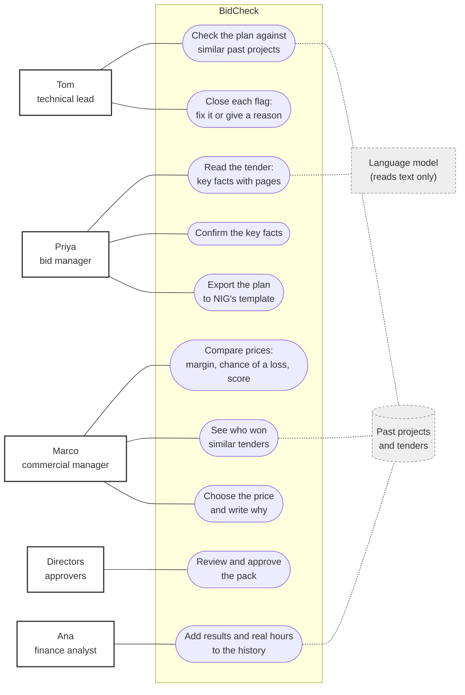
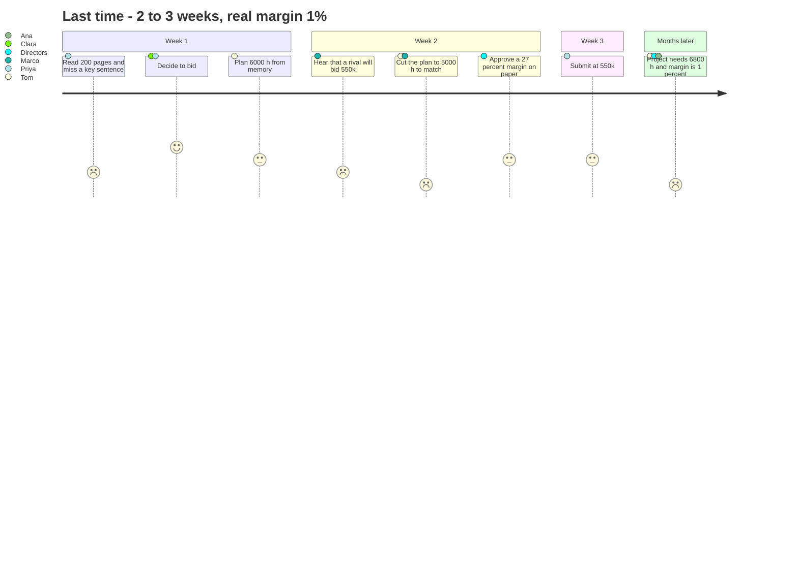
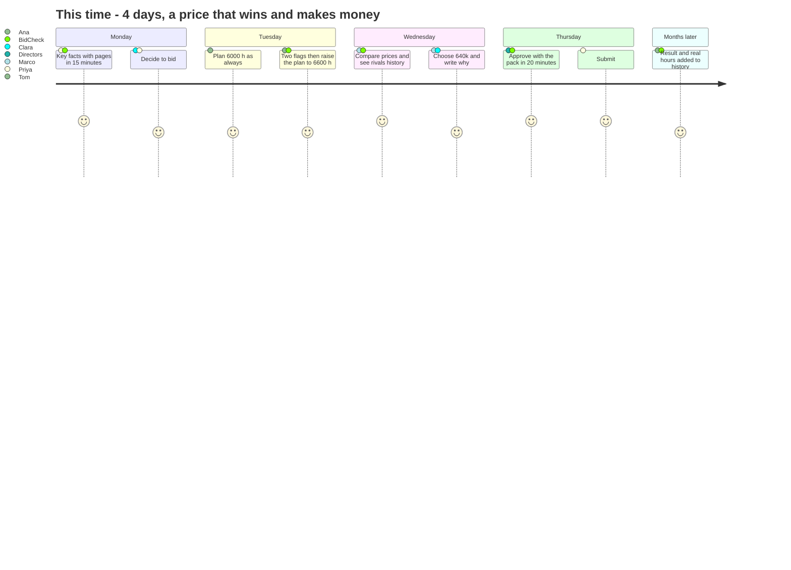
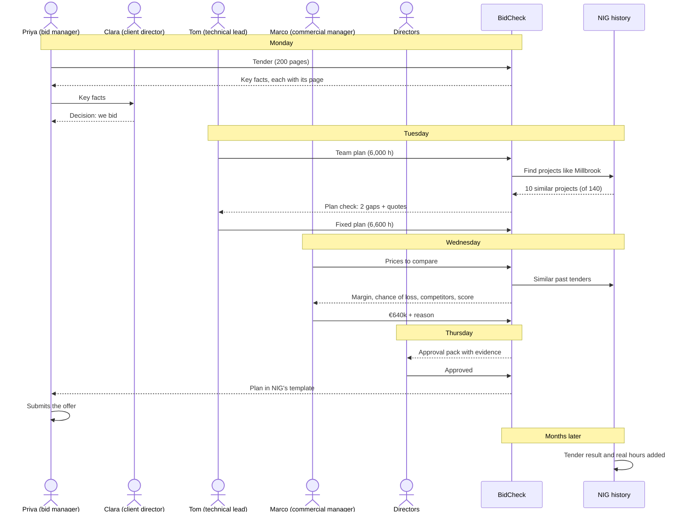

# User journey: the Millbrook bid, with BidCheck

> One bid, followed from the moment the tender arrives to the moment the offer is sent, and what happens after. Visual version: [user-journey.html](user-journey.html).
> The example is fictional, but built to look and behave like the real thing.

## 1. The setting

| | |
|---|---|
| **The company** | **NIG** designs infrastructure (water plants, roads, rail, buildings) for towns, utilities and private clients. It sells its engineers' time: a project is a number of hours. |
| **How it gets work** | Clients publish a **tender** saying what they want and how offers will be scored; several firms send an offer; the best score wins. |
| **The goal of this process** | Send an offer that **wins**, at a price that **still makes money**. |
| **The input** | A tender from the town of **Millbrook**: *"Design a new water treatment plant. The old plant must keep supplying the town until the new one is ready. Budget: up to €700k. Scored 70% on quality, 30% on price. Offers due in 6 weeks."* About 200 pages. |
| **The environment** | A busy bid team, with other bids and projects running. Behind them: years of finished projects and past tenders in NIG's systems, which nobody has time to dig through. |

## 2. The problem everyone recognises

Last time, a bid like this went the usual way:

1. **Guess.** The engineers planned **6,000 hours**; the work around the drawings came from memory.
2. **Squeeze.** "A competitor will bid €550k", so the plan was cut to **5,000 hours** to match.
3. **Surprise.** The directors approved a "27% margin". The project really needed **6,800 hours**. The real margin: **1%**.

NIG had done **10 projects just like it**, and had won most similar tenders at **€610–650k**. The answers were in its own history; nobody had time to look.

## 3. The people

| Person | Role | What they want from this bid |
|---|---|---|
| **Clara** | Client director | Win Millbrook; she has known the town for years |
| **Priya** | Bid manager | A complete offer, on time, with no surprises |
| **Tom** | Technical lead (with 3 discipline leads) | A realistic plan he will have to deliver himself |
| **Marco** | Commercial manager | A price that wins and still makes money |
| **The directors** | Approvers | To approve with confidence, not on gut feel |
| **Ana** | Finance analyst | Behind the scenes: keeps the history clean, once a month |
| **BidCheck** | The tool | Does the reading, comparing and maths, so people can decide |

## 4. The journey

### Monday — 1. The tender arrives
- **Who:** Clara.
- **What she does:** shares it with Priya. *No tool needed.*

### Monday — 2. Understand the tender
- **Who:** Priya.
- **Why:** before anything else, the team needs the few facts that drive the work and the price.
- **Uses BidCheck:**
  - **Input:** the 200-page tender.
  - **BidCheck:** reads it and lists the key facts, each with its page.
  - **Output:** *20 million litres a day (p. 12) · "the old plant must keep running" (p. 47) · "the town reviews each design stage" (p. 31) · budget up to €700k (p. 5) · quality 70%, price 30% (p. 9).*
- **She:** checks and confirms. **15 minutes instead of an afternoon of reading.**

### Monday — 3. Decide to bid
- **Who:** Clara and Priya, with the key facts in front of them. **Decision: bid.** *No tool needed.*

### Tuesday — 4. Plan the work, then check it
- **Who:** Tom and his discipline leads.
- **Why:** the hours decide the cost, and the cost decides whether NIG makes money.
- **What they do:** make their plan as always: phases, drawings, hours. **6,000 hours.**
- **Uses BidCheck:**
  - **Input:** their plan (Excel) + the key facts + NIG's project history.
  - **BidCheck:** finds the **10 past projects that are really similar** (out of 140 water plants: the old plant also had to keep running) and compares the plan with what they really took, phase by phase.
  - **Output:** a plan check with two flags:
    - *Town reviews: you plan 400 h; similar projects needed 650–850 h — "three review rounds with the town council".*
    - *Keeping the old plant running: you plan 200 h; similar projects needed 400–650 h.*
- **They:** raise both phases. **Plan: 6,600 hours, done by Tuesday afternoon.**

### Wednesday — 5. Set the price
- **Who:** Marco, with Clara.
- **Why:** the price must win, without losing money.
- **Uses BidCheck:**
  - **Input:** the checked plan + the prices he is considering + NIG's past tenders.
  - **BidCheck:** for each price, the margin and the chance of a loss; who won similar tenders and at what price; the score NIG would get.
  - **Output:**
    - *€550k → 1% margin, 4 in 10 similar projects would lose money.*
    - *€640k → 15% margin, none would lose money, best expected score.*
    - *Riverton, the low bidder, wins when price counts 40%+. Millbrook counts it at 30%: NIG won 5 of 6 tenders scored like this.*
- **He:** chooses **€640k** and writes why: *"we win on quality, 70% of the score."* The price is a decision, not a guess.

### Thursday — 6. Approve
- **Who:** the directors.
- **Uses BidCheck:**
  - **Input:** everything above.
  - **BidCheck:** builds the approval pack.
  - **Output:** one pack with the facts, the similar projects, the plan and its flags, the price view and the competitors.
- **They:** ask two questions, find the answers in the pack, approve. **20 minutes.**

### Thursday — 7. Submit
- **Who:** Priya. BidCheck exports the plan into NIG's usual template; she sends the offer. **4 days, not 2–3 weeks.**

### Months later — 8. Learn
- The tender result is published: won or lost, winner and price go into the history.
- If NIG won, the project starts with a 6,600-hour budget that matches reality. When it ends, its real hours and final report flow back. Ana checks the few unclear items in her monthly review.
- **The next bid is checked against more evidence.**

## 5. Use cases: who uses BidCheck for what

Each person uses the tool for a few clear jobs. The history and the language model are behind the tool; nobody talks to them directly.

## 6. Journey map: how it feels, last time and this time

Scores run from 1 (painful) to 5 (smooth).

**Last time, the usual way:**

**This time, with BidCheck:**

## 7. The journey as a workflow

```mermaid
flowchart LR
    T[/"Tender<br/>200 pages"/]
    H[("NIG history<br/>projects + tenders")]

    P1["<b>Priya</b><br/>uploads tender"]
    F1{{"<b>BidCheck</b><br/>reads tender"}}
    O1[/"Key facts<br/>with pages"/]
    P2["<b>Clara + Priya</b><br/>decide to bid"]
    P3["<b>Tom + leads</b><br/>make the plan<br/>6,000 h"]
    F2{{"<b>BidCheck</b><br/>checks the plan against<br/>10 similar projects"}}
    O2[/"Plan check<br/>2 gaps + evidence"/]
    P4["<b>Tom + leads</b><br/>fix the plan<br/>6,600 h"]
    F3{{"<b>BidCheck</b><br/>price view"}}
    O3[/"Margin · chance of loss<br/>competitors · score"/]
    P5["<b>Marco</b><br/>chooses €640k + why"]
    F4{{"<b>BidCheck</b><br/>builds approval pack"}}
    P6["<b>Directors</b><br/>approve"]
    P7["<b>Priya</b><br/>submits"]
    L["Result published ·<br/>project ends"]

    T --> P1 --> F1 --> O1 --> P2 --> P3 --> F2 --> O2 --> P4 --> F3 --> O3 --> P5 --> F4 --> P6 --> P7
    H --> F2
    H --> F3
    P7 -. "months later" .-> L -. "flows back" .-> H

    classDef person fill:#e8f8e8,stroke:#1e8449,color:#000;
    classDef tool fill:#e0f0ff,stroke:#2471a3,color:#000;
    classDef artefact fill:#fff4d6,stroke:#b7950b,color:#000;
    class P1,P2,P3,P4,P5,P6,P7 person;
    class F1,F2,F3,F4 tool;
    class T,O1,O2,O3,H,L artefact;
```

*Green = people · Blue = BidCheck · Yellow = documents and data.*

## 8. Who talks to the tool, and what passes between them

## 9. What changed

| | Last time | This time |
|---|---|---|
| Reading the tender | An afternoon, a key sentence missed | 15 minutes, every key fact with its page |
| The plan | Guessed where it's hard, then cut | Made by the engineers, checked against 10 real projects |
| Competitors | A rumour: "they'll bid €550k" | Who really won similar tenders, at what price, and how |
| The price | Cut blindly to €550k | Chosen knowingly: €640k, 15% margin, best expected score |
| Approval | "27% margin" on paper | Evidence behind every number |
| Time to submit | 2–3 weeks | 4 days |
| The outcome | 1% real margin | A budget that matches reality, or a bad deal avoided |
