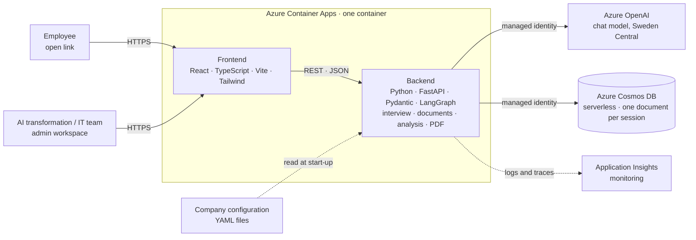
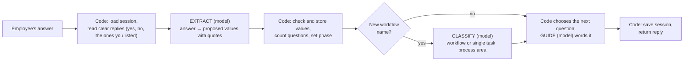

# AI Use Case Discovery Agent: technical design

> How the prototype works and why it is built this way. Detail lives in the specs (`specs/`), linked at the end of each part. Every number comes from the code, the specs or the latest evaluation run; cost and employee time are estimates from assumed prices and reading speeds.

**Contents:** 1 Overview · 2 Technical architecture (2.1 Diagram · 2.2 How it works · 2.3 Components) · 3 Models, tooling choices and integrations (3.1 Models · 3.2 Integrations · 3.3 Bought versus built) · 4 Evaluation and how we know it works (4.1 Evaluation strategy · 4.2 Measured results · 4.3 Observed failure cases and what we changed) · 5 How the code was built · 6 What we would change with more time

---

## 1. Overview

Companies that want to use AI at scale must first know **which workflows are worth transforming**, and that knowledge sits with the employees who do the work. Today AI specialists interview people one by one, so discovery is limited by the **size of the specialist team**. The AI Use Case Discovery Agent runs that interview instead: every employee can take part at the same time, and the specialists review the best candidates rather than collect them.

An **employee** opens a link and has a **guided interview of 20–30 minutes**. Together with the agent they **find** a recurring workflow in their daily work, **map** it in 2 to 6 main steps, and receive an **assessment** of where and how AI can help. At any time they can upload a document (a procedure, a process map, an example output); the agent reads it and proposes values, which count only once the employee confirms them.

Behind the chat there is a **form**: process fields such as trigger, volume and pain, and for each step fields such as activities, systems, data in and out, and whether the work follows fixed rules or needs judgement. Every value is stored with its **source** (employee, document or agent) and its **status** (proposed or confirmed). The design rests on one principle: **code controls the conversation and computes every number; where the model has to judge, it chooses from fixed options and code checks the result.** Code decides what to ask next, whether an answer is complete, what a "yes" means and when the interview may finish. The tool guides; it never gives a go / no-go verdict.

When the employee presses *Finish*, an **analysis** produces the **discovery report**, on screen and as PDF. It shows a short summary, the process map, and for each step how well AI fits with a route (Microsoft 365 Copilot, an internal AI tool, low-code or a custom build); it answers the three questions a manager asks (*a good AI use case? a dedicated solution or a general assistant? worth it?*) and ends with a readiness checklist. The AI transformation / IT team reads every session in an **admin workspace** and uses the reports to decide which use cases to build. *Spec: [01-product](../../specs/01-product.md).*

**Built and live** on [Azure](https://link-on-request.invalid/xxxxxxxxxxxxxxxxxxxxxxxxxxxxxxxxxxxxxxxxxxxxxxxxxxxxxxxxxx): the guided interview, document reading, the analysis, the report and PDF, the read-only admin workspace, the evaluation and the deployment setup (container, Bicep templates, CI pipeline). What changes for production is in [production-readiness](production-readiness.md): about two months of one engineer's work (€20k) over about four months, and about €6k a year to run (Azure hosting about €5.5k, the AI about €240) *(assumptions, updated 2026-11-21 (bottom-up cost))*.

---

## 2. Technical architecture

### 2.1 Diagram

The product is one web application: a React page for the chat and the workspace, and a Python backend with two AI stages, the **interview** (turn by turn) and the **analysis** (once, at *Finish*). Each interview is one JSON document in a database, and everything specific to the company lives in configuration files, not in code.

The browser calls the backend with plain REST requests. **Each employee message is one request that runs one turn** and returns the reply together with the updated session; nothing is streamed. The backend reaches Azure OpenAI and Cosmos DB with a **managed identity** (Azure signs the app in; no stored passwords), so no service keys are needed outside local development. The company configuration (`config/nig/`) holds the process areas such as Finance or HR, the solution catalogue, the wording and the limits.

### 2.2 How it works

**The interview path.** The interview moves through fixed **phases**: about you → find a workflow → boundaries (trigger, result, pain) → measures (volume, time, owner) → number of steps → the steps → review. In *find* the agent suggests likely workflows for the employee's role and recommends the one with the most value and the most ready data; the employee decides. In the steps phase the employee lists the steps, and each step gets one open question and at most one follow-up, plus one optional question (sign-off, exceptions, and for judgement steps the decision criteria). Effort is asked once for all steps, and the agent proposes each step's goal and owner for confirmation. **Every loop has a limit:** a field is asked at most three times and then set aside for the review, and after 40 employee messages the agent offers *Finish* (and again every 10) without forcing it. *Finish* opens when 80 % of the scored fields are complete.

**One turn.** The server keeps nothing in memory between messages. For each answer it loads the session document, runs one turn and saves the document again. The turn is a small, fixed graph built with **LangGraph**, which keeps the order of the work explicit and testable:

EXTRACT turns the answer into proposed values, each with the employee's own words as a quote, and code accepts a value only if the quote is really there and the value fits the field's rules. Code then picks the next question by a fixed priority: document conflicts first, then document proposals, then the choice between candidate workflows, then the next missing field. GUIDE only words that question; if it fails or is slow, code sends a plain fallback question. Most turns cost two model calls, and a turn that names a new workflow costs three. *Spec: [14-interview](../../specs/14-interview.md).*

**Documents.** The employee can upload up to 10 files per session: PDF, Word, Excel or CSV, PowerPoint, e-mail, text, BPMN or an image. Code checks the type by content. BPMN files are parsed by code; everything else is read by one model call that knows where the interview stands, so a file can be read as "an example output of step 3". The agent then asks in the chat whether to fill the proposed values, and when a document disagrees with the employee or with another document it asks which one is right. Files are never stored, only the extracted text and the proposals. *Spec: [17-documents](../../specs/17-documents.md).*

**Analysis and report.** *Finish* runs three model calls in parallel, each with its own fallback, so one failed call never blocks the report: **MAP** (the process map as data), **LABEL** (impact and feasibility labels, each backed by the employee's words) and **ASSESS_STEPS** (for each step, how well AI fits, the signals behind it and a route from the solution catalogue). Code then checks every quote and step number, keeps routes only from the catalogue (an assumed set of tools, marked as such), and computes the hours a year, the readiness levels and the answers to the three questions. Code assembles the report in six parts, and the PDF is generated on request. The report states the potential in **hours a year**; a euro value is a planned next step. *Specs: [19](../../specs/19-value-and-readiness.md), [20](../../specs/20-report.md), [26](../../specs/26-step-assessment.md), [27](../../specs/27-report-v2.md).*

**Admin workspace.** The team lists all sessions and opens a read-only view of each: summary, steps (as now and as first told), assessment, map, the full conversation and the report PDF. Opening a conversation, downloading and deleting each write an audit log line. *Spec: [21-admin](../../specs/21-admin.md).*

### 2.3 Components

**Frontend.** A single-page React app in TypeScript, built with Vite and styled with Tailwind, with a light and a dark theme. The interview shows the chat beside a live "Your process" panel. The frontend decides nothing: it shows what the server sends, including the progress bar, and reacts to the server's error codes. *Spec: [23-frontend](../../specs/23-frontend.md).*

**Backend.** FastAPI provides a thin web layer (routes, access checks, settings, storage) around one engine package that holds the interview, documents, analysis and report. Lower layers of the engine never depend on higher ones, and a test fails the build if that rule breaks. **Pydantic** models check data at every boundary: the stored session, the requests and responses, the configuration files and every structured model output. *Spec: [15-api-and-store](../../specs/15-api-and-store.md).*

**Language model client.** All calls go through one client (the models are in §3.1). Each call has a 60-second timeout, up to three retries on temporary errors, and a strict JSON schema taken from a Pydantic model, with one more try if the output does not fit. An empty or cut-off reply counts as an error. Text from employees and documents is wrapped in markers so the model treats it as text, never as instructions, and a whole turn has a 150-second guard. *Spec: [11-llm-client](../../specs/11-llm-client.md).*

**Database.** Azure Cosmos DB (serverless) holds one JSON document per session: messages, form values with source and status, counters, document metadata and analysis results. A save succeeds only if nobody else saved the same session in between, so two browser tabs cannot overwrite each other. Unfinished sessions expire after 90 days; finished ones are kept. Tests use an in-memory store that passes the same tests. *Spec: [15-api-and-store](../../specs/15-api-and-store.md).*

**Security and data.** Employees need no sign-in: the browser creates a random visitor key and the server stores only its hash, so nobody can open another person's sessions. The workspace needs an access code (or a typed name in the open demo, where deleting is off). Rate limits and a daily token budget protect the open link from abuse; answers are screened for prompt injection; logs never contain message or document text. The team can read the conversation, as the employee is told at the start; uploaded files are not kept. *Spec: [16-access](../../specs/16-access.md).*

---

## 3. Models, tooling choices and integrations

### 3.1 Models

| Deployment | Model | Used for | Why |
|---|---|---|---|
| `app-chat` | gpt-5.6-sol (version 2026-07-09), **EU Data Zone** deployment (processing stays in the EU) in Sweden Central | Every product call: EXTRACT, CLASSIFY, GUIDE, document reading (including images), MAP, LABEL, ASSESS_STEPS; also the evaluation judge | Reliable **structured outputs** against a strict JSON schema; data processed inside the EU; reached with a **managed identity**, so no keys; about **€0.34–0.50 per interview** at assumed list prices |
| `eval-expert` | gpt-5.4-mini | **Only** the simulated employees of the evaluation; it never sees real data | A cheaper model is enough to play a persona sheet, and a different model from the product keeps the test honest |

One product model means one version to pin and one set of prompts to evaluate. The plan assumed a small model; a stronger one was chosen because the interview depends on following the field rules and quoting exactly, and at under €0.50 an interview its cost is small next to the hours saved. Swapping to a smaller model (for EXTRACT or GUIDE, or overall) is one setting, taken only if the evaluation shows no loss. The model deployments were created once by hand; the Bicep template grants the app access.

### 3.2 Integrations

Today the prototype connects to **Azure OpenAI**, **Cosmos DB** and **Application Insights**, all with a managed identity. It takes **documents in** (PDF, Word, Excel or CSV, PowerPoint, e-mail, text, BPMN, images, uploaded by the employee) and gives the **report out** on screen and as PDF. There is **no connection to NIG's own systems yet**, on purpose: the prototype needs no access rights to start. The first production integration is Microsoft 365 (sign-in with Entra ID, then Teams transcripts and SharePoint documents with consent); export to a BPM tool and briefs into the engineering backlog follow (see [production-readiness](production-readiness.md)).

### 3.3 Bought versus built (tooling choices)

The rule: **buy the commodity, build what makes the product.** Every buy below is a dependency the platform team will live with, so each one names it.

| Component | Choice | Why | Dependency it creates |
|---|---|---|---|
| Language model | **Bought:** Azure OpenAI | Training our own model adds nothing; EU Data Zone, managed identity, structured outputs | Model versions retire and behave differently: the version must be pinned and every upgrade must pass the evaluation; quota and price set by the vendor |
| Database | **Bought:** Cosmos DB serverless | One JSON document per session, pay per request, built-in expiry and safe concurrent saves | Azure-specific; a small store interface (with an in-memory twin used in tests) keeps it replaceable |
| Hosting | **Bought:** Azure Container Apps | One container, one replica today and more by configuration, managed identity, no cluster to run | Azure platform; the container itself runs anywhere |
| Monitoring | **Bought:** Application Insights | Standard logs, traces and alerts | Cost grows with log volume |
| Turn orchestration | **Open source:** LangGraph | Keeps the fixed order of a turn explicit and testable | Small: a handful of nodes that could become plain functions |
| Web, data checks, screens | **Open source:** FastAPI, Pydantic, React, Vite, Tailwind, document readers (pypdf, python-docx, openpyxl, python-pptx) | Standard, well known, no licence cost | Ordinary upkeep: versions pinned, security updates |
| PDF and process map | **Open source:** reportlab, Mermaid | The report is built by code, so it looks the same every time | Same as above |
| Interview engine and field registry | **Built** | This is the product: a fixed form, completeness rules, limits on every loop, the next question chosen by code. A general assistant gives 400 different documents for 400 chats | Owned code, covered by the tests in §5 |
| Quote checks | **Built** | Every value and rating must trace back to the employee's own words, or it is dropped | Owned code |
| Scoring, hours a year, readiness, the three questions | **Built** | Numbers must be reproducible and explainable, so code computes them, never the model | Owned code; rates and thresholds in configuration |
| Evaluation runner | **Built** | Generic evaluation tools score single answers; we need whole interviews played through the real API and scored against a hidden truth, field by field | Owned code; personas and truth files to maintain |

---

## 4. Evaluation and how we know it works

### 4.1 Evaluation strategy

A prompt change can improve one interview and break another, so the agent is measured, not judged by feel. The evaluation plays **six simulated employees** through the real API from the first message to *Finish*. Each has a hidden true workflow and a behaviour (cooperative, vague, starts with a task, uploads an out-of-date procedure, CV screening, work-order priority), and the smaller model plays the employee using only that sheet, in answers of 15 to 45 words as a busy person would give.

Scoring is **code first**: numbers, lists, step counts, the AI fit and the route are compared with the hidden truth by code. Only free-text fields go to a judge, the product model asked one narrow question ("do these two values mean the same?"), which agrees with hand-labelled pairs 97 % of the time (37 of 38); below 90 % the run is not accepted. Every run writes a scorecard, and each change is compared with the previous run (`make eval`). *Spec: [24-evaluation](../../specs/24-evaluation.md).*

### 4.2 Measured results

We know the system works from three sources. **About 3,400 automated tests** check every acceptance criterion (§5). **Live runs** against Azure OpenAI and Cosmos DB, including end-to-end tests by the product owner, check the real behaviour. The **evaluation scorecard** measures quality against targets. The latest full run (six personas, 21 November 2026) gave:

| Measure | Result | Target |
|---|---|---|
| Sessions that reached *Finish* | 6 of 6, in 26–32 messages; no loops, no repeated questions | All |
| Quality of the core fields | 54–94 % per persona (75 % pooled) | ≥ 85 % |
| AI fit and route right | 17 of 19 steps | ≥ 70 % |
| Invented values | 4, all in the vague persona | 0 |
| Detail burden (questions on low-value details) | 6–12 % | ≤ 15 % |
| Estimated employee time | 19.6–24.4 minutes (22.5 mean) | ≤ 20 minutes |
| Time per turn (median) | 3.9–4.6 s | < 10 s |
| *Finish* (analysis and report) | 34–48 s | < 30 s |
| Model cost per interview | €0.34–0.50 | < €0.50 |

The targets are deliberately strict and were set before tuning. The latest run reaches them for detail burden, completion, loops, cost and AI fit; core-field quality (75 % against 85 %), employee time and *Finish* speed are the next tuning targets (§4.3, §6). Simulated employees are a development gate, not proof of real quality: the pilot's first check uses real employees. One run per persona varies with the model, so a small change needs two or three runs before it is read.

### 4.3 Observed failure cases and what we changed

Each case below was seen in an evaluation run or a live test and traced in the turn log; each fix came with a new acceptance criterion and test, and what is not yet fixed is listed as next work.

| Observed | Root cause | What we changed |
|---|---|---|
| Interviews were too long: the first evaluation runs hit the 60-message cap before *Finish* | One question per step field, about 11 per step | **Short step walk:** the employee lists the steps, then one open question per step plus one follow-up, one optional question, effort once for all steps |
| A "yes" to values the agent itself proposed (step names, kinds of sensitive data) was not understood; the question came back until the field was skipped | The values lived only in the agent's question | The agent now returns the values it offers; code records them and reads the "yes", "those are right" or a pick such as "the second one" |
| Step ratings were dropped and steps showed "not assessed" | The model quoted the employee's rules-or-judgement answer, which the quote check did not search | That answer is now part of the evidence the check searches |
| The report showed no hours a year | Frequencies such as "once per role, about 6 times a month" were not parsed | The parser reads them part by part; when the volume is known, the agent asks only for duration and assumes once per run, which the employee can correct; the latest run still left one step without hours, the next item to tune |
| For judgement steps, nobody asked what the decision is based on | No field held it | A decision-criteria question joins the existing optional step question, with no extra turn; one persona still did not get it in the latest run |
| The model occasionally filled a value for a vague employee who gave none | A non-answer ("it depends") was stored as a step's effort | Every value carries a quote and counts only once confirmed; treating "it depends" as no number is next |
| An out-of-date procedure did not always trigger a question about which source is right | Not yet traced | Out-of-date values were never kept, because the employee's answers win; making the conflict question fire reliably is next |
| The evaluation itself misled at first (long simulated answers, steps matched by name only) | Test harness, not product | Answers capped at busy-person length, steps matched by content, judge recalibrated on real wording |

---

## 5. How the code was built

**Spec first, then test first.** Work flows down one chain (use case → product spec → architecture → 17 component specs → tests → code), and a person approves every spec before code is written. Each acceptance criterion becomes a failing test that cites its ID; then only the minimum code that makes it pass is written, and every change is verified with the full suite (about 3,400 tests), linting, strict type checks and, for model behaviour, a live run and the evaluation. AI coding agents did most of the writing, under the same rules. *See [pipeline](../05-how-we-worked/pipeline.md).*

---

## 6. What we would change with more time

| Change | Why |
|---|---|
| *Finish* as a background job the page polls, and a faster analysis | *Finish* takes 34–48 s today, above the 30 s target and close to request limits |
| Close the quality gap (75 % → 85 % of core fields): the conflict question, "it depends" answers, hours for every step | The gap the latest run shows, traced in §4.3 |
| Prompt tuning on pilot data: fewer, better-grouped questions, more values proposed for the employee to confirm | Employee time is above the 20-minute target in five of six personas, driven by the number of questions |
| A larger evaluation set built from real, anonymised pilot sessions, with the specialist's corrections as truth | Six personas cannot cover NIG's variety; each persona run two or three times |
| Specialist edits and validation in the workspace | Today the workspace is read-only |
| An overview across all sessions, and implementation briefs for engineers | The selection decision and the hand-over to builds |
| A euro value next to the hours, and export of the process map to BPM tools (BPMN) | What managers and process owners ask for next |
| More languages, each tested with the evaluation | The prototype is tested in English only |

