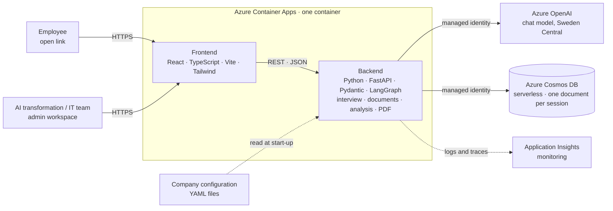
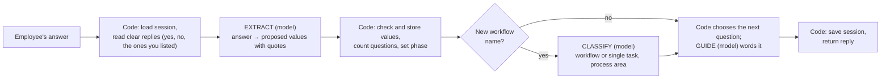

# AI Use Case Discovery Agent: technical design

> How the prototype works and why it is built this way. Detail lives in the specs (`specs/`), linked at the end of each part. Every number comes from the code, the specs or the latest evaluation run.

**Contents:** 1 Overview (1.1 Product · 1.2 Architecture at a glance) · 2 Technical architecture (2.1 Diagram · 2.2 How it works · 2.3 Components) · 3 Evaluation · 4 How the code was built · 5 Status and production

---

## 1. Overview

### 1.1 Product

Companies that want to use AI at scale must first know **which workflows are worth transforming**. That knowledge sits with the employees who do the work. Today an AI specialist has to interview people one by one to find, map and validate use cases, so discovery is limited by the **time and size of the AI specialist team**. The AI Use Case Discovery Agent runs that interview with an AI agent instead: every employee can take part at the same time, and the specialists spend their time reviewing the best candidates rather than collecting them. That is how discovery scales from a few workshops to the whole company.

An **employee** opens a link and has a **guided interview of about 20 minutes**. Together with the agent they **find** a recurring workflow in their daily work, **map** it in 2 to 6 main steps, and receive an **assessment** of where and how AI can help. At any time they can upload a document (a procedure, a process map, an example output); the agent reads it and proposes values, which count only once the employee confirms them.

Behind the chat there is a **form**: process fields such as trigger, volume and pain, and for each step fields such as activities, systems, data in and out, and whether the work follows fixed rules or needs judgement. Every value is stored with its **source** (employee, document or agent) and its **status** (proposed or confirmed). The design rests on one principle: **code controls the conversation and computes every number; where the model has to judge, it chooses from fixed options and code checks the result.** Code decides what to ask next, whether an answer is complete, what a "yes" means and when the interview may finish. The tool guides; it never gives a go / no-go verdict.

When the employee presses *Finish*, an **analysis** produces the **discovery report**, on screen and as PDF. It opens with a short **summary**, then shows the mapped process with a process map, and for each step how well AI fits, with a route such as Microsoft 365 Copilot, an existing internal AI tool, low-code or a custom build. It closes by answering the three questions a manager asks: *Is this a good AI use case? A dedicated AI solution or a general assistant? Is it worth it?*, followed by a readiness checklist and what to prepare first. The AI transformation / IT team reads every session in an **admin workspace** and uses the reports to decide which use cases to build. *Spec: [01-product](../../specs/01-product.md).*

### 1.2 Architecture at a glance

The product is one web application: a React page for the chat and the admin workspace, and a Python backend that holds two AI stages. The **interview** runs turn by turn: the model reads each answer and words the next question, while code chooses that question. The **analysis** runs once, at *Finish*. Each interview is one JSON document in a database, and everything specific to the company lives in configuration files, not in code.

---

## 2. Technical architecture

### 2.1 Diagram

The browser calls the backend with plain REST requests. **Each employee message is one request that runs one turn** and returns the reply together with the updated session; nothing is streamed. The backend reaches Azure OpenAI and Cosmos DB with a managed identity, so no service keys are needed outside local development. The company configuration (`config/nig/`) holds the process areas such as Finance or HR, the solution catalogue, the wording and the limits.

### 2.2 How it works

**The interview path.** The interview moves through fixed **phases**: about you → find a workflow → boundaries (trigger, result, pain) → measures (volume, time, owner) → number of steps → the steps → review. In the *find* phase the agent suggests likely workflows for the employee's role when they have none in mind, and recommends the candidate with the most value and the most ready data; the employee decides. The step walk is short by design. The employee lists the steps in one answer, and each step then gets one open question (activities, people, systems, data, pain, rules or judgement) and at most one follow-up. Sign-off, exceptions, hand-over and, for judgement steps, the decision criteria share one optional question. Effort is asked once for all steps, and the agent suggests each step's goal and owner for the employee to confirm. **Every loop has a limit:** a field is asked at most three times and then set aside for the review, and after 40 employee messages the agent offers *Finish* (and again every 10) without forcing it. *Finish* opens when 80 % of the scored fields are complete.

**One turn.** The server keeps nothing in memory between messages. For each answer it loads the session document, runs one turn and saves the document again. The turn is a small, fixed graph built with **LangGraph**, which keeps the order of the work explicit and testable:

EXTRACT turns the answer into proposed values, each with the employee's own words as a quote, and code accepts a value only if the quote is really there and the value fits the field's rules. Code then picks the next question by a fixed priority: document conflicts first, then document proposals, then the choice between candidate workflows, then the next missing field. GUIDE only words that question; if it fails or is slow, code sends a plain fallback question. Most turns cost two model calls, and a turn that names a new workflow costs three. *Spec: [14-interview](../../specs/14-interview.md).*

**Documents.** The employee can upload up to 10 files per session: PDF, Word, Excel or CSV, PowerPoint, e-mail, text, BPMN or an image. Code checks the type by content. BPMN files are parsed by code; everything else is read by one model call that knows where the interview stands, so a file can be read as "an example output of step 3". The agent then asks in the chat whether to fill the proposed values, and when a document disagrees with the employee or with another document it asks which one is right. Files are never stored, only the extracted text and the proposals. *Spec: [17-documents](../../specs/17-documents.md).*

**Analysis and report.** *Finish* runs three model calls in parallel, each with its own fallback, so one failed call never blocks the report:

| Call | Produces |
|---|---|
| MAP | The process map, as data for a standard process diagram |
| LABEL | Impact and feasibility labels, each backed by the employee's words |
| ASSESS_STEPS | For each step: how well AI fits, the signals behind it (reads varied documents, compares with criteria, drafts text, must be exact, follows fixed rules), and a route from the solution catalogue |

Code then checks every quote and step number, keeps routes only from the solution catalogue (an assumed set of tools, marked as such), and computes the hours a year, the readiness levels and the answers to the three guiding questions. The report is assembled by code in six parts (summary, process, measures, map and steps, step-by-step AI assessment, AI readiness and feasibility), and the PDF is generated on request. The report states the potential in **hours a year**; a euro value is a planned next step. *Specs: [19](../../specs/19-value-and-readiness.md), [20](../../specs/20-report.md), [26](../../specs/26-step-assessment.md), [27](../../specs/27-report-v2.md).*

**Admin workspace.** The team lists all sessions and opens a read-only view of each: summary, steps (as now and as first told), assessment, map, the full conversation and the report PDF. Opening a conversation, downloading and deleting each write an audit log line. *Spec: [21-admin](../../specs/21-admin.md).*

### 2.3 Components

**Frontend.** A single-page React app in TypeScript, built with Vite and styled with Tailwind, with a light and a dark theme. Its pages are My processes, the interview (chat on the left, a live "Your process" panel on the right), the report and the workspace. The frontend decides nothing: it shows what the server sends, including the progress bar, and reacts to the server's error codes. *Spec: [23-frontend](../../specs/23-frontend.md).*

**Backend.** FastAPI provides a thin web layer (routes, access checks, settings, storage) around one engine package that holds the interview, documents, analysis and report. Lower layers of the engine never depend on higher ones, and a test fails the build if that rule breaks. **Pydantic** models check data at every boundary: the stored session, the requests and responses, the configuration files and every structured model output.

| Area            | Main endpoints (under`/api`)                                                                              |
| --------------- | --------------------------------------------------------------------------------------------------------- |
| Interview       | `POST /sessions`, `GET /sessions`, `GET /sessions/{id}`, `POST /sessions/{id}/messages`, `POST …/finish` |
| Documents       | `POST …/documents`, `POST …/proposals/confirm`, `POST …/proposals/reject`                              |
| Report          | `GET …/report`, `GET …/report.pdf`                                                                      |
| Admin workspace | `POST /workspace/login`, `GET /review/sessions`, `GET /review/sessions/{id}`, `GET …/conversation`       |

*Spec: [15-api-and-store](../../specs/15-api-and-store.md).*

**Language model.** All calls go through one client to the chat deployment (`app-chat`, in Sweden Central). Each call has a 60-second timeout, up to three retries on temporary errors, and a strict JSON schema taken from a Pydantic model, with one more try if the output does not fit. An empty or cut-off reply counts as an error. Text from employees and documents is wrapped in markers so the model treats it as text, never as instructions, and a whole turn has a 150-second guard. *Spec: [11-llm-client](../../specs/11-llm-client.md).*

**Database.** Azure Cosmos DB (serverless) holds one JSON document per session: messages, form values with source and status, counters, document metadata and analysis results. A save succeeds only if nobody else saved the same session in between, so two browser tabs cannot overwrite each other. Unfinished sessions expire after 90 days; finished ones are kept. Tests use an in-memory store that passes the same tests. *Spec: [15-api-and-store](../../specs/15-api-and-store.md).*

**Security and data.** Employees need no sign-in: the browser creates a random visitor key, and the server stores only its hash, so nobody can open another person's sessions. The admin workspace needs an access code, or only a typed name in the open demo mode, where deleting is switched off. Requests are rate-limited (30 a minute per employee, 120 per network address), and a daily token budget protects the open link from cost abuse. Answers are screened for prompt injection, and logs never contain message or document text. The conversation is kept and readable by the team, as the employee is told at the start; uploaded files are not kept. *Spec: [16-access](../../specs/16-access.md).*

---

## 3. Evaluation

A prompt change can improve one interview and break another, so the agent is measured, not judged by feel. The evaluation plays **six simulated employees** through the real API from the first message to *Finish*. Each has a hidden true workflow and a behaviour (cooperative, vague, starts with a task, uploads an out-of-date procedure, CV screening example, work-order priority), and a second, smaller model plays the employee using only that sheet.

Scoring is **code first**: numbers, lists, step counts, the AI fit and the route are compared with the hidden truth by code. Only free-text fields go to a judge, the same chat model asked one narrow question ("do these two values mean the same?"), which agrees with hand-labelled pairs 97 % of the time (37 of 38); below 90 % the run fails. The headline targets are what matters to the employee and the analysis: **estimated employee time** ≤ 20 minutes, **detail burden** (questions on low-value details) ≤ 15 %, **quality of the core fields** ≥ 85 %, and **AI fit and route** right in ≥ 70 % of steps.

Every run writes a scorecard, and each prompt or code change is compared with the previous one (`make eval`), so the interview is tuned with numbers rather than by feel. *Spec: [24-evaluation](../../specs/24-evaluation.md).*

---

## 4. How the code was built

The code was built **spec first** and then **test first**, so that every line of code answers a written, reviewed requirement.

**1. Spec first.** Work flows down one chain: use case → product spec → architecture → component spec → tests → code. A change starts at the highest level it affects, so a lower document never contradicts a higher one. Each component spec (16 in total) describes the behaviour, the interfaces and the rules, and ends with numbered **acceptance criteria**: short, testable statements in the form *given / when / then*. A person reviews and approves every spec before any code is written.

**2. Tests first (test-driven development).** Each acceptance criterion becomes at least one automated test that cites its ID, and the test is run **before** the code exists, so it must fail. For example, spec 14 states *AC-14.122c: the reply "…, yes it is the same everywhere" completes the "same way everywhere?" field and moves on to the next question*. The test `test_ac_14_122c_same_everywhere_in_a_longer_reply_completes_the_variation` plays exactly that exchange with a scripted model and fails until the behaviour exists.

**3. Minimum code.** Only then is the **smallest amount of code that makes the failing test pass** written. Once all tests pass, the code is tidied up while the tests stay green. Nothing is built that no criterion asks for, and every behaviour can be traced from its test back to the spec that requires it.

**4. Verify.** Every change runs the full suite (about 3,300 automated tests across backend, frontend and evaluation) together with linting and strict type checks, plus a test that fails if a module breaks the layer rules. Where a change touches the model's behaviour, it is also run live against Azure OpenAI and re-measured with the evaluation.

AI coding agents did most of the writing, in parallel and each in its own folders, but under the same rules: inspect the existing specs and code first, write the tests first, write the minimum code, and report what was built and any difference from the spec. *See [pipeline](../05-how-we-worked/pipeline.md).*

---

## 5. Status and production

**Built:** the guided interview, document reading, the analysis, the report and PDF, the admin workspace, the evaluation and the deployment setup (container, Bicep templates, CI pipeline for Azure Container Apps). The prototype runs against Azure OpenAI and Azure Cosmos DB. **Next steps:** specialist review and validation in the workspace, an overview across all sessions, implementation briefs for AI engineers, a euro value next to the hours, and export of the process map to BPM tools.

| Area            | Prototype                                | Production                                                                                 |
| --------------- | ---------------------------------------- | ------------------------------------------------------------------------------------------ |
| Identity        | Visitor key; workspace code or open demo | Entra ID sign-in and roles                                                                 |
| Network         | Public endpoint                          | Private endpoints, firewall                                                                |
| Data protection | One region, no files stored              | Impact assessment, works-council agreement, retention per country                          |
| Reliability     | One replica;*Finish* in one long request | Two or more replicas;*Finish* as a background job the page polls                           |
| AI quality      | Evaluation set, daily budget             | Pinned model versions; evaluation gate before every change, fine tuning of interview  |
| Languages       | English                                  | Tested interviews and reports per company language                                         |
| Data sources    | The interview and uploaded documents     | Connection to the Microsoft 365 environment (Microsoft Graph, Work IQ), with consent: Teams meeting transcripts, process documents and files on SharePoint, to pre-fill the map and validate it |

*Detail: [production-readiness](production-readiness.md).*
