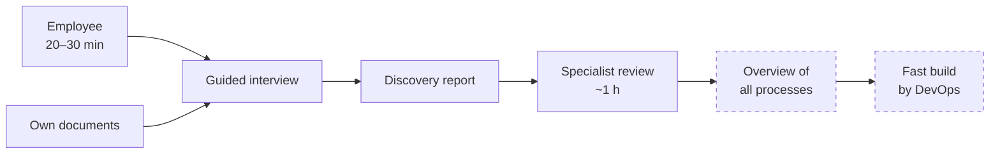

# AI Use Case Discovery Agent · Executive summary

> NIG (fictional) · **IT & Security** · November 2026 · *Figures are assumptions, to confirm in a pilot.* Detail: [use case](../01-use-case/use-case.md) · [deck](deck.pdf)

**In one line:** we propose an AI tool that **automates and speeds up AI use case discovery**. Today this is slow, manual work for the AI team in IT & Security. With the tool, an employee spends **20–30 minutes in a guided interview**. The AI helps them find the processes in their routine worth transforming, map one, and assess its AI potential and readiness. A specialist then reviews the report in about an hour. Discovery becomes **fast and scalable**: it is no longer capped by the size of the AI team and can reach the whole company.

## 1. Context

NIG has 50,000 people; 9 clusters × 4 regions = 36 teams, each with its own systems; earlier AI programmes stalled on fragmented data. First, someone must find, map and select the workflows worth transforming: **AI use case discovery**, IT's work for all nine clusters.

## 2. Problem

Today the AI specialists do AI use case discovery one colleague at a time. They sit with the people who do the work every day, in finance, HR or operations, because they know their process best. Together they map it, then the specialists assess it. Each process takes **around 24 person-hours in total and 2–3 weeks** *(assumption)*. Because specialists must be in every conversation, discovery is capped by the size of the AI team.

| What happens today                          | Why it hurts                                    |
| ------------------------------------------- | ----------------------------------------------- |
| Specialists interview people one by one     | At most 150–200 processes a year, for 36 teams |
| Each specialist asks and writes differently | Reports cannot be compared                      |
| Nobody checks whether a workflow is ready   | AI builds stall after weeks                     |
| Detail is lost at hand-over                 | Engineers re-ask people:**~60 h per build**     |

## 3. Solution

An employee who wants to automate part of their work opens a link and, in a **guided chat** with an AI agent, maps one of their own workflows worth transforming. A fixed form makes results comparable; specialists only review the best.

*Solid: built. Dashed: next release.* The report answers three questions (*good AI use case(Data, Feasibility, etc.)? own tool or Copilot? worth it (Business value)?*), then shows per step how AI helps and what to prepare.

## 4. Business value and ROI (base case: 400 processes a year)

|                          | Today | With the tool                               |
| ------------------------ | ----- | ------------------------------------------- |
| Person-hours per process | 24    | **~1.5** (estimate)                         |
| Engineer hours per build | 60    | **20** (with hand-over brief, next release) |

- **For the AI team (counted): €450k–675k a year**, from 400 processes × 22.5 h plus 25 builds × 40 h saved, at €90/h and 50–75 % adoption.
- **For the whole company (not counted, likely larger):** discovery **scales to every team at once**, so NIG compares 400+ processes, not 150–200, and builds the best, **each paying back again**.
- **Costs:** **€20k once** to build (one engineer, two months); **~€6k a year** to run (Azure hosting ~€5.5k; AI ~€0.40 per interview, ~€240): **payback under a month; ~€17 back per €1 in year one.**

## 5. Risks: three things must be true

| Must be true                  | Pilot check              | Stop if          |
| ----------------------------- | ------------------------ | ---------------- |
| Employees finish on their own | Share who complete       | Below 50 %       |
| Reports are good enough       | Specialist: major edits? | Below 50 % clean |
| Specialist review is quick    | Time each review         | Above 3 h        |

At 18 h by hand, not 24, it still holds (€342k). Open: works council, languages, interview quality (75 %, target 85 %).

## 6. Status, rollout and the ask

The first working version is **live on Azure** (link on request) and passed six simulated interviews end to end. **The ask:** an **8-week pilot in one cluster and region (~20 processes)** with volunteers, data-protection sign-off and company sign-in, stopped at any §5 limit; then **about two months** of hardening while the works-council agreement is prepared; then **cluster by cluster**: **about four months** to the first cluster live.
