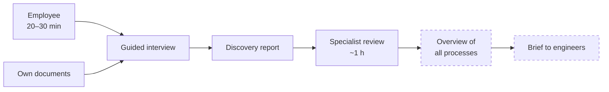

# AI Use Case Discovery Agent · Executive summary

> NIG (fictional) · **IT & Security** · November 2026 · *Figures are assumptions, to confirm in a pilot.* Detail: [use case](../01-use-case/use-case.md) · [deck](deck.pdf)

**In one line:** a 20–30 minute guided interview shows NIG **which processes AI should transform first, without weeks of workshops.**

## 1. Context

NIG has 50,000 people in 36 teams (9 clusters × 4 regions), each with its own systems; earlier AI programmes stalled on fragmented data and processes. Before anything is built, someone must find, map, assess and select the workflows worth transforming: **AI use case discovery**, IT's own work for all nine clusters.

## 2. Problem

Today two specialists map each process in a workshop and write it up by hand: **24 person-hours and 2–3 weeks per process**.

| What happens today | Why it hurts |
|---|---|
| Specialists interview people one by one | At most 150–200 processes a year |
| Each specialist asks and writes differently | Reports cannot be compared |
| Nobody checks whether a workflow is ready | AI builds stall after weeks |
| Detail is lost at the hand-over | Engineers re-ask people: **~60 h per build** |

## 3. Solution

The employee opens a link and has a **guided chat** with an AI agent, which helps them pick and map a workflow of their own worth transforming with AI. A fixed form behind the chat makes every result comparable, and because it runs **for everyone at once**, specialists review the best candidates instead of collecting them.

*Solid: built. Dashed: next release.* The report answers three questions (*good AI use case? own tool or Copilot? worth it?*), then shows per step how AI can help and what to prepare.

## 4. Business value: it pays back twice (base case: 400 processes a year)

| | Today | With the tool |
|---|---|---|
| Person-hours per process | 24 | **1.5** |
| Engineer hours per build | 60 | **20** |

- **For the AI team (counted): €450k–675k a year**, from 400 processes × 22.5 h plus 25 builds × 40 h saved, at €90/h and 50–75 % adoption.
- **For the whole company (not counted, and larger):** NIG compares 400+ processes instead of 150–200 and builds the best and most ready, **each build paying back again in the business**.
- **Costs:** **€100k once** for production (two engineers, one quarter) and **about €35k a year** to run, plus **about €0.40 of AI per interview**: **payback in about 3 months.**

## 5. Risks: three things must be true

| Must be true | Pilot check | Stop if |
|---|---|---|
| Employees finish on their own | Share who complete | Below 50 % |
| Reports are good enough | Specialist: major edits? | Below 50 % clean |
| The hours saved are real | Time 5 manual mappings | Above 3 h review |

At 18 manual hours instead of 24 it still pays (€342k a year); works councils, invented facts and languages are handled by design.

## 6. Status, rollout and the ask

The first working version is **[live on Azure](https://link-on-request.invalid/xxxxxxxxxxxxxxxxxxxxxxxxxxxxxxxxxxxxxxxxxxxxxxxxxxxxxxxxxx)** and tested (Azure OpenAI, Cosmos DB). **The ask:** an **8-week pilot in one cluster and one region (~20 processes)**, stopped if a §5 check fails; then **one quarter** to harden it (company sign-in, security, works-council agreement); then **cluster by cluster and region by region**, by configuration, not new code. About **two quarters** to the first cluster in production.
