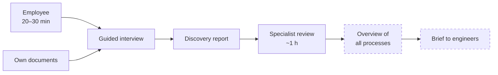

# AI Use Case Discovery Agent · Executive summary

> NIG (fictional) · **IT & Security** · November 2026 · *Figures are assumptions, to confirm in a pilot.* Detail: [use case](../01-use-case/use-case.md) · [deck](deck.pdf)

**In one line:** a 20–30 minute guided interview shows NIG **which processes AI should transform first, without weeks of meetings.**

## 1. Context

NIG has 50,000 people; 9 clusters × 4 regions = 36 teams, each with its own systems; earlier AI programmes stalled on fragmented data. First, someone must find, map and select the workflows worth transforming: **AI use case discovery**, IT's work for all nine clusters.

## 2. Problem

Today two AI specialists map each process in a workshop: **24 person-hours and 2–3 weeks per process**.

| What happens today                          | Why it hurts                                |
| ------------------------------------------- | ------------------------------------------- |
| Specialists interview people one by one     | At most 150–200 processes a year           |
| Each specialist asks and writes differently | Reports cannot be compared                  |
| Nobody checks whether a workflow is ready   | AI builds stall after weeks                 |
| Detail is lost at hand-over                 | Engineers re-ask people:**~60 h per build** |

## 3. Solution

The employee opens a link and, in a **guided chat** with an AI agent, maps one of their own workflows worth transforming. A fixed form makes every result comparable; it runs **for everyone at once**, so specialists review the best candidates instead of collecting them.

*Solid: built. Dashed: next release.* The report answers three questions (*good AI use case? own tool or Copilot? worth it?*), then shows per step how AI helps and what to prepare.

## 4. Business value and ROI (base case: 400 processes a year)

|                          | Today | With the tool                               |
| ------------------------ | ----- | ------------------------------------------- |
| Person-hours per process | 24    | **~1.5** (estimate)                         |
| Engineer hours per build | 60    | **20** (with hand-over brief, next release) |

- **For the AI team (counted): €450k–675k a year**, from 400 processes × 22.5 h plus 25 builds × 40 h saved, at €90/h and 50–75 % adoption.
- **For the whole company (not counted, likely larger):** NIG compares 400+ processes, not 150–200, and builds the best, **each build paying back again in the business**.
- **Costs:** **€100k once** for production (two engineers, one quarter) and **about €35k a year** to run (AI included, ~€0.40 per interview): **payback in about 3 months; about €3 back per €1 in year one.**

## 5. Risks: three things must be true

| Must be true                  | Pilot check              | Stop if          |
| ----------------------------- | ------------------------ | ---------------- |
| Employees finish on their own | Share who complete       | Below 50 %       |
| Reports are good enough       | Specialist: major edits? | Below 50 % clean |
| Specialist review is quick    | Time each review         | Above 3 h        |

Five manual mappings are also timed; at 18 h, not 24, the case holds (€342k a year). Open points: works-council agreement (critical path), languages beyond English, interview quality (latest test: 75 % of core fields right; target 85 %).

## 6. Status, rollout and the ask

The first working version is **[live on Azure](https://link-on-request.invalid/xxxxxxxxxxxxxxxxxxxxxxxxxxxxxxxxxxxxxxxxxxxxxxxxxxxxxxxxxx)** and passed six simulated interviews end to end. **The ask:** an **8-week pilot in one cluster and region (~20 processes)** with volunteers, data-protection sign-off and company sign-in, stopped at any §5 limit; then **one quarter** of hardening (private network, reliability, works-council agreement for rollout); then **cluster by cluster, region by region**, by configuration. **Two quarters** to the first cluster in production.
