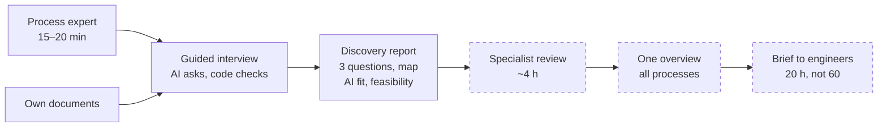

# AI Use Case Discovery Agent · Executive summary

> NIG (fictional) · **IT & Security** · November 2026 · *Figures are assumptions, to confirm in a pilot.* Detail: [use case](../01-use-case/use-case.md) · [deck](deck.pdf)

**In one line:** a 15–20 minute guided interview shows NIG **which processes AI should take over first, without weeks of workshops.**

## 1. Context

NIG: 50,000 people, 9 clusters × 4 regions = **36 teams**, each with its own systems. It wants AI across its operations; past programmes stalled on fragmented data and processes. Every AI build starts with **AI use case discovery**: find, map, assess and select the workflows worth transforming. That is the workflow we chose: IT's own work, serving all nine clusters.

## 2. Problem

| Today, per process | Why it hurts |
|---|---|
| **24 person-hours, 2–3 weeks** | One by one: capped by AI team size, max 150–200 a year |
| Each specialist asks and writes differently | No two reports alike: nothing can be compared |
| Nobody checks readiness | AI builds stall weeks in, on workflows nobody defined |
| Detail lost at handover | Engineers spend **~60 h per build** re-asking people |

## 3. Solution

The employee who knows the process opens a link: a **guided interview with a fixed form behind it**, optionally from their own documents. It runs **for every employee at once**: specialists review the best candidates instead of collecting them, and discovery scales to the whole company. **AI** asks and follows up; **code** checks every answer and makes every number; **the expert** confirms everything. It guides; it never gives a go / no-go.

*Solid: built. Dashed: next release.* The report answers three questions (good AI use case? own tool or Copilot? worth it?), then AI fit and route per step, readiness and what to prepare; every claim quotes the expert.

## 4. Business value (base case: 400 a year)

| | Today | With the tool |
|---|---|---|
| Person-hours per process | 24 | **5** |
| Engineer hours per build | 60 | **20** |

**It pays back twice.**
- **Return 1, the AI team (counted): €387k–581k a year** = (400 processes × 19 h + 25 builds × 40 h) × €90/h × 50–75% adoption. That is ~4 specialists' work done by ~1. Cost: €100k build, €35k a year to run. **Payback ~3.5 months.**
- **Return 2, the whole company (not counted, the bigger prize):** a fast funnel. NIG finds and compares 400+ processes instead of 150–200, picks the best and ready ones, and builds more AI. **Each build pays back again in the business**, from a measured "before" number.

## 5. Risks: three things must be true

| Must be true | How we check in the pilot | Stop or redesign if |
|---|---|---|
| Employees finish on their own | Share of invited employees who complete | Below 50% (target 70%) |
| Reports are good enough | Specialist marks major edits, yes or no | Below 50% clean (target 70%) |
| The hours saved are real | Time 5 manual mappings, then the pilot | Above 10 specialist h (target 4) |

At 18 h by hand (not 24) it still pays: €279k a year, payback ~5 months. **Also:** works councils (processes, not people), invented facts (no quote, no claim; the expert confirms), languages (tested per region).

## 6. Status and the ask

**Status:** MVP built and tested (interview, documents, report, workspace); not yet deployed. **The ask:** fund an **8-week pilot, one cluster, one region, ~20 processes**, with the stop rules above. Then production, adding Microsoft 365 evidence with consent (Graph, Work IQ: Teams transcripts, SharePoint files pre-fill and validate the map), and scale **by configuration.**
