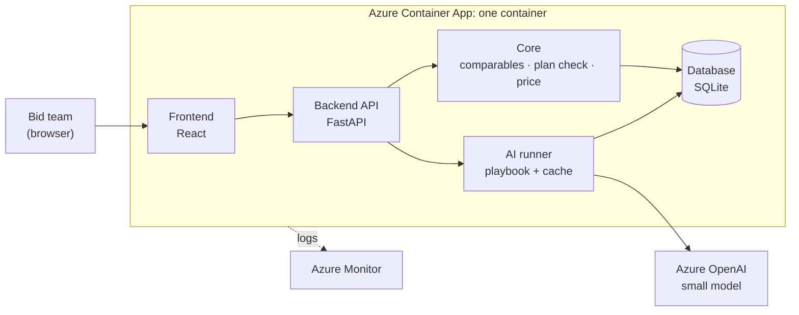

# 00 · Architecture overview

> One page: what each part does and why we chose it. Specs 01–09 give the detail.

## The app in three lines

BidCheck is a web app that the bid team opens after the go/no-go decision. They upload the tender and their plan. The app reads the tender, finds similar past projects and tenders in NIG's history, and shows two things: where the plan is too thin, and what each price means for margin, risk and score.
**The AI only reads text into fixed fields. Every number comes from code. People decide.**

| Part | What it does | Built with | Why this choice |
|---|---|---|---|
| **Frontend** | The guided workspace: four tabs (Tender → Plan check → Price → Approval pack). Users edit the plan, close flags and compare prices | React + Vite + TypeScript, built to static files that the backend serves | Editable tables and price comparisons need a real UI. Serving it from the same container means one deploy and no cross-origin setup |
| **Backend API** | Takes uploads, runs the fixed pipeline, saves decisions, builds the PDF pack and the Excel plan | Python 3.12 + FastAPI + Pydantic | Python has the PDF, statistics and Azure OpenAI libraries. Pydantic models are the one contract for the API, the AI outputs and the frontend types (generated from OpenAPI) |
| **Core** | Picks comparables, scales hours, computes ranges, flags, margins, chance of a loss and scores | Plain Python functions with no I/O; all rules in one config file | It must be trusted, so it holds no AI: deterministic, unit-tested, same answer every time |
| **AI runner** | Reads the tender into the data dictionary, with page and quote for every value | Azure OpenAI small model, structured outputs (schema from Pydantic), temperature 0. Playbook files (rules, vocabulary, task cards) are versioned in the repo. PyMuPDF gives text with page numbers | Reading varied wording is the one job code can't do. Fixed fields plus checked quotes make the reading auditable. Caching each call by a hash of its input keeps the cost of repeat runs near zero |
| **Database** | Past projects (hours per phase, conditions, overrun reasons), past tenders and results, bids and decisions, AI cache, audit log | SQLite via SQLModel (SQLAlchemy) | ~600 projects fit in one file, and "retrieval" is a SQL query on fixed fields. The same models run on PostgreSQL in production |

## One bid, end to end

1. **Read the tender.** The PDF becomes text with page numbers. The AI runner fills the bid profile. Code checks that each quote is on its page. A person confirms.
2. **Check the plan.** Core queries the database for comparables, scales them and checks the plan phase by phase.
3. **Price it.** People fix or justify each flag. Core computes the price view for each price they try.
4. **Approve.** The backend writes the approval pack (PDF) and the plan (Excel). Every step goes to the audit log.

## What we deliberately leave out

- **No agent, no chat.** The steps are the same for every bid, so a fixed pipeline is cheaper, faster and testable ([Anthropic, *Building effective agents*](https://www.anthropic.com/engineering/building-effective-agents): start with the simplest workflow).
- **No vector search (RAG).** We match jobs on facts (type, size, conditions), not on similar wording. With SQL, the app can always answer "why is this project similar?".
- **No microservices.** One container is enough for one team, and for building it in four days.

## On Azure

| | Prototype (now) | Production (later) |
|---|---|---|
| Hosting | One Azure Container App (1 replica), image in Azure Container Registry, deployed by GitHub Actions | Same, plus revisions for safe roll-out and more replicas |
| AI | One small-model deployment in Azure OpenAI, with a token budget per call | Higher quota, pinned model version, a second region as fallback |
| Data | SQLite file built from the fictional data at start-up. A restart resets bid work, which is fine for a demo | Azure Database for PostgreSQL, with backups |
| Security | API key stored as a Container Apps secret; sign-in with the built-in Entra ID auth | Managed identity to Azure OpenAI and the database, Key Vault, private endpoints |
| Logs | Structured JSON logs to Log Analytics. Each AI call logs its task, playbook version, tokens, latency and cache hit | Application Insights dashboards; alerts on cost and errors |

The design follows the shape of Microsoft's [baseline Azure OpenAI chat architecture](https://learn.microsoft.com/en-us/azure/architecture/ai-ml/architecture/basic-openai-e2e-chat): app, model, secrets, monitoring. It runs on Container Apps instead of App Service because we ship one container.
