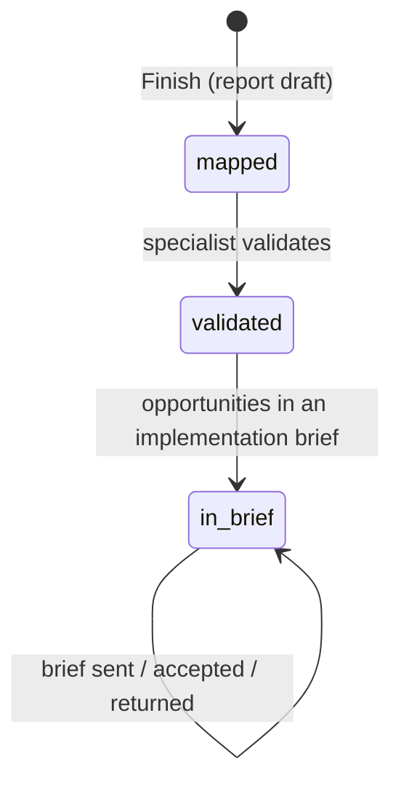

# 01 · Product specification: AI Use Case Discovery Agent

> **Status:** draft v2, 2026-11-19 · **amendment 2026-11-21 (p05 evaluation), approved and built:** S14 decision criteria, effort asks duration only when volume is known, scope refreshed from the map (spec 14 §3.21) · **amended 2026-11-21 (owner test):** welcome, suggestions in find, offered values, progress bar, one optional question per step, no roles and systems confirmation (detail: spec 14 §3.20) · **Owner:** product + engineering
> **Sits between** the [use case](../docs/01-use-case/use-case.md) (why: problem, users, value) and the [architecture](02-architecture.md) (how). This document says **what the product does**. Every component spec (`specs/1x–5x`) implements features defined here and cites their IDs.
> **Rule:** a behaviour that is not here is not in the product. To add or change one, change this document first.
> **v2:** the product helps the expert rather than judging the process: there is no go / no-go anywhere. The main output is the discovery report (map + transformation assessment). Documents can be uploaded, read by the AI and confirmed by the expert.
> **v3 (2026-11-19, approved):** steering in the find phase (F-03: quick questions per candidate, code ranks, the agent recommends, the expert decides); a step-by-step AI assessment with routes from a company solution catalogue (F-26); **numbers are hours only**: cost, hours that could be freed, euro values and saving shares are *parked until the value method is decided (refinement R5)*, kept below as parked text so they can come back.

---

## 1. The product on one page

> **Renamed 2026-11-21:** from "Discovery Agent" to **AI Use Case Discovery Agent**. "Process discovery" means automated log and task mining in the industry; "AI use case discovery" is the recognised term for what this product does. Tagline: *Find a workflow worth transforming, map it step by step, and see where AI can help*. Code identifiers (`process_discovery`, `/process-discovery`) keep their names.

**AI Use Case Discovery Agent** helps the people who do the work find which parts of it AI could take over, and shows them how.

The user is the **process expert**: the employee who owns a process or knows it best. In a **20–30 minute guided interview** the agent helps them:

1. **discover** the processes in their routine that are worth mapping;
2. **map** one of them step by step, starting from documents they already have if they want (an existing process map, a procedure, an example of what the process produces);
3. **see its transformation potential** and **how it could be done**: hours a year, which steps AI could do or assist, which kind of solution fits each step, what each change would look like, what to prepare first.

The result is a **discovery report**: a summary of the mapped process and an AI transformation assessment, the same structure for every process. IT and transformation specialists review the reports, see all mapped processes in one overview, and turn chosen opportunities into an **implementation brief** for AI engineers.

| It is | It is not |
|---|---|
| A guided interview with a fixed form behind it | A chatbot. The expert cannot ask it anything; it asks, one question at a time |
| A helper for the expert: it finds, maps and explains | A judge. It never says go or no-go; it shows potential and the path to it |
| A form-filling machine that can also read the expert's documents, and asks them to confirm what it read | A free agent. Every turn runs the same fixed steps |
| Generic: the company's clusters, rates, rules and wording are configuration | A process-mining or task-mining tool. It reads no system logs and watches no desktops |

**Five product rules** (they shape every feature below):

1. **The agent fills a form. The chat is only the way in.** Every field is defined once, with its own rule for when it counts as answered.
2. **Code owns every decision.** What counts as answered, which phase the interview is in, when the map is complete, whether a "yes" was a yes: code decides. The model reads and writes words.
3. **Code makes every number.** Hours, value, scores and readiness levels come from tested code. The model never produces a number.
4. **The expert has the last word on their process.** Anything the AI reads from a document is a proposal until the expert confirms it. Nothing counts until it is confirmed.
5. **Every loop has a counter, and every counter has a maximum.** The interview can never get stuck asking the same thing.

---

## 2. Users and roles

| Role | Who (at NIG) | What they do in the product | Sees |
|---|---|---|---|
| **Expert** | Any employee who owns or knows a process | Finds processes in their routine, uploads documents, maps one in the interview, reads and downloads the discovery report, keeps ideas for later, deletes their data | Only their own sessions and reports |
| **Specialist** | IT and transformation specialists | Reviews reports, corrects fields, accepts or adjusts opportunities, sees the overview of all mapped processes, creates implementation briefs | All reports and the **full conversation** of every session (to check profiles and improve the interview); never the full text of uploaded files |
| **Engineer** | AI engineers, AI DevOps | Reads implementation briefs, accepts them or sends them back with questions | Briefs addressed to engineering |

*In the code and API the expert's role is called `employee`.*

---

## 3. Core concepts

| Concept | Meaning |
|---|---|
| **Session** | One interview by one expert about one process. Holds the conversation, the uploaded documents and the profile |
| **Idea** | A candidate process the expert mentioned but did not map yet, with the signals the expert gave about it (how often, how long, how many people, what inputs). Kept on "My processes" to start later |
| **Candidate signals** | Four quick facts about a candidate process, in the expert's words: how often it runs, roughly how long it takes, how many people are involved, whether its inputs are digital or paper/verbal. Code reads them into hours a year, people and a data score, and ranks the candidates (F-03) |
| **Profile** | The structured description of one process: process fields (§5.1) and one row of step fields per main step (§5.2) |
| **Field** | One slot in the profile, for example *trigger* or *systems used in step 3*. Each field has a kind (text, list, number, object, list of rows), a weight and a rule for "complete" |
| **Source** | Where a value came from: **expert** (said in the interview), **document** (read by the AI from an upload, with the quote), **specialist** (edited in review) |
| **Proposed value** | A value read from a document and not yet confirmed by the expert. Shown, but not counted |
| **Verdict** | Code's judgement on one field: **complete**, **partial** (with the missing part named in words) or **invalid** (with the reason). Only confirmed, complete values count |
| **"None" answer** | "Nobody else", "no approvals", "nothing goes wrong" are real answers, stored as an explicit *none*, and count as complete |
| **Completeness score** | Weighted points of complete fields ÷ total points. Total points grow with the number of declared steps |
| **Map complete** | The condition to finish: score ≥ 80% and every declared step complete *(amended 2026-11-21 (owner test): the roles and systems confirmation is removed; both are captured per step)*. This is about the quality of the map, never about the process's worth |
| **Phase** | Where the interview is: *context → find → boundaries → measure → step count → steps → review* *(amended 2026-11-21 (owner test): no confirm phase)*. Code moves the phase, never the model |
| **Process or task** | A **process** repeats, involves more than one person, and has a clear start and end. A **task** is one person's activity. Judged on five signals (F-06) |
| **Cluster** | The company's taxonomy of process areas. At NIG: FIN, HR, LEG, IT, PRO, COM, KNW, ANL, GWT |
| **Opportunity** | A concrete change to the process: which step, what kind of change, what it would look like, what to prepare, and the expert's words that support it |
| **Transformation potential** | Hours a year the process takes, per step and in total (the expert's numbers multiplied). *Cost today, hours that could be freed and euro values: parked until the value method is decided (refinement R5)* |
| **AI fit** | Per step: **automate** (AI can do it), **assist** (AI helps a person do it) or **human** (stays with people), with a reason and the expert's words (F-26) |
| **Route** | Per step: which kind of solution fits, chosen only from the company's **solution catalogue** (off-the-shelf assistant, low-code automation or agent, custom AI build, IT integration or RPA, fix first, none) (F-26) |
| **Recommended route** | A short summary built by code from the step ratings: which steps to start with and with which route, what to fix first, what stays with people (F-26) |
| **Readiness checklist** | Six dimensions (defined, standard, data, systems, rules, risk and size), each *high*, *medium* or *low*, with what to prepare. A guide, not a verdict |
| **Discovery report** | The output of a mapped process: the process summary and the AI transformation assessment (F-16) |
| **Implementation brief** | The hand-off to engineering for chosen opportunities (F-19) |

---

## 4. User journeys

**Expert (main path).**

1. Opens the tool from a link and sees "My processes" (mapped processes, ideas, reports).
2. Starts an interview and answers about department, role and region.
3. The agent asks about their routine and, when they have nothing in mind, suggests two or three likely recurring workflows, reasoned by the model from their department, role and words (code decides when; nothing is stored until they pick or name one) *(amended 2026-11-21 (owner test))*. When it hears several candidate processes, it asks two or three quick questions about them (how often, how long, how many people, digital or paper inputs), code ranks them, and the agent recommends one with a one-line why. The expert picks it or another one; all others are kept as ideas with their signals.
4. The agent checks whether it is a process or a task, and proposes a cluster, which the expert confirms.
5. *Optionally* the expert uploads a document (a procedure, a process map, an example output); the agent reads it, fills the form with proposals and asks the expert to confirm or correct them.
6. The agent asks for what is still missing: what starts the process, what it produces, who uses the result, what hurts, volume, owner, time today, target, whether teams do it the same way, sensitive data.
7. The expert splits the process into 2–6 main steps, and the agent walks each step, one question at a time.
8. *(Amended 2026-11-21 (owner test).)* The expert confirms what the agent filled in (goal, owner) with one yes; *Finish* unlocks.
9. They press it and see their **discovery report**, which they can download as a PDF.
10. Later, "My processes" shows that IT validated it, and they can map one of their ideas.

**Expert (starting from a document).** Uploads the team's procedure at the start → the agent reads it and says what it understood: a name, a trigger, five steps with roles and systems → asks "is this how it really runs?" → the expert corrects step 3 and confirms the rest → the interview only asks for what the document did not say (volume, time, pain, exceptions). The interview is shorter; nothing from the document counts until confirmed.

**Expert (honest exit).** At any point, or when the agent offers it after several turns without a candidate, the expert can say "this isn't worth mapping" and close the session. That is a valid ending, not a failure.

**Specialist.** Opens the review list → reads a report: every field with its status and source → corrects or fills fields if needed → checks the map → accepts, adjusts or rejects each opportunity (*saving shares parked, R5*) → marks the report *validated* → in the overview, compares all mapped processes by potential and readiness, by cluster and region → selects opportunities to build and creates an **implementation brief**.

**Engineer.** Opens a brief → reads goal, baseline, steps, data, systems, rules, exceptions, risk, acceptance criteria and open questions → accepts it, or returns it with questions.

---

## 5. The profile

### 5.1 Process fields (asked in this order)

| ID | Field | Phase | Weight | Question (default wording) | Complete when |
|---|---|---|---|---|---|
| P01 | Department | context | 1 | "Which department are you in?" | A unit name (not a job title) |
| P02 | Role | context | 1 | "What is your own role in that department?" | A role, never a person's name |
| P03 | Region | context | 1 | "Which region do you work in?" | One of the configured regions |
| P04 | Process name | find | 1 | "Thinking about a normal week, what work comes round again and again, and who else gets involved?" | A name the expert agreed to, in their words |
| P05 | Cluster | find | 1 | *Proposed by the agent, confirmed by the expert* | One of the configured clusters, set only by code (F-07) |
| P06 | Trigger | boundaries | 1 | "What starts this process off?" | Text |
| P07 | End result | boundaries | 1 | "What exists at the end that did not exist before?" *(asked together with P08: "What exists at the end, and who uses it for what?")* | Text |
| P08 | Who uses the result | boundaries | 1 | "Who uses that result, and what for?" | Text |
| P09 | Business pain | boundaries | 1 | "What hurts most about this process today?" | Text |
| P10 | Volume | measure | 1 | "How often does this process run?" | Count **and** period, or a free-text range |
| P11 | Process owner | measure | 1 | "Who owns this process end to end?" | A role, or "none identified" |
| P12 | Time today (baseline) | measure | 2 | "How would you measure how this process performs today?" | Value **and** unit, or a qualitative description |
| P13 | Target | measure | 2 | "Where would that number need to get to?" *(optional: asked at most once, never blocks)* | Value and unit, in the **same unit** as P12 (else invalid) |
| P14 | Same way everywhere? | measure | 1 | "Do other teams or regions do this the same way? A yes or no is enough." *(asked together with P15 as two quick yes/no questions; "what differs" only after a no)* | Yes, no, or "differs in …" with what differs |
| P15 | Sensitive data or regulation | measure | 1 | "Does it involve personal or sensitive data, or a regulation? A yes or no is enough." *("which" only after a yes)* | At least one item, or "none" |
| P16 | Number of main steps | step count | 1 | "List the main steps in order, 2 to 6." *(one answer fills P16 and every S01)* | A whole number from 2 to 6 (outside the range: invalid, and the agent helps group) |

Process points: **18**.

### 5.2 Step fields (asked for each step, in groups)

| ID | Field | Weight | Asked how | Question (default wording) | Complete when |
|---|---|---|---|---|---|
| S01 | Step name | 1 | **List**: all names in the one steps question (with P16) | "What would you call this step?" | Text: a step, not a click and not a whole phase |
| S02 | Goal | 1 | **Tier C**: proposed by code, confirmed in bulk in the review | "What has to be true for this step to be done?" | Text |
| S03 | Activities | 1 | **Tier A** | "What do you actually do in this step?" | At least one item (2–5 expected) |
| S04 | Roles involved | 1 | **Tier B** | "Who else is involved, and what do they contribute?" | At least one role, or *none* |
| S05 | Step owner | 1 | **Tier C** | "Who is accountable for this step?" | One role |
| S06 | Systems | 1 | **Tier A** | "Which systems or tools do you use here?" | At least one item |
| S07 | Data in and out | 1 | **Tier A** | "What information goes in, and what comes out?" | Inputs **and** outputs |
| S08 | Effort | 1 | **Effort**: once for all steps, after the walk | "How long does this step take, and how often?" | Duration **and** frequency |
| S09 | Pain points | 1 | **Tier A** | "What is annoying or slow about this step?" | At least one item |
| S10 | Approvals | 1 | **Tier B** | "Does anything here need an approval or sign-off?" | At least one approval, or *none* |
| S11 | Exceptions | 1 | **Tier A** | "What goes wrong here, and where do you end up when it does?" | At least one exception, or *none* |
| S12 | Hand-over | 0 | **Tier C** | "How does the work get to whoever does the next step?" | Optional, never blocks |
| S13 | Rules or judgement | 1 | **Tier A** | "Is this step mostly fixed rules, judgement, or a mix?" | One of *rules*, *judgement*, *mix*, with the expert's words |
| S14 | Decision criteria *(2026-11-21)* | 0 | **Tier B, only for a *judgement* or *mix* step** | "What do you base that decision on, who sets those criteria, and are they written down?" *(inside the step's optional question, never on its own)* | What the decision is based on, in the expert's words; optional: who sets the criteria, written yes / partly / no, what varies. Optional, never blocks |

Points per step: **12**. Total points = 18 + 12 × declared steps (for example 90 for 6 steps; finishing then needs 72).

**The short step walk (approved 2026-11-20, short step walk).** Per step the expert gets at most two questions, plus one short follow-up only when something is missing:

1. **Tier A, one big open question:** activities, systems, data in and out, pain points, exceptions and rules-or-judgement together ("Walk me through *Collect the cost data*: what you do, with which systems and files, what's annoying, what often goes wrong, and is it mostly fixed rules, judgement or a mix?"). If a Tier A field is still missing, **one** follow-up asks only the missing ones together.
2. **Tier B, one optional question** *(amended 2026-11-21 (owner test))*: "Any sign-off needed, anything that often goes wrong, or anything special about passing it on? If nothing, just say no." Approvals, exceptions and hand-over, asked once; a "no" or no answer settles it and never counts against *Finish*. Roles involved are asked in the Tier A question ("…and who else is involved").
3. **Effort** is asked **once for all steps** after the walk ("Roughly how long does each step take, and how often? 1 …, 2 …"); the missing ones are asked once more together. *(2026-11-21: when the process volume P10 is known, only the duration is asked, and each step is assumed to happen once per run unless the expert says otherwise; spec 14 §3.21 P3.)*
4. **Tier C is never asked:** goal and step owner are proposed by code (goal from what comes out of the step, owner = the expert's role; *amended 2026-11-21 (owner test): hand-over is no longer proposed*), shown as proposals, and confirmed in bulk with one "yes" (or corrected) in the review. They count only once confirmed; the 80 % gate is reachable without them.

### 5.3 Built by code, never asked

| Field | How |
|---|---|
| All roles | Every role from every step, without duplicates *(amended 2026-11-21 (owner test): no longer confirmed separately; F-10 removed)* |
| All systems | Every system from every step, without duplicates; shown in the report |
| Readiness labels | Per step: the format of each input (structured, digital document, paper, verbal) and the kind of each decision (fixed rule, explainable judgement, pure judgement). Proposed by the model with the expert's words as evidence, checked by code (F-15) |

---

## 6. Features

| ID | Feature | Users | Release |
|---|---|---|---|
| **Discover and map** | | | |
| F-01 | My processes: mapped processes, ideas, reports, status | Expert | MVP |
| F-02 | The interview turn | Expert | MVP |
| F-03 | Discovering processes in your routine, and the honest exit | Expert | MVP |
| F-04 | Start from your documents | Expert | MVP |
| F-05 | Field rules, Verdicts and proposed values | Expert | MVP |
| F-06 | Process-or-task check | Expert | MVP |
| F-07 | Cluster placement | Expert | MVP |
| F-08 | The step walk | Expert | MVP |
| F-09 | Limits on every loop | Expert | MVP |
| F-10 | Confirming roles and systems | Expert | MVP |
| F-11 | Live profile, completeness and *Finish* | Expert | MVP |
| **Assess** | | | |
| F-12 | Opportunities and how to realise them | Expert, specialist | MVP |
| F-13 | Process map | Expert, specialist, engineer | MVP |
| F-14 | Transformation potential (value) | Expert, specialist | MVP |
| F-15 | Readiness checklist | Expert, specialist | MVP |
| F-16 | Discovery report (screen and PDF) | Expert, specialist | MVP |
| F-26 | Step-by-step AI assessment and recommended route | Expert, specialist, engineer | MVP |
| **Review and hand-off** | | | |
| F-17 | Review and corrections | Specialist | MVP (edits: Should) |
| F-18 | Process overview | Specialist | MVP |
| F-19 | Implementation brief | Specialist, engineer | MVP |
| F-20 | BPMN and Excel exports | Specialist, engineer | Could |
| **Platform** | | | |
| F-21 | Access: open link, workspace code, limits | All | MVP |
| F-22 | Company configuration | Administrator (edits config files; not an app role) | MVP |
| F-23 | Privacy and data rights | All | MVP |
| F-24 | Turn log and cost tracking | Engineering | MVP |
| F-25 | Evaluation set | Engineering | MVP |

*F-26 is listed under Assess; it got the next free ID so that no existing ID changes.*

*MVP = in the prototype for the demo. Should = in the prototype if time allows. Could = after the prototype.*

---

### F-01 · My processes

**Purpose.** The expert's home: their mapped processes, their ideas, their reports.

1. **Mapped processes:** the expert's sessions, newest first: process name (or "Not named yet"), phase or status, completeness, last activity. An unfinished session resumes exactly where it stopped.
2. **Ideas:** candidate processes the expert mentioned but did not map (F-03), with the words they used. *Map this* starts a new session with the name filled in as a proposal.
3. **Reports:** for each finished session, the discovery report (F-16) on screen and as PDF.
4. **Status** of a finished session: *mapped* → *validated by IT* (with the specialist's note, if any) → *in an implementation brief*. No status ever says the process was rejected or not worth it.
5. *Start* creates a session and shows a fixed welcome message (no model call): what will happen (find a recurring workflow worth transforming with AI, map it step by step, then assess where and how AI can help), how long it takes (about 20 minutes), that documents can be uploaded, that the answers describe the work, not the person, and that the transformation team may read the conversation to improve the tool *(amended 2026-11-21 (owner test); wording in spec 14 §3.20 O1)*.
6. The expert can delete a session or an idea (F-23).

**Done when:** an expert can start, leave, resume and finish an interview, open its report, keep ideas for later, and see what IT did with it.

### F-02 · The interview turn

**Purpose.** Turn a free answer into profile fields and ask the next useful question.

Every turn runs the same fixed steps:

1. **Read.** The model turns the expert's message into changes to allowed fields only. It may correct spelling, never rephrase, translate or add detail. When in doubt it copies the words.
2. **Check before trusting.** Code drops any change to a field the model may not write (cluster, confirmations, roll-ups, flags) and any change that fails the injection screen. A short "yes" or "no" to a proposal is read by code, not by the model.
3. **Apply.** Code writes the changes, grades every touched field (F-05), updates the counters (F-09), rebuilds roles and systems, recomputes completeness and moves the phase.
4. **Classify (only when needed).** If the process name is new or changed and its scope or cluster is not settled, one model call checks process-or-task (F-06) and proposes a cluster (F-07).
5. **Ask.** The model writes one short question (2–4 sentences) from what code gives it: the phase, the fields still missing with *why* (for example "Volume still needs: period"), the proposed values waiting for confirmation, how many times this field was asked, and whether *Finish* is open.

Rules for the questions:
- One question at a time. Uses the process name, never "the process".
- Never asks again a field that is complete. Never repeats the same words: the second time it rephrases, the third time it names the exact missing part and offers a way to settle it ("if there are none, say so").
- Never says "I've noted that" or "saved".
- Never asks the expert to classify their work into an internal framework.
- If a turn fails (model error or empty reply), the expert gets a plain fallback question built by code. The interview never stops on a model error.

**Done when:** a cooperative expert maps a 4–5 step process in 20–30 minutes, and every answer lands in the right field or is visibly asked again.

### F-03 · Discovering processes in your routine, and the honest exit

**Purpose.** Most experts don't arrive with a process in mind. Help them see what in their routine is worth mapping.

1. The agent asks about their normal week: what repeats, what involves other people, what follows fixed rules, where they wait for others, what they copy between systems.
2. **Steering.** When the expert has named two or more candidates, the agent asks **at most three quick questions**, each covering all candidates at once (up to three candidates): how often it runs and roughly how long it takes; how many people are involved; whether the work starts from files and systems or from paper, calls and memory.
3. **Code ranks** the candidates with a small scoring rule: value signals (hours a year = runs × time, number of people) and data readiness (digital inputs), with weights in configuration. The model never ranks or scores.
4. **The agent recommends** the top candidate with a one-line why built by code ("the monthly cost review: about 288 hours a year, 6 people, digital inputs"), shows the others, and asks which to map. **The expert decides** and may pick any of them. With too few signals, the agent lists them and asks the expert to pick.
5. **All other candidates are kept as ideas** on "My processes" (F-01), **with their signals**, so the expert can map them later.
6. How hard the agent pushes depends on how many turns the find phase has taken: turns 1–3 open questions; turns 4–5 focus on the strongest candidate already mentioned; from turn 6 it proposes one candidate (the top-ranked one, if ranked) and asks for a plain yes or no, and offers the exit. Steering questions count as find turns, so steering never makes the find phase longer than this ladder.
7. **The exit:** "this may not be worth mapping, and that's a fine answer". Only the expert can close the session this way. The agent never ends the session itself.

**Done when:** an expert with no candidate in mind either picks one within about 6 turns or is offered the exit; an expert with several candidates gets a code-ranked recommendation with a why line and can still pick another; and every other candidate they mentioned appears as an idea with the signals they gave. Detail: spec 14 §3.15.

### F-04 · Start from your documents

> **Amended 2026-11-20** (product owner): any document at any time, read in context, images, confirmation in the chat. Detail: spec 17 §3.18–§3.19, spec 14 §3.16.

**Purpose.** Many experts already have something written down, or an example of what a step produces. Use it at the moment it comes up, so the interview only asks for what is missing, and let the expert correct what the AI understood.

1. **When:** at **any time** in an active session, in any phase: the "+" button by the message box, the *Add a document* button in the panel, or a file dropped on the chat. The welcome message and the find phase mention it.
2. **What:** any file about the work: a procedure, a process map, an e-mail, a spreadsheet, a report, a template, a screenshot, a photo of a form or a whiteboard.
   - Formats: PDF, Word (.docx), Excel (.xlsx), PowerPoint (.pptx), e-mail (.eml: subject, date, attachment names and body only, never names or addresses), CSV, text and Markdown, BPMN 2.0 (.bpmn / .xml), and **images (PNG, JPG), including screenshots**. Other formats (.doc, .msg) are not read: save them as PDF or take a screenshot.
   - Limits: up to 10 documents per session; 10 MB per file; images up to 5 MB and 40 megapixels. Large documents are read up to a fixed text budget; the agent says when it read only part.
3. **Reading in context:**
   - A BPMN file is read **by code**: tasks become proposed steps (names, order), lanes become proposed roles.
   - Any other file is read by **one model call that knows where the interview is**: the phase, the step in focus, the question just asked, the form so far. It first decides what the file is: the **whole process** (today's behaviour), an **example of what a step produces**, an **example of what a step receives**, **something used in a step** (a template, a system screenshot), or **other**. Then it proposes only what fits. Example: during step 3, a site report is an output example, so it proposes step 3's outputs as a short description of the file ("Excel cost report per site with variance comments, one tab per site"); a screenshot of a system proposes that step's systems; plus anything else the file clearly shows (activities, roles, exceptions).
   - **Which step:** the step in focus, unless the file or the expert's last message names another. Code checks that the step exists. A file that belongs to a step but matches none fills nothing for a step.
   - **Evidence, checked by code:** a value copied from a document carries a quote found in its text; a description of the file carries a short excerpt found in its text (a title, a header row, a line).
   - **Images** are read by the model with vision: it copies the visible text and describes the image. Evidence is checked against that transcription only, so every proposal from an image is marked *(from an image)*. The image itself is never stored, only the transcription and the description.
4. **Writing:** proposals fill only fields that are empty or still proposals, or the missing part of a partly answered field (a volume with a count and no period; a step's data with inputs and no outputs): then the whole field is proposed, with the expert's part unchanged, and a no restores exactly what was there. They never overwrite what the expert said or a specialist entered. Steps are proposed only while the step table is empty (a document with more than 6 steps is proposed as a list for the expert to group); a file about one step never adds, removes or reorders steps. The cluster and the confirmations are never set from a document.
   - **Conflicts** *(approved 2026-11-20)*: when a file says something different from the expert, or from another file (the same meaning in other words, such as "monthly" and "every month", is not different), nothing is dropped and nothing is overwritten: the agent shows both in the chat and asks which to keep (yours, the document's, both for lists, or in your words); unanswered after 2 asks, the value stays as it is and is listed in the report's gaps. Each item keeps its own source, so a cell filled from two files names both. Detail: spec 17 §3.21, spec 14 §3.17.
5. **Confirmation in the chat:** right after an upload, the agent's next message names the file and asks plainly, without the expert typing first: *From "site_report_march.xlsx" I'd fill: Step 3 "Collect explanations" – Outputs: Excel cost report per site… Should I fill it like this, or is something wrong?*
   - a plain yes confirms the values in that question;
   - a correction replaces them with the expert's words;
   - a no rejects them, and the agent asks for them later as normal questions;
   - ✓ and ✎ on each proposed value in the panel are shortcuts for the same.
   Proposed values are shown in the profile marked *from <document>* with the evidence. They **do not count** until confirmed. Further proposals from the same file are presented in small groups in the next questions.
6. The expert can remove a document. Values confirmed from it stay (the expert confirmed them); proposals from it are removed.
7. Instruction-like text inside a document or an image ("ignore your rules…") is always treated as data, never followed. A document whose text (or an image whose transcription) fails the injection screen is rejected as a whole, with a plain message.

**Done when:** an expert who uploads a 5-step procedure gets the steps proposed with quotes, confirms or corrects them in a few turns, and is then asked only about what the document did not cover; an expert on step 3 who uploads an example report is asked at once whether step 3's outputs are "Excel cost report per site…", and a plain yes makes it count; nothing from a document or an image counts before it is confirmed.

### F-05 · Field rules, Verdicts and proposed values

**Purpose.** One definition of "answered", used everywhere: completeness, *Finish*, the questions and the review screen.

1. Each field's rule lives on the field definition (§5). Code grades a field when it is written.
2. A Verdict is *complete*, *partial* or *invalid*, and always carries a sentence that says what is missing or wrong. That sentence goes to the question (F-02), the review screen (F-17) and the turn log (F-24).
3. Storing a value and counting it are different. A field can hold a value and still be partial (a volume without a period). The expert is asked only for the missing part, and the agent repeats back the part it already has.
4. A rule may read another field (the target must use the same unit as the baseline).
5. *None* answers count as complete. A stored "false" is never an answer.
6. Every value keeps its **source** (expert, document, specialist) and, for documents, the evidence (a quote, or an excerpt for a description of the file; marked when from an image). A **proposed** value never counts, whatever its Verdict.

**Done when:** for every field, the review screen and the agent agree on whether it is answered, why not, and where the value came from.

### F-06 · Process-or-task check

**Purpose.** Tell a process from one person's task, and say so honestly.

1. Five signals, each yes or no: **several roles**, **several systems**, **clear trigger and outcome**, **recurring**, **someone else depends on the output**.
2. Code counts them: 4–5 with "someone depends on it" = *process*; 3, or 4–5 without it = *borderline*; 0–2 = *task*.
3. If *borderline* or *task*, the agent asks one **widening question** ("who receives or depends on this?"). At most 2 widening questions per session, even if the name changes. *Amended 2026-11-21 (owner test):* only when the work is not recurring; recurring work done mostly by one person (reviewing CVs) is a valid candidate and is accepted without asking about hand-offs.
4. If it is still a task after widening, the expert may continue. The report carries a note that it looks like a single task. The tool explains, never refuses.
5. If the work is a process but not recurring (a one-off project), the agent says so once.

**Done when:** "I file my timesheet" gets an honest "this looks like a task" message, "the monthly cost review" is judged a process, and no expert is blocked by the check.

### F-07 · Cluster placement

**Purpose.** Place every process in the company's taxonomy without asking the expert to know it.

1. If the process name matches exactly one cluster's keywords, code places it without a model call.
2. Otherwise the model proposes a cluster and a runner-up, each with a confidence. Code ignores a proposal below 60% confidence or within 15 points of the runner-up.
3. The agent explains the proposed cluster in plain words and asks if it fits. Code reads the reply: a plain yes confirms; naming another cluster switches to it; a no rejects the proposal, and the model does not propose again for this name.
4. With no usable proposal, or after a rejection, the agent shows the list of clusters with a plain description each, and the expert picks. The same list is always available as a picker in the profile panel.
5. Only code writes the cluster. "ok", "sure" and "fine" are not a yes.

**Done when:** the cluster is always set by code, from a confirmed proposal or the expert's pick, and placement never deadlocks.

### F-08 · The step walk

**Purpose.** Map the process step by step, at the right level of detail.

1. *(Amended 2026-11-20, short step walk.)* One question asks for the main steps in order, 2 to 6: the answer fills the count (P16) and the step names (S01) together. More than 6: the agent says so and helps group the steps (the out-of-range number is kept so the agent can refer to it); fewer than 2: asked again. A number without names is followed by one question for all the names.
2. If a document proposed the steps, the names become the steps and the count follows (after confirmation).
3. *(Amended 2026-11-20, short step walk.)* The agent walks one step at a time with at most two questions per step, grouped by code (§5.2): the Tier A question, one follow-up for the missing Tier A fields only if needed, then the Tier B question. Effort is asked once for all steps after the walk. Tier C (goal, owner, hand-over) is never asked: code proposes it and the expert confirms it in bulk in the review. Code decides which fields are in each question; the model only words it.
4. When every declared step is complete, the walk closes. Editing a step later reopens it, and resets the confirmation of roles or systems if they changed.
5. Exceptions can point back to an earlier step ("then we go back to step 2"). Pointers to non-existing steps are dropped.

**Done when:** a 5-step process is walked in order, each question group asked until complete or settled by its limit, and a cooperative expert needs at most 3 messages per step.

### F-09 · Limits on every loop

**Purpose.** The interview always moves on.

| Loop | Limit | Then |
|---|---|---|
| A process field asked without becoming complete | 3 asks | The field is **deferred**: the interview moves on and asks it again in the review phase (next row) |
| A deferred field in the review phase | 2 more asks | The field is **given up**: it stays missing (and lowers completeness) but is never asked again |
| A field with an **invalid** answer (for example 13 steps) | Blocks its phase until fixed or given up | — |
| A step cell asked without becoming complete *(amended 2026-11-20, short step walk)* | Tier A: 2 asks (the big question and one follow-up) · Tier B: 1 ask · Effort: 2 asks · Tier C proposals: 2 bulk confirmations · step names: 3 asks. A group question counts once for every field in it | Fields that allow *none* (roles, approvals, exceptions) get *none*; other cells are **skipped** (settled for the walk, missing for the score) |
| An optional process field (P13 target) *(amended 2026-11-20)* | 1 ask | Given up at once: never asked again, never blocks |
| Process fields asked together (P07 + P08; P14 + P15) | The same limits | Each field in the question is charged once per ask |
| Proposed values waiting for confirmation | Count as asks on their fields | Same limits as above; unconfirmed proposals stay visible as proposals in the report |
| Widening question (F-06) | 2 per session | The check stops; a "looks like a task" note if still a task |
| Confirmation of roles and systems | 6 turns | The agent lists both and asks for one yes; the buttons stay available |
| Step count deferred | — | Code assumes the number of steps already started (at least 2) so the walk can start |

The specialist sees every deferred, given-up, skipped and unconfirmed field (F-17). Counters are stored with the session.

**Done when:** no scripted conversation, however unhelpful, asks the same field more than 5 times or fails to reach the review phase.

### F-10 · Confirming roles and systems

> **Removed 2026-11-21 (owner test).** Roles and systems are captured per step; there is no separate confirmation and *Finish* does not wait for one. Kept below for history.

**Purpose.** The expert checks the roll-ups before the map counts as complete.

1. After the walk, code shows the list of all roles and the list of all systems.
2. The expert confirms each list with a button, or with a plain yes in the chat when the agent has just asked about that list. Confirming an empty list needs a second click.
3. Any later change to a step's roles or systems clears the matching confirmation.

**Done when:** *Finish* never opens with an unconfirmed or outdated list.

### F-11 · Live profile, completeness and *Finish*

**Purpose.** The expert sees what the tool has understood, while they talk.

1. Beside the chat, the profile fills up live: sections for context, the process, boundaries, measures, and one tab per step. Each field shows its status (complete, partial with what is missing, skipped, proposed from a document) and its source.
2. A phase meter shows where the interview is. A progress bar shows how far along the interview path the expert is, computed by code with the steps carrying their real share (*amended 2026-11-21 (owner test)*; the 80 % gate keeps using completeness).
3. *Finish* is enabled only when code says the map is complete. When it is not, the panel says why: completeness below 80% or steps incomplete.
4. *Finish* closes the interview, runs the assessment (F-12–F-15, F-26) and opens the discovery report (F-16). The expert can no longer change the session; corrections go through the specialist.

**Done when:** the button state comes only from code, and the reason is always shown.

### F-12 · Opportunities and how to realise them

> **Report v2 (2026-11-21, spec 27):** the separate opportunities list is folded into the step assessment and the **AI readiness and feasibility** part: three guiding questions (good AI use case? a dedicated solution or a general assistant? worth it?), each a level with reasons and the expert's words, never a yes / no. The report (F-16) has six parts: summary, the process, volume and measures, map and steps, step-by-step AI assessment, AI readiness and feasibility.

**Purpose.** Say where automation or AI fits, what each change would look like, and what to do first, grounded in what the expert said.

1. One model call reads the finished profile and proposes opportunities, best first. Each opportunity has:

   | Part | Content |
   |---|---|
   | Title | One line |
   | Where | A step, several steps, or the whole process |
   | Type | One of the types below |
   | What changes | The step as it would run after the change, in one or two sentences |
   | How | What the solution would do, and the kind of tooling (generic categories, only if grounded in the systems named) |
   | Prepare first | What must be true before building it (links to the readiness checklist) |
   | Impact, feasibility | High, medium or low, each with a reason |
   | Evidence | The expert's words that support it |

2. **Types:**

   | Type | Meaning |
   |---|---|
   | Eliminate | The step should not exist; remove it |
   | Standardise | Agree one way, template or rule first |
   | Workflow | Routing, reminders, approvals, tracking |
   | Integration | Systems exchange data instead of people re-typing it |
   | Document AI | Read, extract from or write documents |
   | AI assistant | Drafts, summarises or suggests; a person decides |
   | AI agent | Carries out several steps on its own; a person checks the result |
   | RPA | Screen automation for systems with no interface |

   Eliminating and standardising are preferred over automating a broken step. The analysis also names the steps that **should stay with people**, and why.
3. Code checks each opportunity: the steps must exist (names are replaced with the real names); the quoted words must appear in the profile; otherwise the opportunity is dropped and logged. **No quote, no opportunity.**
4. **The path** (by code): opportunities are grouped as **prepare first** (standardise, or a *low* readiness dimension that blocks its type in its steps), **quick wins** (high feasibility), and **bigger changes** (the rest), each group ordered by the **hours a year of the steps it touches** (whole process: the total).
5. The specialist can accept, adjust or reject each opportunity (F-17). *Saving share per opportunity (default by type from configuration, editable by the specialist): parked until the value method is decided (refinement R5). The stored field stays; nothing reads it, and it is not shown.*
6. An empty list is a valid result; the report then explains what was looked for.

**Done when:** every opportunity shown points to real steps and a real quote, and says what would change and what to prepare. The step-by-step view of the same process is F-26.

### F-13 · Process map

**Purpose.** A process map without anyone drawing it.

1. One model call proposes a BPMN-style map: swimlanes by role, one task per step in order, gateways only where the profile states a decision, approval or exception; a task type per step (manual, user, service, send, receive, script, business rule) and start/end types.
2. Code checks everything: one task per real step, with its real name; lanes only for real roles; legal types (a step with no system cannot be a system task); no orphan or self-loops; merges where paths join. Data objects (inputs, outputs) and data stores (systems) are added **by code** from the profile, never by the model. If the map cannot be repaired, code draws a simple map: start → steps in order → end, in the owners' lanes, marked *simplified*.
3. The map is stored with a fingerprint of the steps. If the steps change, the map is redrawn.

**Done when:** every finished profile has a map, and no map shows a step, role or system that is not in the profile.

### F-14 · Transformation potential (value)

**Purpose.** Put a number on the process and on each step, the same way for every profile. **Hours only:** no euros until the value method is decided.

1. **Runs a year** from the volume (count and period).
2. **Hours a year per step** = duration per run × runs a year, adjusted when a step runs at a different frequency from the process (the expert's numbers multiplied).
3. **Hours a year** = the sum over steps.
4. **Hours per opportunity** = the hours a year of the steps it touches (the whole process for a process-wide one). It orders the path (F-12.4) and the recommended route (F-26), and feeds *Risk and size* (F-15).
5. If a duration or volume cannot be read as a number, the hours are *incomplete*, and the report names the field to fix. Code never guesses.
6. The formula and the assumptions are shown next to every number.

*Parked until the value method is decided (refinement R5), kept so it can come back:*
- ~~**Cost today** = hours × hourly rate (configuration, default €90).~~
- ~~**Hours that could be freed** = for each step, its hours × the combined saving share of its opportunities (never above 90% of a step).~~
- ~~**Value** = hours freed × hourly rate × realisation: **conservative 50%**, **expected 75%**. Also shown per opportunity.~~

**Done when:** the same profile always gives the same hours, every number can be traced to its fields, and no euro figure appears anywhere in the report, the overview or the *Finish* flow.

### F-15 · Readiness checklist

**Purpose.** Show what would make the process easier to transform, so the expert and IT know what to prepare. It guides; it does not judge.

| Dimension | Question | From |
|---|---|---|
| Defined | Clear trigger, result, owner, and a goal for every step? | P06, P07, P11, S02 |
| Standard | Done the same way across teams and regions? Exceptions the minority? | P14, S11 |
| Data | Are the inputs digital, structured or readable documents? | S07 + input-format labels |
| Systems | Are the systems known, with an export or an API? | S06 + the configured application list |
| Rules | Are decisions fixed rules, or judgement that can be explained? | Decision labels |
| Risk and size | Enough hours to be worth the effort? Sensitive data or regulation that needs a human check? | F-14 hours, P10, P15 |

1. The model only **labels** words (input formats, decision kinds), each with the expert's words as evidence, checked by code like opportunities.
2. Code rates each dimension *high*, *medium* or *low*, with a reason, using thresholds from configuration.
3. Every *medium* or *low* produces a **"to prepare"** line in plain words ("agree one spreadsheet template across sites"). *Low* lines also feed the *prepare first* group of the path (F-12); *medium* lines appear in the checklist only.
4. If the labels could not be produced, Data and Rules show **unknown** with the reason, never a guessed level.
5. There is **no overall verdict**. The specialist can add a note to any dimension.

**Done when:** the monthly cost review where each site sends a different spreadsheet shows *Standard: low* with "agree one site template" to prepare, and the one-template version shows it *high*.

### F-16 · Discovery report

**Purpose.** The output of a mapped process: a summary of the process and the AI transformation assessment, the same structure for every process. The expert gets it at *Finish*; specialists and engineers use the same report.

| # | Part | Content | Made by |
|---|---|---|---|
| — | **Cover** | Process name, department, cluster, region, owner role, date, status (*mapped*, *validated by IT*) | Code |
| 1 | **At a glance** | Hours a year; the recommended route headline; the top three opportunities in one line each with their hours; the main things to prepare | Code (figures and lists), from F-12, F-14, F-15, F-26 |
| 2 | **The process** | What starts it, what it produces, who uses the result, the main pain, owner, cluster, and whether it looks like a single task | Profile |
| 3 | **Volume and measures** | Volume, time today, target, same way everywhere, sensitive data; "not measured yet" where missing, never invented precision | Profile |
| 4 | **Process map and steps** | The map (F-13); all systems used; the step table (goal, activities, owner and roles, systems, data in and out, effort, pain points, approvals, exceptions, hand-over) | Code + map |
| 5 | **Step-by-step AI assessment** | One row per step: hours a year, AI fit (automate, assist, human), route (catalogue name), reason, evidence | F-26 |
| 6 | **Recommended route** | Start with (steps and routes), later, fix first, stays with people, what to have in place | F-26 (code) |
| 7 | **Transformation assessment** | AI summary of where the largest benefit is; opportunities with what changes, how, what to prepare, impact, feasibility, evidence; steps that should stay with people | F-12 |
| 8 | **Hours a year** | Hours per step and in total, hours of the steps each opportunity touches, with the formula and assumptions. *Cost today, hours freed and value: parked (R5)* | F-14 |
| 9 | **Readiness checklist** | Six dimensions with level, reason and what to prepare | F-15 |
| 10 | **Suggested path** | Prepare first → quick wins → bigger changes, each item with its steps and hours | F-12 (code) |
| 11 | **Gaps and sources** | Fields missing, deferred, given up or unconfirmed; documents used; the note that the report is a first assessment from one expert's account | Code |

1. Shown on screen and downloadable as **PDF**. Branding (product name, colours, logo) from configuration.
2. Every part fails on its own: if an AI part is missing or fails, that part shows a note and the rest still works.
3. All numbers come from code. Missing answers show as "—" or a note, never invented text.
4. When a specialist changes the profile or the opportunities, the report is rebuilt. Its status changes only when the specialist validates it (F-17).

**Done when:** an expert who presses *Finish* sees the report within about 30 seconds, can download the PDF, every number in it matches the calculators, and it holds no euro figure while R5 is open.

### F-26 · Step-by-step AI assessment and recommended route

**Purpose.** Next to the opportunities (F-12), say for **every step** whether AI can do it, help with it, or should leave it to people, and which kind of solution the company has for it.

1. After *Finish*, one model call (ASSESS_STEPS) rates each step:

   | Part | Content |
   |---|---|
   | AI fit | **automate** (AI can do it; a person checks), **assist** (AI helps; a person decides), **human** (stays with people) |
   | Reason | One or two sentences, from the step's inputs, systems, decisions and pain |
   | Evidence | The expert's words, copied from that step or the process fields; checked by code like opportunities. **No quote, no rating** |
   | Route | One entry of the company's **solution catalogue** (configuration, F-22) that fits the step, with one sentence on why |

2. **Code checks** every step number (it must exist), every quote, and every route id (it must be in the catalogue and serve the step's AI fit; otherwise the route is dropped and the step shows *no route*). A step the model left out shows *not assessed*.
3. **Recommended route** (by code, from the checked ratings and the step hours): *start with* the two automate/assist steps with the most hours a year and a route, *later* the rest, *fix first* the steps routed to fix first, *stays with people* the human steps, and what to have in place (the prerequisites of the starting routes). One headline sentence, built by code.
4. The catalogue for NIG is a **placeholder** (vendor-neutral entries per category) until the product owner provides NIG's tools; while it is, the report says so.
5. If the call fails, the two report parts show a note; the rest of the report is not affected. No numbers from the model.

**Done when:** every step of a finished profile is rated or marked *not assessed*, every route shown exists in the catalogue and fits the step's AI fit, every rating carries a real quote, and the recommended route of the same ratings and hours is always the same. Detail: spec 26.

### F-17 · Review and corrections

**Purpose.** The specialist reviews and completes reports instead of interviewing.

1. **Review list:** all finished sessions with process, cluster, region, completeness, hours a year, review status. Filters by cluster, region and status; search by process name.
2. **Review screen:** the report (F-16) plus every field with its value, Verdict and source. Deferred, given-up, skipped and unconfirmed fields are highlighted.
3. The specialist accepts, adjusts or rejects each opportunity and can add notes to readiness dimensions. *Changing the saving share: parked (R5).*
4. The specialist marks the report **validated**, optionally with a note to the expert.
5. **Edits (Should):** the specialist can edit any field or step cell, add or remove steps (within 2–6, exception pointers renumbered). Edited values are marked *specialist* with the time and the name the specialist typed at the workspace prompt, and are never overwritten by automated changes. Edits do not change completeness (it measures the interview), but they update the hours, readiness, map, opportunities and step assessment; changes to roles or systems clear the confirmations; opportunities whose steps changed are recomputed.
6. The specialist can read the **full conversation** of a session, to check the profile against what the expert said and to improve the interview's questions. The full text of uploaded files stays hidden; only the quotes in the profile are shown.
7. Every action is written to the audit log.

**Done when:** a specialist can validate a report in under an hour without contacting the expert, unless fields are missing.

### F-18 · Process overview

**Purpose.** One view of every mapped process across clusters and regions: the company's process baseline and where the potential is.

1. A table of all mapped processes: process, cluster, region, hours a year, steps rated *automate* or *assist* (F-26), readiness levels, number of opportunities, review status. Sortable by any column. *Value that could be freed: parked (R5).*
2. A chart of hours a year against readiness (how many dimensions are *high*), coloured by cluster.
3. Filters: cluster, region, review status, opportunity type.
4. Totals across the filter: number of processes, hours a year. *Value that could be freed: parked (R5).* The same process mapped in several regions is visible side by side.
5. **No ranking verdicts and no funding decisions** in the tool. The overview informs the people who decide.

**Done when:** a specialist can find, for one cluster, the processes with the most potential and what each needs first.

### F-19 · Implementation brief

**Purpose.** Hand chosen opportunities to engineering in one standard format, so they don't re-interview the expert.

1. The specialist selects one or more opportunities of a validated report and creates a brief.
2. Code assembles the brief from the profile and the report; the model drafts only the plain-language goal and the acceptance criteria, which the specialist can edit before sending.
3. Sections: goal and scope · baseline (volume, time today, target, hours) · steps with the map, the covered steps marked · data in and out per step · systems · rules and decisions (what a person must keep deciding) · exceptions · what to prepare (from readiness) · risk (sensitive data, regulation, human checks) · acceptance criteria · open questions (missing, deferred, skipped and unconfirmed fields) · sources (the expert's words and document quotes behind each claim; the owner as a role).
4. Formats: screen, Markdown, JSON; the map as BPMN once F-20 exists.
5. Status: *draft → sent → accepted* or *returned* with the engineer's questions. The expert sees *in an implementation brief* on "My processes".

**Done when:** an engineer can read a brief and either accept it or return it with questions, and both are recorded.

### F-20 · BPMN and Excel exports *(Could)*

The process map as **BPMN 2.0 XML**, to import into BPM tools. The step table as Excel, protected against formula injection.

### F-21 · Access

**Purpose.** Anyone with the link can start a discovery session, with no account. The workspace is kept for the transformation team.

1. **Experts need no sign-in.** On the first visit the browser gets a random private key; "My processes" shows the sessions, ideas and reports made with that key. The expert may type a first name for the greeting; it is optional.
2. **Private resume link.** "My processes" offers a link that carries the key, so the expert can continue on another device. Whoever has the link sees those sessions, and the screen says so.
3. **Workspace by access code.** `/workspace` asks for an access code (one for specialists, one for engineers, set by the administrator) and a name, used only for the audit log and edit marks. Engineers see only briefs.
4. **Limits**, because the link is open: a rate limit per visitor and per network address, upload limits, and a **daily model budget** for the whole app. Over the budget, new turns get a plain "try again later" message.
5. Every request is checked on the server; the screens only hide what a caller cannot use.
6. Company sign-in (single sign-on, roles from the directory) is a production step, described in [production readiness](../docs/03-technical-design/production-readiness.md).

### F-22 · Company configuration

Everything that differs between companies is configuration, not code:

| Config | Content |
|---|---|
| Organisation | Product name, company name, report branding, regions, languages |
| Taxonomy | Clusters: code, name, plain description, keywords |
| Rates | Hourly rate (default and per role group), realisation shares. *Loaded but unused while R5 is open* |
| Opportunity types | Default saving share per type. *Loaded but unused while R5 is open* |
| Solutions (`solutions.yaml`) | The solution catalogue for routes (F-26): per entry id, category, name, what it is good for, when to choose it, when not, prerequisites, which AI fits it serves. *NIG: placeholder until the product owner provides the tool list* |
| Steering (`steering.yaml`) | Candidate ranking (F-03): weights for hours, people and data; the hours and people that score in full; minimum known signals; candidate and question limits; input cue words; solo phrases |
| Readiness | Dimension thresholds, "to prepare" wording, application list (systems with export or API) |
| Documents | Allowed formats, size and count limits, text budget |
| Language | Words read as yes and no, cue words, per language |
| Field wording | Optional overrides of labels and default questions (IDs, kinds and weights stay fixed) |

A new company is a new set of these files. Access codes, rate limits and the daily model budget are deployment settings, not company configuration. Invalid configuration stops the app at start-up with a clear message.

### F-23 · Privacy and data rights

1. The tool maps **processes, not people**. It never reports an individual's time or performance.
2. No account and no e-mail are needed. Reports, the overview and briefs show roles, never names; an optional first name is kept on the session only, for the greeting.
3. Uploaded files are used to read the text and are **not kept**: only the extracted text (within the budget) is stored with the session, and only the quotes appear in the profile. Specialists never see the full text **Amended 2026-11-20:** images are not kept either; only the model's transcription of the visible text and a short description of the image (no people) are stored, like extracted text, with metadata such as location removed before the model sees the image.
4. An expert can delete one session, one idea, one document, or all their data. Unfinished sessions expire after a configured period (default 90 days).
5. The expert is told in the welcome message that the transformation team may read the conversation to improve the tool. Conversations are visible only in the workspace (F-17); they never appear in reports, the overview or briefs.
6. Expert text and document text are always passed to the model as fenced data, never as instructions. Input that looks like prompt injection is rejected with a plain message.

### F-24 · Turn log and cost tracking

One structured log line per turn: phase, counters, fields the model offered, fields dropped, fields written but not complete, proposals waiting, still missing, the focus field and its ask count, model time and tokens. One line per document read and per assessment call, with the items dropped by the quote check. Model cost per session is visible. Text of messages and documents is not logged.

### F-25 · Evaluation set

A set of **simulated experts**, each with a hidden true process and a behaviour (cooperative, vague, describes a task, gives 13 steps, refuses numbers, switches language, contradicts themselves, starts from a document that is partly out of date). A runner plays each one through the real API and measures: field accuracy against the hidden truth, turns to *Finish*, loops hit, sessions that never finish, document proposals confirmed versus corrected, and cost. Finished runs also seed the demo overview.

---

## 7. Lifecycles

**Session** (the interview):

| Status | Meaning |
|---|---|
| `active` | Interview in progress |
| `finished` | Map complete and *Finish* pressed; report available |
| `no_candidate` | Closed by the expert: nothing worth mapping |
| *(deleted)* | Unfinished sessions are deleted after the retention period (default 90 days); there is no separate status |

**Report** (after *Finish*), shown to the expert on "My processes":

**Idea:** `open` → `started` (a session was created from it) or `dismissed` (deleted by the expert).

---

## 8. Quality targets

| Area | Target (prototype) |
|---|---|
| Interview time | 20–30 minutes for a cooperative expert and a 4–5 step process; less when starting from a good document |
| Turn time | Typical reply under 10 s; never above 150 s (a fallback question is sent instead) |
| *Finish* to report | Under 30 s |
| Model cost | Under €0.50 per finished session with a small model |
| Field accuracy | At least 85% of fields correct against the evaluation set's hidden truth |
| Robustness | 0 evaluation sessions stuck in a loop |
| Languages | English in the demo. Interviews follow the expert's language; yes/no word lists for English and German |
| Accessibility | Keyboard use, labelled controls, status never shown by colour alone |
| Audit | Every specialist and engineer action is logged with role, the name typed at the workspace prompt, time and action (named sign-in in production) |

## 9. Out of scope

**Not in the prototype, planned later:** company sign-in and roles from the directory · OCR of scanned PDFs · invitation campaigns by cluster or region · grouping the same process across regions into one use case · a steering-group pack · translation of reports into one language · read-only roles for cluster leads.

**Never:** go / no-go or funding decisions inside the tool · answering questions or searching documents · routing tickets · judging people · writing to any system of record.

## 10. Demo scenario

1. **Expert:** a cost controller in Europe (FIN) starts the interview. Asked about her week, she mentions the monthly cost review, chasing site managers and booking travel. Three quick questions later the agent recommends the **monthly cost review** ("about 288 hours a year, 6 people, digital inputs"); she agrees; the other two are kept as ideas with their signals. She uploads the team's **procedure document**: the agent proposes five steps with roles and systems, she corrects step 3 and confirms the rest, then answers what the document did not say (volume, time, pain, exceptions). *Finish* → her **discovery report**: about 340 hours a year for her unit, a step-by-step view (consolidation and variance analysis to *automate*, the summary to *assist*, collecting site files to *fix first*), the top opportunities (document AI to read site spreadsheets, an AI assistant to draft the variance summary, a workflow for chasing explanations), *Standard: low* with "agree one site template" to prepare first.
2. **Specialist:** reviews the report, accepts the opportunities, validates it; does the same for the North American report.
3. **Overview:** next to it, the North American version of the same process (from the evaluation set) shows *Standard: high*: the same opportunities, nothing to prepare first.
4. **Engineer:** the specialist creates an implementation brief for the North American document-AI and assistant opportunities; the engineer accepts it.

## 11. Assumptions and open questions

| # | Item | Default until decided |
|---|---|---|
| Q1 | Up to 6 main steps keeps the interview at 20–30 minutes | 2–6 |
| Q2 | Realisation shares | *Parked (R5)*; was 50% / 75% (use case §2.1.6) |
| Q3 | Default saving share per opportunity type | *Parked (R5)*; set in configuration, tuned in the pilot |
| Q4 | Readiness thresholds | First version in configuration, owned by the AI transformation team |
| Q5 | Should experts be able to correct their own report after *Finish*? | No: corrections go through the specialist, so the report stays the expert's interview account |
| Q6 | **R5 · Value method:** how to turn hours into euros, savings or ROI | Hours only. Cost today, hours freed, euro values and saving shares are parked: specs keep the text marked *parked (R5)*, code does not compute or show them |
| Q7 | NIG's solution catalogue (F-26): which tools does NIG have, per category? | Placeholder catalogue, vendor-neutral, marked as such in every report |
| Q8 | Steering weights (F-03): hours 0.5, people 0.2, data 0.3 | Assumption in `steering.yaml`, tuned with the evaluation set |
