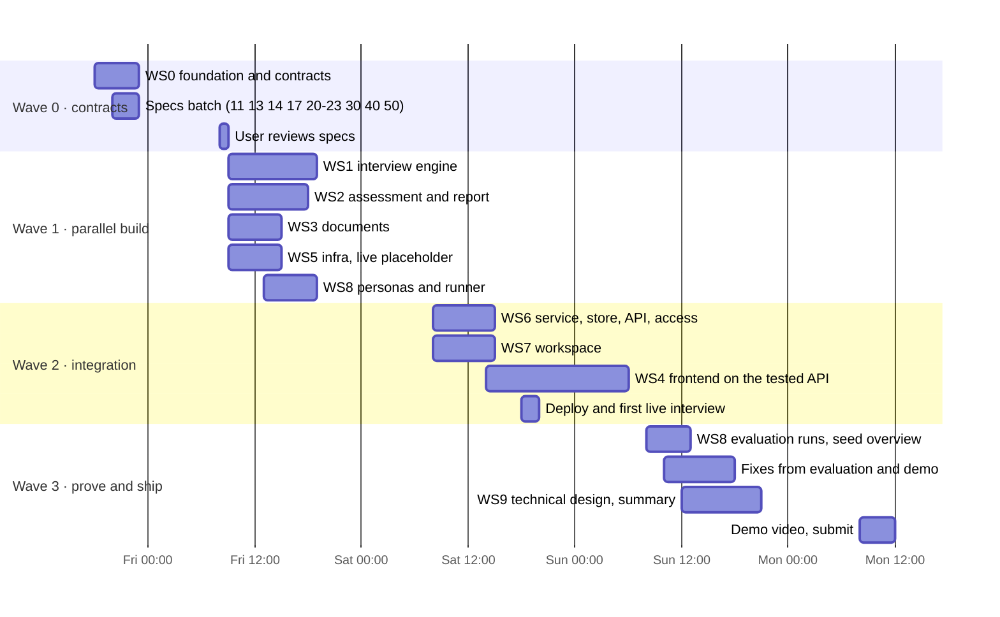

# 03 · Implementation plan

> **Status:** draft, 2026-11-19 · **Deadline:** Monday 2026-11-23, 12:00
> **Goal:** the full MVP of the [product spec](01-product.md), built to the [architecture](02-architecture.md), deployed on Azure, measured by the evaluation set, in about 3 days.
> **How:** freeze the shared contracts first, then build in **parallel workstreams**, each owned by one agent with its own folder, spec and tests. Integrate in waves.

---

## 1. What "done" looks like on Monday

| # | Deliverable | Proof |
|---|---|---|
| 1 | The app on Azure: an expert discovers and maps a process (with a document), finishes, and reads the report; a specialist validates it, sees the overview, creates a brief; an engineer accepts it | The demo script runs end to end on the public URL |
| 2 | Tests green in CI | GitHub Actions badge |
| 3 | Evaluation report: field accuracy, turns to *Finish*, loops, cost on 8–12 simulated experts | `eval/reports/` |
| 4 | Technical design, executive summary, demo video | `docs/03`, `docs/04`, video link |

## 2. Why parallel work is safe here

Three **contracts** are written and frozen before any parallel work. Every workstream codes against them, never against another workstream's internals.

| Contract | Content | Owner | File |
|---|---|---|---|
| **C1 · Profile and session model** | The field registry (P01–P16, S01–S12, kinds, weights, rules), the profile shape with source/proposal metadata, the session document, the assessment and report models | Wave 0 | `app/services/process_discovery/domain/field_spec.py`, `app/models/process_discovery_schemas.py`, spec 12 |
| **C2 · Engine façade** | The function signatures the service calls: `turn()`, `apply_proposals()`, `confirm_proposals()`, `read_document()`, `assess()`, `build_report()`, `overview_rows()` | Wave 0 | `process_discovery/__init__.py` (stubs raising `NotImplementedError`), spec 15 |
| **C3 · HTTP API** | Every route, request and response (camelCase), error codes | Wave 0 | `app/models/*` wire models, `frontend/src/types/*`, spec 15 |

Rules for every workstream:
1. Inspect first: CLAUDE.md, product, architecture, its spec, the existing code. Follow the coding rules in CLAUDE.md (tests first, minimum code, a header docstring on every file).
2. Its component spec is written and reviewed by the user before any code.
3. Touch only its own folders (listed below). A needed change to a contract goes back to the lead, never edited in place.
4. Tests first; `make lint test` green before hand-back.
5. Each workstream runs in its own git worktree and branch; the lead merges in the order of §4.

## 3. Workstreams

| WS | Name | Owns (folders) | Builds | Needs | Spec |
|---|---|---|---|---|---|
| **WS0** | Foundation and contracts *(lead)* | repo root, `app/core`, `app/models`, `domain/`, `llm.py`, `json_schema.py`, `fake_llm.py`, `app/utils/prompt_safety.py`, `config/nig/`, test harness | Scaffold, pinned dependencies, settings and config loader, logging, architecture test, the registry and models (C1), façade stubs (C2), API wire models (C3), LLM client and FakeLLM | — | 10, 11, 12, 15 (contract part) |
| **WS1** | Interview engine | `profile/`, `interview/` | Changes, Verdicts, proposals, completeness, roll-ups, snapshot; phases with per-field counters, gates, replies, prompts, the nodes EXTRACT / CLASSIFY / GUIDE, the LangGraph graph, the turn log | C1, LLM client | 13, 14 |
| **WS2** | Assessment and report | `artifacts/`, `export/` | OPPORTUNITIES (extended), MAP + grounding + linear fallback, LABEL, value, readiness, path, report model, PDF report, BPMN drawing | C1, LLM client | 18, 19, 20 |
| **WS3** | Documents | `documents/` | Text extraction (pdf, docx, xlsx/csv, txt/md), BPMN reading, READ_DOCUMENT with quote checks, proposal diffs | C1, LLM client; calls WS1's `apply_proposals` through C2 | 17 |
| **WS4** | Frontend | `frontend/` | All screens of §4 of the architecture, built **after** the backend is proven through FastAPI tests, against the real API | WS6, WS7 merged and API-tested | 23 |
| **WS5** | Infrastructure | `infra/`, `Dockerfile`, `azure.yaml`, `.github/` | Multi-stage image, Bicep (Container Apps, registry, Cosmos serverless, Azure OpenAI with two deployments, monitoring, identity), `azd` environment, CI and deploy; a placeholder app live on Azure on day 1 | WS0 scaffold | 25 |
| **WS6** | Service, store, API, access | `services/store/`, `service.py`, `app/api/`, `app/core/access.py`, `rate_limit.py` | Repository (Cosmos + memory), all use cases, all routes, visitor key and workspace token, rate limits and daily budget, audit line | WS1, WS2, WS3 merged | 15, 16 |
| **WS7** | Workspace | `admin/`, `overview/`, `artifacts/brief/` | Field and step edits with provenance (and the three edit fixes), opportunity review, readiness notes, validate, overview rows and totals, BRIEF call and brief documents | C1, C2; WS6 for routes | 21 |
| **WS8** | Evaluation | `eval/` | 8–12 personas with hidden truth (incl. a document persona and the two cost-review variants), the EXPERT call, the runner, scoring, report; seed data for the overview | C3; WS6 deployed for runs | 24 |
| **WS9** | Deliverable documents | `docs/02–04` | Processes and user journey, technical design (with eval results and failure cases), production readiness, executive summary, demo script | Use case, specs; WS8 results | — |

## 4. Waves

| Wave | When | Exit criterion |
|---|---|---|
| **0 · Contracts** | Thu evening | Repo builds; `make test` green; C1–C3 committed; all component specs drafted and reviewed |
| **1 · Parallel build** | Fri | Engine runs a full interview in a terminal against the real model (`make chat`); assessment produces a report and PDF from a fixture profile; documents produce checked proposals; placeholder live on Azure |
| **2 · Integration** | Sat | Every route proven by FastAPI tests; the API on Azure runs interview → *Finish* → report, review, overview, brief; frontend started on the tested API |
| **3 · Prove and ship** | Sun – Mon 12:00 | Evaluation report; demo path rehearsed; documents written; video recorded |

**Merge order:** WS0 → WS5 (placeholder) → WS1 → WS3 → WS2 → WS6 → WS7 → WS4 → WS8. **The frontend starts only once the API is green in FastAPI tests.** Each merge runs the full test suite.

## 5. Risks and the cut line

| Risk | Mitigation |
|---|---|
| The interview engine (WS1) is the largest piece and on the critical path | Started first, with the clearest spec; everything else codes against C2 stubs |
| Contract changes ripple across workstreams | Contracts owned by the lead; changes batched and announced, never edited by a workstream |
| Azure quota or model availability in the region | WS5 checks quota on day 1; fall back to another EU region |
| A slow model turn exceeds the ingress limit | 150 s turn guard and fallback question (architecture §6.1) |
| Integration surprises on Saturday | The FakeLLM and in-memory store let WS6 test every route before Azure |

**Cut line if late** (cut from the top): BPMN XML and Excel exports → specialist field edits (keep validate and opportunity review) → BPMN reading of uploads (keep text documents) → PDF styling (keep the on-screen report and a plain PDF). Never cut: the interview engine, documents as proposals, the report, the overview, the brief, the evaluation set.

## 6. Prerequisites from the user

| # | Item | Needed by |
|---|---|---|
| 1 | Command-line tools installed: Azure CLI, Azure Developer CLI (`azd`), `uv`, GitHub CLI | Wave 1 (WS5) |
| 2 | `az login` to the Azure subscription; subscription and an EU region chosen; permission to create a resource group | Wave 1 (WS5) |
| 3 | Azure OpenAI quota for a chat model in that region | Wave 1 (WS5) |
| 4 | A GitHub repository for the project (public at the end) | Wave 1 (CI) |
| 5 | A first commit of the specs, so workstreams can branch from it | Wave 0 |
